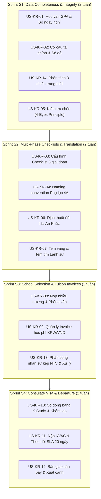

# SHD OneERP — BACKLOG BỔ SUNG PHÂN HỆ HỒ SƠ DU HỌC SHD KOREA
## (STUDENT DOSSIER INCREMENTAL BACKLOG)

**Dự án:** SHD OneERP — Enterprise Multi-Company Platform  
**Phân hệ:** Quản lý Tuyển sinh, Hồ sơ & Visa (AdmissionVisa) phối hợp Định danh hệ sinh thái (Party360)  
**Tài liệu cơ sở:**  
- `QUẢN LÝ HỒ SƠ DU HOC HÀN.xlsx`  
- `SHD-KR-HS-01 - Quy trình tiếp nhận, xử lý và quản lý hồ sơ du học Hàn Quốc.docx`  
- `SHD-KR-HS-02 - Quy trình tổng quan xử lý hồ sơ Hàn Quốc (1).docx`  
- Báo cáo kiểm toán: `STUDENT_DOSSIER_IMPLEMENTATION_AUDIT.md`  
- Ma trận khoảng trống: `SHD_KOREA_BUSINESS_GAP_MATRIX.md`

---

## 1. NGUYÊN TẮC THIẾT KẾ BACKLOG (ARCHITECTURE & COMPLIANCE PRINCIPLES)

1. **Không đập đi xây lại (No Rewrite):** Tái sử dụng 100% nền tảng đã nghiệm thu: `Party_Parties`, `Party_Persons`, `Adm_StudentApplications`, `Adm_ChecklistItems`, `Doc_Documents`, `IWorkflowEngine` (FND-03), `System_Modules/Features` (FND-04).
2. **Cấu hình theo thị trường (Market-Configurable, Not Hardcoded):** Các quy tắc nghiệp vụ đặc thù của Hàn Quốc (tem vàng, tem tím, K-study, khám lao, KVAC) được lưu dưới dạng metadata và bảng cấu hình theo `TargetMarket = 'Korea'`, không hardcode vào logic lõi của hệ thống để có thể tái sử dụng cho thị trường Đức, Nhật Bản, Úc.
3. **Tuân thủ triệt để Clean Architecture & CQRS:**
   - **Write:** EF Core, Domain Entities, FluentValidation, BusinessRuleViolationException, RowVersion concurrency 409, Transactional Outbox.
   - **Read:** Hand-written SQL Stored Procedures (`sp_*`), Direct GBAC v4.2 fail-closed, PII masking.
4. **Phân quyền và bảo mật dữ liệu:** Áp dụng đầy đủ Action Permissions, Data Scope theo LegalEntity/BU/Branch, kiểm soát nguyên tắc 4 mắt (Four-Eyes Principle / Cross-Checking).

---

## 2. DANH SÁCH USER STORIES BỔ SUNG THEO EPIC

```
┌──────────────────────────────────────────────────────────────────────────────────────────────────┐
│ CẤU TRÚC EPIC:                                                                                  │
│ EPIC 1: Hồ sơ Học vấn & Năng lực Tài chính Bảo lãnh (Academic & Financial Profiling)            │
│ EPIC 2: Checklist 3 Giai đoạn & Kiểm soát Nội bộ (Multi-Phase Checklist & Cross-Check)           │
│ EPIC 3: Dịch thuật, Công chứng & Hợp pháp hóa Lãnh sự (Translation & Legalization Pipeline)      │
│ EPIC 4: Đăng ký Trường, Phỏng vấn & Invoice Học phí (University Application & Invoices)          │
│ EPIC 5: Thụ lý Visa Lãnh sự, KVAC & Xuất cảnh Bàn giao (Consulate Visa, KVAC & Departure)        │
│ EPIC 6: Phân công Nhân sự kép & Quản lý Kỳ Tuyển sinh (Dual Assignment & Intake Lifecycle)       │
└──────────────────────────────────────────────────────────────────────────────────────────────────┘
```

---

### EPIC 1: HỒ SƠ HỌC VẤN & NĂNG LỰC TÀI CHÍNH BẢO LÃNH

#### US-KR-01: Quản lý học vấn chi tiết (THPT, GPA 3 năm, số ngày nghỉ cấp 3)
- **Mã User Story:** `US-KR-01`
- **Mức độ ưu tiên:** `CRITICAL` (Gap: GAP-KR-01)
- **Mô tả:**  
  *Là một* Chuyên viên xử lý hồ sơ du học Hàn Quốc,  
  *Tôi muốn* ghi nhận chi tiết lịch sử học tập cấp 3 (Tên trường THPT, năm tốt nghiệp, GPA lớp 10, 11, 12, GPA 3 năm) và số buổi nghỉ học trong học bạ của học viên,  
  *Để* đánh giá chính xác điều kiện nộp trường Hàn Quốc và chuẩn bị giải trình vắng mặt cho Lãnh sự quán.
- **Tiêu chí chấp nhận (Acceptance Criteria):**
  1. **Given** chuyên viên hồ sơ đang ở màn hình chi tiết hồ sơ tuyển sinh (`StudentApplication`),  
     **When** chuyên viên nhập thông tin học vấn: Tên trường THPT, Năm tốt nghiệp, GPA Lớp 10 (0.0 - 10.0), GPA Lớp 11 (0.0 - 10.0), GPA Lớp 12 (0.0 - 10.0), Số buổi nghỉ học cấp 3,  
     **Then** hệ thống tự động tính GPA 3 năm theo công thức `(GPA10 + GPA11 + GPA12) / 3` làm tròn 2 chữ số thập phân.
  2. **Given** học viên có số buổi nghỉ học cấp 3 > 5 buổi,  
     **When** lưu thông tin,  
     **Then** hệ thống hiển thị cảnh báo nghiệp vụ màu hổ phách: *"Học viên có số buổi nghỉ học vượt ngưỡng an toàn (> 5 buổi). Cần chuẩn bị đơn giải trình lý do nghỉ học có xác nhận của nhà trường."*
  3. **Given** học viên đã có bằng Cao đẳng hoặc Đại học,  
     **When** tích chọn "Đã tốt nghiệp CĐ/ĐH",  
     **Then** hiển thị thêm trường nhập: Tên trường CĐ/ĐH, Ngành tốt nghiệp, Năm tốt nghiệp, Điểm GPA tích lũy.
- **Thiết kế kỹ thuật:**
  - Bảng mới: `Adm_StudentAcademicProfiles` (`Id`, `StudentApplicationId`, `HighSchoolName`, `GraduationYear`, `GpaGrade10`, `GpaGrade11`, `GpaGrade12`, `GpaOverall3Years`, `HighSchoolAbsentDays`, `HigherEducationInstitution`, `HigherEducationMajor`, `HigherEducationGpa`, `RowVersion`).
  - Cập nhật SP: `sp_Admission_Application_GetDetailById` để trả về khối dữ liệu `AcademicProfile`.
  - Frontend: Bổ sung card "Năng lực học vấn & Điểm GPA" trong giao diện chi tiết hồ sơ.

---

#### US-KR-02: Quản lý cơ cấu tài chính người bảo lãnh & Tài sản đất đai (Sổ đỏ, Thu nhập)
- **Mã User Story:** `US-KR-02`
- **Mức độ ưu tiên:** `HIGH` (Gap: GAP-KR-02)
- **Mô tả:**  
  *Là một* Chuyên viên xử lý hồ sơ,  
  *Tôi muốn* khai báo chi tiết nguồn thu nhập hàng tháng của bố mẹ, thông tin các sổ đỏ sở hữu và đính kèm bản dựng phương án chứng minh tài chính,  
  *Để* đảm bảo hồ sơ giải trình tài chính đạt yêu cầu khắt khe của trường Hàn Quốc và Lãnh sự quán.
- **Tiêu chí chấp nhận:**
  1. **Given** thân nhân có đánh dấu `IsFinancialSponsor = true`,  
     **When** chuyên viên nhập nguồn tài chính,  
     **Then** hệ thống cho phép chọn loại nguồn thu: `Trồng trọt / Chăn nuôi / Thủy hải sản`, `Kinh doanh tự do / Hộ kinh doanh`, `Đi làm công ty / Tiền lương`, `Khác`; và nhập Tổng thu nhập hàng tháng (VNĐ).
  2. **Given** gia đình học viên có đất đai/sổ đỏ,  
     **When** khai báo số lượng sổ đỏ (`1, 2, 3...`),  
     **Then** hệ thống cho phép lưu thông tin từng sổ: Người đứng tên (Bố/Mẹ/Ông bà), Tình trạng thế chấp (Đang thế chấp ngân hàng / Không thế chấp). Nếu đất đứng tên ông bà, tự động thêm checklist: *"Giấy khai sinh của Bố/Mẹ để chứng minh quan hệ thừa kế."*
  3. **Given** chuyên viên soạn xong phương án giải trình thu nhập,  
     **When** tải lên tệp "File Dựng thu nhập - Cam kết bảo lãnh",  
     **Then** hệ thống lưu tệp vào `Doc_Documents`, phân loại `Confidential` và gắn link riêng cho 2 mục đích: Hồ sơ trường và Hồ sơ visa.
- **Thiết kế kỹ thuật:**
  - Mở rộng bảng `Party_PartyRelationships`: bổ sung `MonthlyIncomeVnd DECIMAL(18,2)`, `IncomeSourceType NVARCHAR(50)`, `IncomeProofNotes NVARCHAR(500)`.
  - Bảng mới: `Adm_ApplicationLandAssets` (`Id`, `StudentApplicationId`, `LandOwnerName`, `RelationshipToStudent`, `CertificateNumber`, `LandAreaM2`, `IsMortgagedAtBank`, `BankName`, `RowVersion`).

---

### EPIC 2: CHECKLIST 3 GIAI ĐOẠN & KIỂM SOÁT NỘI BỘ

#### US-KR-03: Cấu hình Checklist động theo thị trường & Phân tách 3 giai đoạn (Đầu vào — Trường — Lãnh sự)
- **Mã User Story:** `US-KR-03`
- **Mức độ ưu tiên:** `CRITICAL` (Gap: GAP-KR-03)
- **Mô tả:**  
  *Là một* Trưởng phòng Hồ sơ,  
  *Tôi muốn* hệ thống tự động sinh checklist tài liệu theo 3 giai đoạn độc lập (Phụ lục 1A: Tiếp nhận đầu vào 11 mục, Phụ lục 2A: Nộp trường 11 mục, Phụ lục 3A: Nộp lãnh sự 14 mục) dựa trên cấu hình thị trường Hàn Quốc,  
  *Để* chuyên viên theo dõi đúng tiêu chuẩn pháp lý của từng giai đoạn mà không bị nhầm lẫn.
- **Tiêu chí chấp nhận:**
  1. **Given** một hồ sơ tuyển sinh mới được tạo với `TargetMarket = 'Hàn Quốc'`,  
     **When** hệ thống khởi tạo checklist,  
     **Then** hệ thống tải từ bảng mẫu `Adm_MarketChecklistTemplates` và tạo ra các checklist items được gắn cờ `Phase`:
     - Giai đoạn `Intake` (11 hạng mục đầu vào theo Phụ lục 1A).
     - Giai đoạn `School` (11 hạng mục nộp trường theo Phụ lục 2A).
     - Giai đoạn `Consulate` (14 hạng mục nộp lãnh sự theo Phụ lục 3A).
  2. **Given** học viên đã nộp bản scan Hộ chiếu hoặc CCCD ở Giai đoạn Đầu vào,  
     **When** hồ sơ chuyển sang Giai đoạn Trường hoặc Lãnh sự,  
     **Then** hệ thống gợi ý tái sử dụng liên kết tệp scan đã có, nhưng trạng thái thẩm định pháp lý (`Status`) tại giai đoạn mới vẫn là `Pending` để chuyên viên kiểm tra lại tính hợp lệ theo yêu cầu của cơ quan tiếp nhận.
  3. **Given** giao diện chi tiết hồ sơ tại Frontend,  
     **When** người dùng mở tab Checklist,  
     **Then** hiển thị dạng 3 Tab con (Tabs/Steppers): *Checklist Đầu vào (Tuần 1-2)* | *Checklist Nộp trường (Tuần 3-9)* | *Checklist Lãnh sự (Tuần 11-14)* kèm thanh tiến độ hoàn thành riêng cho từng giai đoạn.
- **Thiết kế kỹ thuật:**
  - Bảng cấu hình mới: `Adm_MarketChecklistTemplates` (`Id`, `TargetMarket`, `Phase`, `ItemCode`, `ItemName`, `Category`, `IsRequired`, `ValidityPeriodDays`, `SortOrder`, `IsActive`).
  - Migration script seed sẵn bộ danh mục 36 tiêu chí cho thị trường Hàn Quốc theo Phụ lục 1A, 2A, 3A của tài liệu `SHD-KR-HS-01`.
  - Mở rộng bảng `Adm_ChecklistItems`: Thêm cột `Phase NVARCHAR(30) NOT NULL`.

---

#### US-KR-04: Đặt tên tệp scan tự động theo chuẩn Phụ lục 4A & Tải trọn bộ hồ sơ
- **Mã User Story:** `US-KR-04`
- **Mức độ ưu tiên:** `MEDIUM` (Gap: GAP-KR-13)
- **Mô tả:**  
  *Là một* Chuyên viên xử lý hồ sơ,  
  *Tôi muốn* các tệp scan tải lên được tự động định dạng tên theo quy tắc Phụ lục 4A và có nút tải về trọn bộ hồ sơ dưới dạng tệp nén ZIP,  
  *Để* nộp ngay cho trường đại học Hàn Quốc mà không phải tốn thời gian đổi tên từng tệp bằng tay.
- **Tiêu chí chấp nhận:**
  1. **Given** học viên tên "TRẦN THỊ MỸ DUNG" tải lên Hộ chiếu vào mục `PASSPORT`,  
     **When** tệp được lưu vào hệ thống,  
     **Then** hệ thống chuẩn hóa tên hiển thị theo Phụ lục 4A: `02. Passport_TRAN THI MY DUNG.pdf` (bỏ dấu tiếng Việt, viết hoa họ tên).
  2. **Given** hồ sơ đã hoàn thành đủ các tài liệu cần thiết của Giai đoạn Nộp trường,  
     **When** chuyên viên bấm nút "Tải trọn bộ hồ sơ Trường (ZIP)",  
     **Then** hệ thống đóng gói toàn bộ các tệp scan hợp lệ vào 1 file zip với cấu trúc thư mục chuẩn và tên file đã được đánh số thứ tự từ `01` đến `14`.
- **Thiết kế kỹ thuật:**
  - Backend utility: `DossierFileNamingHelper.FormatStandardFileName(itemCode, studentFullName, originalExtension)`.
  - Endpoint mới: `GET /api/v1/admissions/applications/{id}/download-package?phase=School`.
  - Kiểm tra quyền `admission.dossier.view` trước khi cho phép tải về.

---

#### US-KR-05: Kiểm tra chéo hồ sơ (Cross-Check & Four-Eyes Principle)
- **Mã User Story:** `US-KR-05`
- **Mức độ ưu tiên:** `CRITICAL` (Gap: GAP-KR-05)
- **Mô tả:**  
  *Là một* Quản lý chất lượng hồ sơ,  
  *Tôi muốn* hệ thống bắt buộc kiểm tra chéo (người phụ trách soạn hồ sơ không được tự thẩm định duyệt hồ sơ của chính mình),  
  *Để* ngăn chặn sai sót thông tin và tuân thủ nguyên tắc kiểm soát nội bộ bắt buộc của SHD OneERP.
- **Tiêu chí chấp nhận:**
  1. **Given** User A là người phụ trách hồ sơ (`AssignedUserId = User A`),  
     **When** User A cố gắng bấm nút "Thẩm định / Verify" trên bất kỳ checklist item nào thuộc hồ sơ đó,  
     **Then** hệ thống chặn lại và trả về lỗi 403: *"Vi phạm nguyên tắc kiểm tra chéo: Chuyên viên phụ trách hồ sơ không được tự thẩm định giấy tờ của mình. Vui lòng chuyển đồng nghiệp kiểm tra chéo."*
  2. **Given** User B (chuyên viên hồ sơ khác hoặc Trưởng phòng) vào kiểm tra chéo,  
     **When** User B bấm thẩm định hoặc từ chối,  
     **Then** hệ thống ghi nhận chính xác `VerifiedByUserId = User B` và thời điểm thẩm định.
  3. **Given** tất cả các tài liệu của Giai đoạn Nộp trường đã được thẩm định đạt,  
     **When** Trưởng phòng hồ sơ thực hiện phê duyệt mốc "Sẵn sàng gửi dịch",  
     **Then** hệ thống ghi nhận chữ ký duyệt cấp độ hồ sơ và phát sự kiện `DossierReadyForTranslationEvent`.
- **Thiết kế kỹ thuật:**
  - Logic kiểm soát trong `ChecklistWriteService.VerifyChecklistItemAsync`:
    Đối chiếu `currentUserId` với `application.AssignedUserId` và quyền `admission.dossier.override_cross_check` (dành riêng cho Admin/Giám đốc).
  - Bảng mới: `Adm_DossierReviews` (`Id`, `StudentApplicationId`, `ReviewerUserId`, `ReviewStage`, `IsApproved`, `ReviewComments`, `ReviewedAtUtc`).

---

### EPIC 3: DỊCH THUẬT, CÔNG CHỨNG & HỢP PHÁP HÓA LÃNH SỰ

#### US-KR-06: Quản lý đợt gửi dịch thuật đối tác (Công ty An Phúc) & Nhận tệp dịch
- **Mã User Story:** `US-KR-06`
- **Mức độ ưu tiên:** `HIGH` (Gap: GAP-KR-06)
- **Mô tả:**  
  *Là một* Chuyên viên hồ sơ,  
  *Tôi muốn* lập đợt gửi dịch thuật sang đối tác (Công ty Dịch thuật An Phúc), theo dõi ngày gửi, ngày hẹn trả và đính kèm bản dịch số hóa sau khi nhận lại,  
  *Để* kiểm soát chặt chẽ tiến độ dịch thuật (thường kéo dài 02 ngày) và đối soát chi phí.
- **Tiêu chí chấp nhận:**
  1. **Given** các tài liệu đã được kiểm tra chéo đạt chuẩn gửi dịch,  
     **When** chuyên viên bấm "Tạo đợt gửi dịch thuật",  
     **Then** hệ thống cho phép chọn đối tác dịch thuật (Mặc định: *Công ty TNHH Dịch thuật An Phúc - 236/2A Dương Thị Mười, Q.12*), chọn danh sách các giấy tờ gửi dịch, nhập ngày gửi và tự động gợi ý ngày hẹn trả sau 02 ngày làm việc.
  2. **Given** đối tác dịch hoàn tất và bàn giao bản dịch công chứng,  
     **When** chuyên viên tiếp nhận bản dịch,  
     **Then** hệ thống cho phép tải lên tệp scan bản dịch đính kèm vào từng hạng mục tương ứng, cập nhật trạng thái mục dịch thành `Translated`.
- **Thiết kế kỹ thuật:**
  - Bảng mới: `Adm_TranslationRequests` (`Id`, `StudentApplicationId`, `VendorName`, `SentDate`, `ExpectedReturnDate`, `ActualReturnDate`, `Status`, `CostVnd`, `Notes`, `CreatedByUserId`, `RowVersion`).
  - Bảng liên kết: `Adm_TranslationRequestItems` (`TranslationRequestId`, `ChecklistItemId`).
  - Bổ sung trường `TranslatedDocumentId` vào `Adm_ChecklistItems`.

---

#### US-KR-07: Theo dõi Tem vàng Sở Ngoại vụ & Tem tím Lãnh sự quán Hàn Quốc
- **Mã User Story:** `US-KR-07`
- **Mức độ ưu tiên:** `HIGH` (Gap: GAP-KR-07)
- **Mô tả:**  
  *Là một* Chuyên viên hồ sơ,  
  *Tôi muốn* theo dõi lịch nộp và nhận kết quả Tem vàng (Sở Ngoại vụ TP.HCM) và Tem tím (Lãnh sự quán Hàn Quốc) cùng thời hạn hiệu lực 1 năm,  
  *Để* đảm bảo bằng cấp và học bạ được hợp pháp hóa kịp hạn nộp cho trường và xin visa.
- **Tiêu chí chấp nhận:**
  1. **Given** hồ sơ cần xin Tem vàng tại Sở Ngoại vụ (184 Pasteur),  
     **When** chuyên viên đăng ký nộp tem vàng,  
     **Then** hệ thống ghi nhận: Số lượng tem, Lệ phí (30.000 VNĐ/tem), Ngày nộp online, Ngày hẹn trả kết quả (tham chiếu 7 ngày làm việc).
  2. **Given** hồ sơ đã có tem vàng và chuyển sang xin Tem tím tại Lãnh sự quán Hàn Quốc (107 Nguyễn Du),  
     **When** chuyên viên đăng ký nộp tem tím,  
     **Then** hệ thống ghi nhận: Số lượng tem (tối đa 12 tem/người), Lệ phí (4 USD/tem ~ 108.000 VNĐ), Ngày nộp, Ngày hẹn trả kết quả (3 ngày làm việc).
  3. **Given** hồ sơ đã được cấp tem tím trên bằng tốt nghiệp và học bạ,  
     **When** chuyên viên xác nhận "Đã nhận tem tím",  
     **Then** hệ thống tự động thiết lập ngày hết hạn hiệu lực `PurpleStampExpiryDate = Ngày cấp + 365 ngày` và hiển thị cảnh báo nếu thời hạn còn dưới 30 ngày trước kỳ nộp visa.
- **Thiết kế kỹ thuật:**
  - Bảng mới: `Adm_DocumentLegalizations` (`Id`, `StudentApplicationId`, `StampType` [Yellow_Sở Ngoại Vụ, Purple_Lãnh Sự], `RegistrationDate`, `AppointmentDate`, `ReceivedDate`, `ExpiryDate`, `Quantity`, `FeeVnd`, `ReceiptNumber`, `Notes`, `RowVersion`).
  - Widget trên Dashboard: Thống kê "Hồ sơ đang chờ lấy tem vàng / tem tím" và "Cảnh báo tem tím sắp hết hạn".

---

### EPIC 4: ĐĂNG KÝ TRƯỜNG, PHỎNG VẤN & INVOICE HỌC PHÍ

#### US-KR-08: Đăng ký nộp nhiều trường đại học Hàn Quốc & Theo dõi kết quả phỏng vấn
- **Mã User Story:** `US-KR-08`
- **Mức độ ưu tiên:** `HIGH` (Gap: GAP-KR-08)
- **Mô tả:**  
  *Là một* Chuyên viên đối ngoại / hồ sơ,  
  *Tôi muốn* ghi nhận các nguyện vọng trường đại học Hàn Quốc mà học viên nộp đơn (1-3 trường), lịch phỏng vấn và kết quả phỏng vấn của từng trường,  
  *Để* điều phối ôn luyện phỏng vấn và kịp thời đề xuất trường thay thế nếu không đạt.
- **Tiêu chí chấp nhận:**
  1. **Given** hồ sơ đang ở Giai đoạn Nộp trường,  
     **When** chuyên viên thêm nguyện vọng trường,  
     **Then** hệ thống cho phép chọn Trường đại học (từ danh mục Partner School), Ngành học, Khu vực (Seoul, Gyeonggi, Busan, Gwangju, v.v.), Thứ tự nguyện vọng (Ưu tiên 1, 2, 3).
  2. **Given** trường gửi lịch phỏng vấn,  
     **When** chuyên viên nhập lịch phỏng vấn,  
     **Then** hệ thống lưu trữ: Ngày giờ phỏng vấn, Hình thức (Google Meet / Zoom / Trực tiếp), Link phòng họp, và tự động tạo thông báo nhắc nhở cho học viên và giáo viên ôn luyện.
  3. **Given** có kết quả phỏng vấn từ trường,  
     **When** cập nhật kết quả: `Pass (Đậu)` hoặc `Fail (Trượt)`,  
     **Then** nếu Pass, cho phép chọn trường này làm trường chính thức để chuyển sang bước nhận Invoice học phí; nếu Fail, hệ thống giữ trạng thái và yêu cầu chọn phương án trường thay thế.
- **Thiết kế kỹ thuật:**
  - Bảng mới: `Adm_ApplicationSchoolChoices` (`Id`, `StudentApplicationId`, `SchoolPartyId`, `MajorName`, `Region`, `PreferenceOrder`, `ApplicationDate`, `InterviewDate`, `InterviewFormat`, `InterviewMeetingUrl`, `MockInterviewScore`, `InterviewResult`, `ResultDate`, `IsFinalSelectedSchool`, `Notes`, `RowVersion`).

---

#### US-KR-09: Theo dõi Invoice học phí trường Hàn Quốc (KRW/VND) & Đối soát thanh toán
- **Mã User Story:** `US-KR-09`
- **Mức độ ưu tiên:** `HIGH` (Gap: GAP-KR-08)
- **Mô tả:**  
  *Là một* Chuyên viên hồ sơ phối hợp Kế toán,  
  *Tôi muốn* theo dõi số invoice, số tiền học phí bằng Won Hàn Quốc, tỷ giá quy đổi sang VNĐ, hạn thanh toán và ngày chuyển khoản cho trường Hàn Quốc,  
  *Để* phụ huynh thanh toán đúng hạn và trường phát hành Thư mời nhập học (COA).
- **Tiêu chí chấp nhận:**
  1. **Given** trường Hàn Quốc phát hành invoice học phí,  
     **When** chuyên viên nhập thông tin invoice,  
     **Then** hệ thống lưu: Số Invoice của trường, Ngày nhận, Hạn thanh toán (`Deadline`), Số tiền KRW (VD: 4.500.000 KRW), Tỷ giá áp dụng (VD: 18.5 VNĐ/KRW), hệ thống tự động tính Thành tiền VNĐ (`83.250.000 VNĐ`). Trạng thái đặt là `Chưa nhận Invoice` -> `Đã nhận Invoice`.
  2. **Given** phụ huynh đã hoàn tất nộp tiền và công ty thực hiện chuyển khoản quốc tế cho trường,  
     **When** kế toán/chuyên viên cập nhật "Ngày chuyển tiền" và số ủy nhiệm chi,  
     **Then** trạng thái chuyển thành `Đã thanh toán`.
  3. **Given** trường Hàn Quốc xác nhận đã nhận đủ tiền học phí và gửi Thư mời nhập học / Mã visa điện tử (COA),  
     **When** chuyên viên cập nhật "Đã nhận COA" và đính kèm tệp COA,  
     **Then** trạng thái invoice chuyển thành `Trường đã xác nhận` và mở khóa điều kiện nộp hồ sơ xin Visa.
- **Thiết kế kỹ thuật:**
  - Bảng mới: `Adm_SchoolInvoices` (`Id`, `StudentApplicationId`, `SchoolChoiceId`, `InvoiceNumber`, `InvoiceDate`, `PaymentDeadline`, `AmountKrw DECIMAL(18,2)`, `ExchangeRate DECIMAL(18,4)`, `AmountVnd DECIMAL(18,2)`, `TransferredDate`, `TransferReferenceNumber`, `CoaNumber`, `CoaDocumentId`, `Status`, `Notes`, `RowVersion`).

---

### EPIC 5: THỤ LÝ VISA LÃNH SỰ, KVAC & XUẤT CẢNH BÀN GIAO

#### US-KR-10: Hồ sơ Lãnh sự: Sổ đóng băng K-Study (10M/8M won) & Khám lao Phước An 2
- **Mã User Story:** `US-KR-10`
- **Mức độ ưu tiên:** `MEDIUM` (Gap: GAP-KR-09)
- **Mô tả:**  
  *Là một* Chuyên viên xử lý hồ sơ visa,  
  *Tôi muốn* theo dõi việc mở sổ tiết kiệm đóng băng K-Study (10 triệu won khu vực Seoul/Gyeonggi hoặc 8 triệu won khu vực khác) và chứng nhận khám lao tại cơ sở chỉ định Phước An 2,  
  *Để* đảm bảo hồ sơ chứng minh tài chính và sức khỏe đáp ứng chuẩn quy định của Bộ Tư pháp Hàn Quốc.
- **Tiêu chí chấp nhận:**
  1. **Given** trường đại học đã chọn nằm ở khu vực Seoul/Incheon/Gyeonggi,  
     **When** chuyên viên mở mục chứng minh tài chính K-Study,  
     **Then** hệ thống tự động gợi ý hạn mức đóng băng tối thiểu là `10.000.000 KRW`; nếu trường ở khu vực khác, gợi ý `8.000.000 KRW`.
  2. **Given** học viên mở tài khoản đóng băng tại Shinhan Bank hoặc Woori Bank,  
     **When** nhập thông tin tài khoản: Tên ngân hàng, Số tài khoản, Số tiền (KRW), Ngày mở, Ngày phát hành giấy xác nhận số dư,  
     **Then** hệ thống kiểm tra ngày cấp giấy xác nhận số dư phải trong vòng 30 ngày tính đến ngày nộp visa dự kiến; nếu quá hạn, hiển thị cảnh báo cần xin lại giấy mới.
  3. **Given** học viên đi khám lao tại cơ sở chỉ định Lãnh sự quán (Trung tâm Y khoa Phước An 2),  
     **When** cập nhật kết quả: Ngày khám, Số phiếu khám lao, Kết quả (Âm tính / Bình thường),  
     **Then** hệ thống thiết lập ngày hết hạn kết quả khám lao (thời hạn 03 tháng).
- **Thiết kế kỹ thuật:**
  - Bảng mới: `Adm_ConsulateRequirements` (`Id`, `StudentApplicationId`, `BankName`, `AccountNumber`, `FrozenAmountKrw`, `BalanceCertDate`, `BalanceCertDocumentId`, `TbClinicName`, `TbExamDate`, `TbExpiryDate`, `TbDocumentId`, `Notes`, `RowVersion`).

---

#### US-KR-11: Theo dõi nộp Visa tại KVAC HCMC & Cảnh báo SLA 20 ngày làm việc
- **Mã User Story:** `US-KR-11`
- **Mức độ ưu tiên:** `HIGH` (Gap: GAP-KR-10)
- **Mô tả:**  
  *Là một* Chuyên viên hồ sơ,  
  *Tôi muốn* ghi nhận mã biên nhận nộp hồ sơ tại Trung tâm Đăng ký Visa Hàn Quốc (KVAC HCMC), theo dõi hạn trả kết quả 20 ngày làm việc và lưu trạng thái kết quả visa,  
  *Để* kịp thời giải trình khi có yêu cầu bổ sung chứng từ và thông báo ngay cho gia đình khi có visa.
- **Tiêu chí chấp nhận:**
  1. **Given** học viên nộp hồ sơ visa tại KVAC TP.HCM (253 Điện Biên Phủ),  
     **When** chuyên viên nhập Mã số hồ sơ biên nhận KVAC (`KvacApplicationCode`) và Ngày nộp thực tế,  
     **Then** hệ thống tự động tính Ngày hẹn trả kết quả dự kiến (`ExpectedResultDate`) bằng cách cộng thêm 20 ngày làm việc (tự động bỏ qua Thứ Bảy, Chủ Nhật và ngày lễ).
  2. **Given** hồ sơ visa đang trong quá trình xét duyệt tại Lãnh sự quán,  
     **When** kiểm tra định kỳ trạng thái,  
     **Then** chuyên viên có thể cập nhật: `Đang xét duyệt (UnderReview)`, `Yêu cầu bổ sung hồ sơ (AdditionalDocsRequired)`, `Đã có Visa (Approved)` hoặc `Bị từ chối (Denied)`.
  3. **Given** có thông báo yêu cầu bổ sung hồ sơ từ Lãnh sự,  
     **When** chuyên viên chọn trạng thái "Yêu cầu bổ sung hồ sơ" và nhập nội dung yêu cầu cùng hạn nộp bổ sung,  
     **Then** hệ thống gửi thông báo khẩn (High-priority notification) đến Trưởng phòng hồ sơ và Người tư vấn tuyển sinh (NTV).
- **Thiết kế kỹ thuật:**
  - Mở rộng bảng `Adm_StudentApplications`: Thêm `KvacApplicationCode NVARCHAR(50)`, `KvacSubmissionDate DATETIME2`, `ExpectedResultDate DATETIME2`, `VisaResult NVARCHAR(50)`, `VisaIssueDate DATETIME2`, `VisaDenialReason NVARCHAR(500)`.
  - Stored Procedure tính toán ngày làm việc: `fn_CalculateWorkingDaysAdd(@StartDate, 20)`.

---

#### US-KR-12: Bàn giao hồ sơ gốc tại sân bay, theo dõi chuyến bay & Xác nhận nhập học Hàn Quốc
- **Mã User Story:** `US-KR-12`
- **Mức độ ưu tiên:** `MEDIUM` (Gap: GAP-KR-11)
- **Mô tả:**  
  *Là một* Chuyên viên hồ sơ phụ trách bàn giao,  
  *Tôi muốn* theo dõi lịch bay, lập biên bản bàn giao hồ sơ gốc cho học viên tại sân bay và cập nhật trạng thái học viên đã hoàn tất nhập học tại trường Hàn Quốc,  
  *Để* hoàn tất trọn vẹn vòng đời dịch vụ du học và chuyển giao hồ sơ sang bộ phận Chăm sóc du học sinh (OverseasCare).
- **Tiêu chí chấp nhận:**
  1. **Given** học viên đã được cấp Visa,  
     **When** phòng Đối ngoại chốt lịch bay,  
     **Then** chuyên viên ghi nhận: Hãng bay, Mã chuyến bay, Ngày giờ cất cánh, Sân bay hạ cánh (Incheon / Gimhae), Thông tin đầu mối đón tại Hàn Quốc (Tên, SĐT Zalo/KakaoTalk).
  2. **Given** ngày xuất cảnh tại sân bay Tân Sơn Nhất / Nội Bài,  
     **When** chuyên viên hồ sơ bàn giao toàn bộ hồ sơ gốc (Bằng tốt nghiệp, Học bạ, Giấy tờ dịch thuật, Kết quả khám lao, Thư mời/Visa),  
     **Then** hệ thống tạo "Biên bản bàn giao hồ sơ gốc", cho phép tải lên ảnh chụp biên bản có chữ ký sống của học viên, cập nhật trạng thái `Đã xuất cảnh`.
  3. **Given** học viên đã nhập cảnh Hàn Quốc và đến trường làm thủ tục nhập học an toàn,  
     **When** chuyên viên xác nhận "Đã nhập học tại Hàn Quốc",  
     **Then** hồ sơ du học chuyển trạng thái hoàn tất (`Completed`), vai trò học viên trong Party360 cập nhật trạng thái `OverseasStudent`.
- **Thiết kế kỹ thuật:**
  - Bảng mới: `Adm_DepartureHandovers` (`Id`, `StudentApplicationId`, `FlightNumber`, `DepartureDateTime`, `ArrivalAirport`, `ReceiverContactName`, `ReceiverContactPhone`, `HandoverMinutesDocumentId`, `HandoverOfficerUserId`, `ArrivalStatus`, `EnrolledDate`, `RowVersion`).

---

### EPIC 6: PHÂN CÔNG NHÂN SỰ KÉP & QUẢN LÝ KỲ TUYỂN SINH

#### US-KR-13: Phân công nhân sự kép (NTV vs Nhân viên xử lý) & Quản lý Deadline theo kỳ
- **Mã User Story:** `US-KR-13`
- **Mức độ ưu tiên:** `HIGH` (Gap: GAP-KR-12)
- **Mô tả:**  
  *Là một* Quản lý phân hệ tuyển sinh & hồ sơ,  
  *Tôi muốn* phân công độc lập 2 nhân sự chịu trách nhiệm cho mỗi hồ sơ: Người tư vấn tuyển sinh (`NTV`) và Chuyên viên xử lý hồ sơ (`Nhân viên xử lý`), đồng thời theo dõi hạn chót (`Deadline`) của từng kỳ nhập học,  
  *Để* phân định rõ trách nhiệm kinh doanh và trách nhiệm chuyên môn kỹ thuật hồ sơ.
- **Tiêu chí chấp nhận:**
  1. **Given** một hồ sơ tuyển sinh mới,  
     **When** phân công phụ trách,  
     **Then** hệ thống bắt buộc chọn hoặc phân tách rõ:
     - `ConsultantUserId` (Người tư vấn tuyển sinh - NTV thuộc phòng Tuyển sinh/Kinh doanh).
     - `ProcessingOfficerUserId` (Chuyên viên xử lý hồ sơ thuộc Phòng Hồ sơ SHD Korea).
  2. **Given** kỳ nhập học được chọn (VD: Kỳ Tháng 3, Kỳ Tháng 6, Kỳ Tháng 9, Kỳ Tháng 12),  
     **When** hồ sơ được kích hoạt,  
     **Then** hệ thống tự động gán các mốc Deadline theo khung thời gian tham chiếu của kỳ đó (VD Kỳ tháng 3: Hạn hồ sơ trường 15/10, Hạn nộp trường 15/12, Hạn hồ sơ lãnh sự 10/01, Hạn nộp visa 10/02).
  3. **Given** hồ sơ đã quá một mốc Deadline mà chưa hoàn thành giai đoạn tương ứng,  
     **When** xem danh sách hồ sơ tuyển sinh,  
     **Then** hàng hồ sơ hiển thị thẻ cảnh báo đỏ `Trễ hạn (Overdue)` kèm số ngày quá hạn, đồng thời hiển thị trên widget Cảnh báo của Trưởng phòng hồ sơ.
- **Thiết kế kỹ thuật:**
  - Mở rộng bảng `Adm_StudentApplications`:
    - Đổi tên hoặc giữ `AssignedUserId` làm `ProcessingOfficerUserId`.
    - Thêm `ConsultantUserId UNIQUEIDENTIFIER NULL` có FK trỏ về `Identity_Users`.
    - Thêm `IntakeMilestoneDeadline DATETIME2 NULL`.
  - Cập nhật SP `sp_Admission_Application_GetPagedList` để trả về cả `ConsultantName` và `ProcessingOfficerName`, cùng cờ tính toán `IsOverdue = CASE WHEN GETUTCDATE() > IntakeMilestoneDeadline AND Status NOT IN ('Accepted','Completed') THEN 1 ELSE 0 END`.

---

#### US-KR-14: Phân tách 3 chiều trạng thái (Student Status vs Dossier Stage vs Document Physical State)
- **Mã User Story:** `US-KR-14`
- **Mức độ ưu tiên:** `CRITICAL` (Gap: GAP-KR-14)
- **Mô tả:**  
  *Là một* Giám đốc điều hành / Quản lý hệ thống,  
  *Tôi muốn* hệ thống tách bạch hoàn toàn 3 chiều trạng thái độc lập: Trạng thái học viên đào tạo, Giai đoạn tiến độ hồ sơ du học, và Tình trạng chứng từ vật lý,  
  *Để* dữ liệu phản ánh chính xác tình hình thực tế của từng phòng ban mà không bị xung đột logic.
- **Tiêu chí chấp nhận:**
  1. **Given** thực thể Học viên (`Party`),  
     **Then** trạng thái đào tạo của học viên (`StudentStatus`) độc lập hoàn toàn với hồ sơ du học và gồm các giá trị: `Mới nhập học`, `Đang học tiếng`, `Đã có TOPIK I`, `Đã có TOPIK II`, `Bảo lưu`, `Rút hồ sơ`.
  2. **Given** thực thể Hồ sơ du học (`Adm_StudentApplications`),  
     **Then** giai đoạn tiến độ hồ sơ (`DossierStage`) gồm 7 giai đoạn: `01_TiepNhan`, `02_XuLyTruong`, `03_NopTruong`, `04_PhongVanTruong`, `05_XuLyLanhSu`, `06_NopVisa`, `07_XuatCanhBànGiao`.
  3. **Given** thực thể Hạng mục giấy tờ (`Adm_ChecklistItems`),  
     **Then** tình trạng chứng từ vật lý (`PhysicalState`) gồm các giá trị: `Bản gốc`, `Bản sao trích lục`, `Bản photo`, `Chờ dấu mộc`, `Chờ gửi dịch`, `Đang dịch`, `Đã công chứng`, `Đã có tem vàng`, `Đã có tem tím`.
  4. **Given** trên giao diện danh sách học viên và danh sách hồ sơ du học,  
     **When** người dùng lọc hoặc xem cột trạng thái,  
     **Then** hiển thị tách biệt 2 cột rõ ràng: Cột "Trạng thái học viên" (với badge màu tương ứng) và Cột "Tiến độ hồ sơ du học" (với thanh % hoàn thành).
- **Thiết kế kỹ thuật:**
  - Bổ sung trường `TrainingStatus NVARCHAR(50)` vào `Party_PartyRoles` hoặc bảng `Edu_StudentEnrollments`.
  - Bổ sung trường `OperationalStage NVARCHAR(50)` và `CompletionPercentage INT` vào `Adm_StudentApplications`.
  - Bổ sung trường `PhysicalState NVARCHAR(50)` vào `Adm_ChecklistItems`.
  - Cập nhật cả 2 SP `sp_Party_Student_GetPagedList` và `sp_Admission_Application_GetPagedList`.

---

## 3. LỘ TRÌNH TRIỂN KHAI ĐỀ XUẤT (PHASED EXECUTION ROADMAP)



---

## 4. TỔNG KẾT & CHỈ DẪN THỰC THI (NEXT ACTIONS)

1. **Không can thiệp vào các branch khác:** Tiếp tục tuân thủ quy tắc làm việc trên nhánh/worktree được phân công, không commit/push khi chưa có lệnh từ PO.
2. **Ưu tiên Sprint S1:** Tập trung hoàn thiện ngay 4 User Stories thuộc `Sprint S1` (`US-KR-01`, `US-KR-02`, `US-KR-14`, `US-KR-05`) nhằm khắc phục triệt để các lỗ hổng về tính pháp lý học vấn, thẩm định tài chính và kiểm soát nội bộ.
3. **Trình PO phê duyệt các Open Decisions:** Chuyển bảng các quyết định cần xác nhận tại Ma trận khoảng trống (`SHD_KOREA_BUSINESS_GAP_MATRIX.md`) đến Product Owner để chốt phương án trước khi viết migration schema cho Sprint S1.

