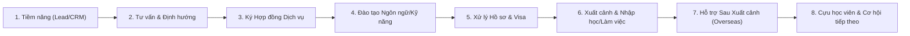

# 01 — BỐI CẢNH NGHIỆP VỤ & HÀNH TRÌNH KHÁCH HÀNG

## 1. Cơ cấu Tổ chức Đa thực thể
- **Legal Entity (Pháp nhân)**: Đơn vị pháp lý độc lập có mã số thuế, con dấu, báo cáo tài chính và tài khoản ngân hàng riêng.
- **Business Unit (Đơn vị kinh doanh)**: Mảng nghiệp vụ kinh doanh chiến lược (ví dụ: Khối Du học Hàn Quốc, Khối Đào tạo Ngôn ngữ, Khối Xuất khẩu Lao động).
- **Brand (Thương hiệu)**: Thương hiệu tiếp thị hướng tới khách hàng (ví dụ: SHD Academy, SHD Education).
- **Branch / Campus (Chi nhánh / Cơ sở đào tạo)**: Địa điểm thực tế triển khai dịch vụ và tiếp đón học viên/phụ huynh.

*Ghi chú: Toàn bộ danh sách pháp nhân và cơ cấu chính thức hiện đang ở trạng thái TBD chờ Product Owner phê duyệt.*

## 2. Hành trình Khách hàng Xuyên Suốt (End-to-End Customer Journey)

## 3. Khái niệm cốt lõi không được nhầm lẫn
- `Party ≠ ApplicationUser`: Party là con người/tổ chức bên ngoài tương tác với doanh nghiệp. ApplicationUser là tài khoản đăng nhập vào hệ thống ERP nội bộ.
- `LegalEntity ≠ BusinessUnit ≠ Brand`: Một pháp nhân có thể vận hành nhiều Business Unit hoặc sở hữu nhiều Brand.
- `Contract ≠ Engagement`: Hợp đồng là văn bản pháp lý ràng buộc nghĩa vụ và thanh toán; Engagement là việc cung cấp dịch vụ thực tế của từng đơn vị đào tạo hoặc hồ sơ.
