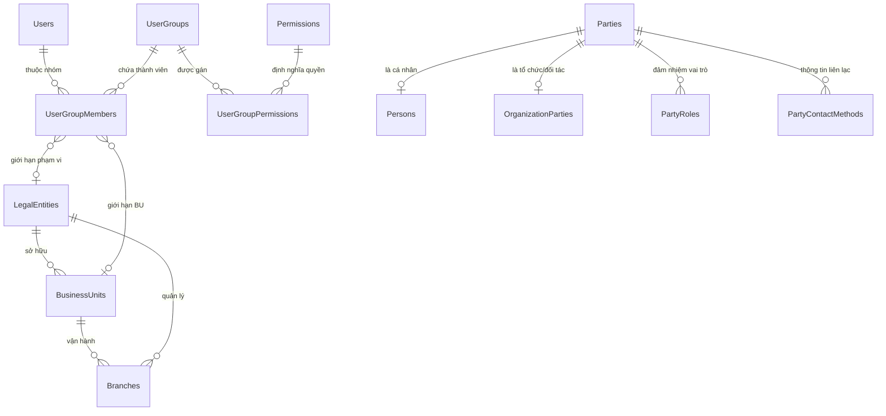

# 04 — MÔ HÌNH DỮ LIỆU CỐT LÕI (CORE DATA MODEL)

## 1. Sơ đồ Quan hệ Thực thể Nền tảng (ERD)

## 2. Các bảng cơ sở dữ liệu đã chuẩn hóa

### A. Identity & Access Management
- `Identity_Users`: `Id`, `Username`, `Email`, `PasswordHash`, `FullName`, `PhoneNumber`, `IsActive`, `MustChangePassword`, `CreatedAtUtc`, `RowVersion`.
- `Identity_UserGroups`: `Id`, `Code`, `Name`, `Description`, `ScopeType` (`Global`, `LegalEntity`, `BusinessUnit`, `Branch`), `IsSystem`, `IsActive`, `RowVersion`.
- `Identity_Permissions`: `Id`, `Code` (`org.legal_entity.view`), `Name`, `Module`, `Description`.
- `Identity_UserGroupPermissions`: `UserGroupId`, `PermissionId`, `GrantedAtUtc`.
- `Identity_UserGroupMembers`: `Id`, `UserId`, `UserGroupId`, `ScopeLegalEntityId`, `ScopeBusinessUnitId`, `ScopeBranchId`, `AssignedAtUtc`.

### B. Organization Module
- `Org_LegalEntities`: `Id`, `Code`, `Name`, `TradingName`, `TaxCode`, `Address`, `PhoneNumber`, `Email`, `Website`, `Status` (`Active`, `Inactive`, `UnderLiquidation`), `CreatedAtUtc`, `UpdatedAtUtc`, `RowVersion`.
- `Org_BusinessUnits`: `Id`, `LegalEntityId`, `Code`, `Name`, `Status`, `CreatedAtUtc`, `RowVersion`.
- `Org_Branches`: `Id`, `LegalEntityId`, `BusinessUnitId`, `Code`, `Name`, `Address`, `Status`, `CreatedAtUtc`, `RowVersion`.

### C. Party 360 Foundation
- `Party_Parties`: `Id` (GUID), `PartyType` (`Person`, `Organization`), `Code`, `Status`, `CreatedAtUtc`.
- `Party_Persons`: `PartyId`, `FirstName`, `LastName`, `DateOfBirth`, `Gender`, `Nationality`.
- `Party_OrganizationParties`: `PartyId`, `CompanyName`, `TaxId`, `RegistrationNumber`.
- `Party_PartyRoles`: `Id`, `PartyId`, `RoleType` (`Student`, `Parent`, `PartnerSchool`, `Agency`, `Vendor`), `LegalEntityId`, `IsActive`.
- `Party_PartyContactMethods`: `Id`, `PartyId`, `ContactType` (`Email`, `Phone`, `Address`, `Zalo`), `Value`, `IsPrimary`.
