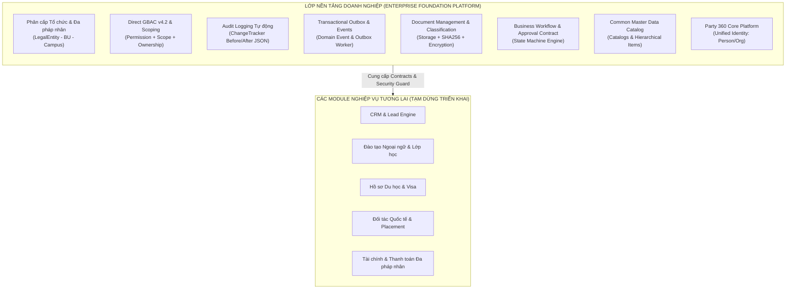

# 12 — FOUNDATION ARCHITECTURE SPECIFICATION
## ĐẶC TẢ KIẾN TRÚC NỀN TẢNG DOANH NGHIỆP (ENTERPRISE FOUNDATION ARCHITECTURE)

---

### 1. Tổng quan & Tuyên bố Chiến lược của Product Owner

> **Chỉ thị của Product Owner:**
> Tạm dừng triển khai các phân hệ nghiệp vụ chi tiết (CRM, Tuyển sinh, Đào tạo, Hồ sơ du học, Visa, Tài chính). Toàn bộ nguồn lực giai đoạn này tập trung hoàn thiện và nghiệm thu **Enterprise Foundation Architecture**. Tất cả các module nghiệp vụ tương lai bắt buộc phải kế thừa và vận hành trên nền tảng kiến trúc thống nhất này.

---

### 2. Các Trụ Cột Kiến Trúc Nền Tảng (Core Pillars)

#### 2.1. Kiến trúc Modular Monolith & Clean Architecture
- **Clean Architecture 4 tầng chuẩn:**
  1. `Domain`: Thực thể DDD, Value Objects, Domain Exceptions, Domain Events, Enums. Độc lập tuyệt đối với database, UI và third-party frameworks.
  2. `Application`: Application Services, DTOs, FluentValidation, Business Invariants, Interfaces (`ISpExecutor`, `IScopeResolver`, `IPermissionResolver`, `IAuditLogService`).
  3. `Infrastructure`: Triển khai Write-side bằng EF Core với Change Tracker, Read-side bằng Stored Procedures tối ưu, JWT, Hashing, Memory Cache, Interceptors.
  4. `Api`: ASP.NET Core 10 Web API, Dynamic Authorization Policies, Global Exception Handling Middleware, OpenAPI/Swagger.
- **Quy tắc phân định ranh giới (Boundary Integrity):**
  - Giao tiếp giữa các module nội bộ thực hiện thông qua **Application Service Interface** hoặc **Domain Events / Outbox Messages**.
  - Không cho phép module A truy cập trực tiếp bảng database hoặc DbContext của module B nếu không thông qua Hợp đồng giao tiếp (Contract).

#### 2.2. Đường dẫn dữ liệu độc lập (CQRS Light)
- **Đường Ghi (Write-path / Commands):**
  - Chạy qua EF Core DbContext.
  - Tự động kiểm tra Concurrency Token (`RowVersion` base64 - HTTP 409 khi xung đột).
  - Tự động kích hoạt `AuditSaveChangesInterceptor` để chụp snapshot Before/After vào `Audit_SystemLogs`.
  - Tự động bóc tách Domain Events trong entity và enqueue vào `System_OutboxMessages` trong cùng một Database Transaction.
- **Đường Đọc (Read-path / Queries):**
  - 100% GET nghiệp vụ thực thi qua **SQL Server Stored Procedures** (`sp_*`) qua `ISpExecutor`.
  - Tích hợp sẵn phân trang, sắp xếp, tìm kiếm và **Direct GBAC Data Scoping** tại tầng database, ngăn chặn triệt để cross-company data leakage.

#### 2.3. Direct GBAC v4.2 & Data Classification
- Quyền hiệu lực được phân giải trực tiếp từ:
  $$\text{User} \longrightarrow \text{UserGroupMember (Scope)} \longrightarrow \text{UserGroup} \longrightarrow \text{UserGroupPermission} \longrightarrow \text{Permission}$$
- Cơ chế bảo mật 3 lớp tại Backend:
  1. **Action Permission**: Kiểm tra mã quyền chuẩn `module.action` (hoặc `module.resource.action`).
  2. **Data Scope**: Kiểm tra phạm vi pháp nhân/đơn vị/cơ sở (`Global`, `LegalEntity`, `BusinessUnit`, `Branch`).
  3. **Resource Ownership & Classification**: Kiểm tra phân loại dữ liệu (`Public`, `Internal`, `Confidential`, `Restricted`). Dữ liệu mật bắt buộc phải là chính chủ sở hữu tài nguyên hoặc Quản trị viên tối cao.

---

### 3. Ma trận Rà soát Hiện trạng Kiến trúc (Architecture Gap Analysis)

| Hạng mục Nền tảng | Trạng thái | Chi tiết đánh giá thực tế | Hành động khắc phục |
|---|---|---|---|
| **Cơ cấu Tổ chức Đa cấp** | `IMPLEMENTED` | Hoàn thiện LegalEntity, BusinessUnit, Branch (Migration 0003, 0007, 0009). Stored Procedures và UI React 18 hoàn chỉnh. | Duy trì kiểm thử hồi quy. |
| **Direct GBAC v4.2** | `IMPLEMENTED` | SP `sp_Identity_User_GetEffectivePermissions` tính quyền trực tiếp từ nhóm, không dùng Role trung gian. Đã bổ sung Cache & Invalidation. | Đã bổ sung `ScopeResolver` và Security Unit Tests. |
| **Data Scope Protection** | `IMPLEMENTED` | Chặn rò rỉ dữ liệu chéo công ty tại Stored Procedures và `IScopeResolver.HasResourceAccessAsync`. | Đã thêm kiểm thử cross-company attempt. |
| **Audit Logging Framework** | `IMPLEMENTED` | Migration `0010` tạo `Audit_SystemLogs`. `AuditSaveChangesInterceptor` tự động bắt CUD, snapshot Before/After. | Đã cấu hình vào DbContext. |
| **Transactional Outbox** | `IMPLEMENTED` | Migration `0010` tạo `System_OutboxMessages`. Interceptor tự động bóc tách DomainEvents vào Outbox. | Đã hoàn thành contract `IEventPublisher`. |
| **Module/Feature Registry** | `IMPLEMENTED` | Migration `0010` tạo `System_Modules`, `System_Features`. Domain & Config đã hoàn tất. | Cung cấp interface `IFeatureRegistryService`. |
| **Common Master Data** | `IMPLEMENTED` | Migration `0010` tạo `System_MasterDataCatalogs`, `System_MasterDataItems`. Domain & Config hoàn tất. | Cung cấp contract `IMasterDataService`. |
| **Document Foundation** | `IMPLEMENTED` | Migration `0010` tạo `Doc_Documents` với `DataClassification` và checksum SHA256. | Cung cấp contract `IDocumentStorageService`. |
| **Workflow State Foundation**| `IMPLEMENTED` | Migration `0010` tạo `Wf_Definitions`, `Wf_Instances`, `Wf_History`. | Cung cấp contract `IWorkflowEngine`. |
| **Party 360 Core** | `IMPLEMENTED` | Migration `0004`, `0008` (Party, Person, OrgParty, Roles, Contacts, Identifications, SPs, UI). | Sẵn sàng làm lõi định danh khách hàng. |
| **Business Modules (CRM, Edu, Visa)** | `STOPPED / BY_PO` | Tạm dừng toàn bộ cho đến khi Foundation được nghiệm thu hoàn chỉnh. | Không sinh code giả hoặc mock tạm bợ. |

