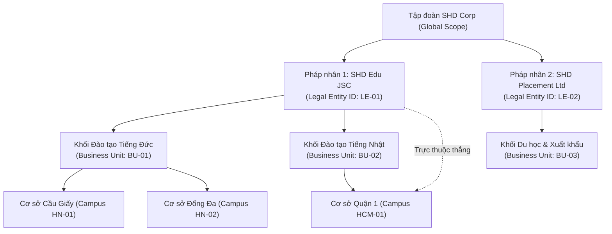
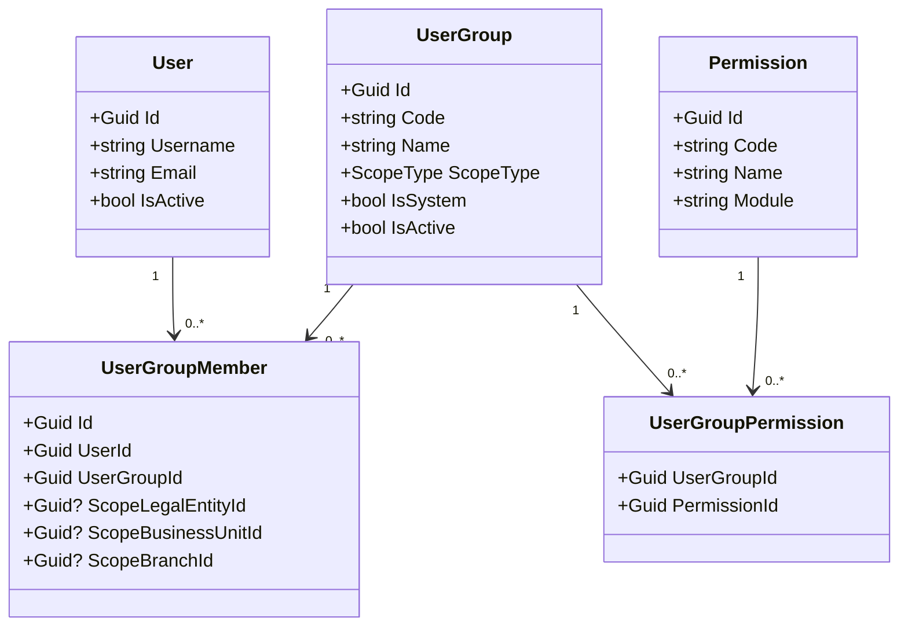
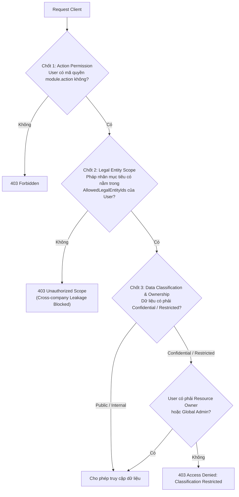

# 13 — KIẾN TRÚC PHÂN CẤP TỔ CHỨC & PHÂN QUYỀN DIRECT GBAC v4.2

---

### 1. Phân cấp Tổ chức Doanh nghiệp (Enterprise Hierarchy)

SHD OneERP phục vụ mô hình tập đoàn đa ngành, bao gồm nhiều pháp nhân độc lập (hoặc liên kết), các khối đơn vị kinh doanh và mạng lưới cơ sở đào tạo / chi nhánh:

- **Quy tắc bất biến (Invariants):**
  1. `LegalEntity` là ranh giới pháp lý cao nhất cho hạch toán tài chính và sở hữu tài sản/hợp đồng.
  2. `BusinessUnit` bắt buộc thuộc một `LegalEntity`. Không có BU độc lập trôi nổi ngoài pháp nhân.
  3. `Branch / Campus` bắt buộc có `LegalEntityId`. Có thể gắn vào một `BusinessUnitId` hoặc trực thuộc trực tiếp Pháp nhân.
  4. Nghiêm cấm gán chéo đơn vị: Một Branch thuộc LegalEntity A không bao giờ được phép gắn với BusinessUnit thuộc LegalEntity B.

---

### 2. Mô hình Phân quyền Direct GBAC v4.2 (Group-Based Access Control)

#### 2.1. Chuỗi quan hệ phân quyền
Hệ thống loại bỏ hoàn toàn tầng Role trung gian để tính toán quyền hiệu lực thời gian thực. Quyền được phân bổ trực tiếp từ Nhóm người dùng:

$$\text{User} \xrightarrow{1..n} \text{UserGroupMember} \xrightarrow{n..1} \text{UserGroup} \xrightarrow{1..n} \text{UserGroupPermission} \xrightarrow{n..1} \text{Permission}$$

#### 2.2. Ma trận Phạm vi Dữ liệu (Data Scope Types)

| Loại Scope | Mô tả | Ứng dụng nghiệp vụ thực tế |
|---|---|---|
| **Global** | Toàn quyền trên tất cả pháp nhân, đơn vị, cơ sở trong toàn tập đoàn. | Ban Tổng Giám đốc, Giám đốc IT, Trưởng Ban Kiểm soát. |
| **LegalEntity** | Quyền chỉ có hiệu lực bên trong 01 Pháp nhân cụ thể (`ScopeLegalEntityId`). | Giám đốc Pháp nhân, Kế toán trưởng công ty thành viên. |
| **BusinessUnit** | Quyền chỉ có hiệu lực bên trong 01 Đơn vị kinh doanh (`ScopeBusinessUnitId`). | Giám đốc Khối Đào tạo tiếng Đức, Trưởng phòng tuyển sinh khối. |
| **Branch** | Quyền chỉ có hiệu lực tại 01 Cơ sở / Chi nhánh đào tạo (`ScopeBranchId`). | Quản lý Cơ sở Cầu Giấy, Lễ tân cơ sở, Giáo vụ tại chỗ. |

---

### 3. Nguyên tắc Bảo mật 3 Lớp Chống Rò rỉ Dữ liệu (Cross-Company Leakage Prevention)

Tại bất kỳ truy vấn hoặc thao tác can thiệp dữ liệu nào, hệ thống bắt buộc kiểm tra 3 chốt chặn:

#### 3.1. Phân loại dữ liệu (Data Classification)
- `Public`: Dữ liệu công khai, giới thiệu khóa học, học phí niêm yết.
- `Internal`: Dữ liệu nội bộ trong phạm vi pháp nhân (Danh sách lớp học, phòng học, lịch khai giảng).
- `Confidential`: Dữ liệu nhạy cảm (Hồ sơ học viên, thông tin nhân thân, hợp đồng du học, bảng điểm).
- `Restricted`: Dữ liệu tối mật (Báo cáo tài chính doanh nghiệp, hồ sơ visa đặc biệt, bí mật kinh doanh).

---

### 4. Cơ chế Bộ đệm & Vô hiệu hóa Bộ đệm Phân quyền (Cache & Invalidation)

- **Chiến lược Caching:**
  - Kết quả phân giải quyền hiệu lực (`sp_Identity_User_GetEffectivePermissions`) được lưu trong `IMemoryCache` (hoặc Redis) với key: `auth:effective_perms:{userId}`.
  - TTL: 60 giây (đảm bảo cân bằng giữa hiệu năng và tính cập nhật).
- **Vô hiệu hóa bộ đệm tức thời (Active Cache Invalidation):**
  - Khi có bất kỳ thay đổi nào tác động đến nhóm hoặc thành viên (`UserGroupMember` được thêm/xóa/sửa scope, `UserGroupPermission` được cấp mới/thu hồi, hoặc `UserGroup.IsActive = false`), hệ thống gọi ngay `IPermissionCacheInvalidator.InvalidateUser(userId)` để xóa cache.
  - Request tiếp theo của user đó bắt buộc gọi Stored Procedure để tính toán lại quyền hiệu lực.

