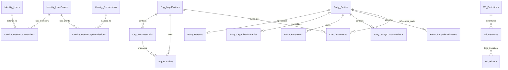

# 14 — MÔ HÌNH DỮ LIỆU DOANH NGHIỆP (ENTERPRISE DATA MODEL)

---

### 1. Kiến trúc Bảng Dữ liệu theo Phân vùng Nghiệp vụ (Schema Partitioning)

Cơ sở dữ liệu SQL Server của SHD OneERP được phân chia thành các schema logic theo tiền tố bảng:

---

### 2. Chi tiết Từ điển Dữ liệu Nền tảng (Platform Data Dictionary)

#### 2.1. Phân vùng Quản trị Danh tính & Phân quyền (`Identity_*`)
- `Identity_Users`: Tài khoản người dùng (Username, Email, PasswordHash, FullName, PhoneNumber, IsActive, MustChangePassword, LastLoginAtUtc).
- `Identity_UserGroups`: Nhóm người dùng (Code, Name, Description, ScopeType, IsSystem, IsActive).
- `Identity_Permissions`: Danh mục quyền nguyên tử (Code theo `module.action`, Name, Module, Description).
- `Identity_UserGroupPermissions`: Bảng liên kết Quyền - Nhóm (UserGroupId, PermissionId, GrantedAtUtc).
- `Identity_UserGroupMembers`: Phân bổ người dùng vào nhóm cùng phạm vi dữ liệu (UserId, UserGroupId, ScopeLegalEntityId, ScopeBusinessUnitId, ScopeBranchId).
- `Identity_RefreshTokens`: Quản lý phiên làm việc JWT (TokenHash, ExpiresAtUtc, RevokedAtUtc, ReplacedByTokenHash).

#### 2.2. Phân vùng Cơ cấu Tổ chức (`Org_*`)
- `Org_LegalEntities`: Pháp nhân doanh nghiệp (Code [UQ], Name, TradingName, TaxCode, Address, PhoneNumber, Email, Website, Status, RowVersion).
- `Org_BusinessUnits`: Khối/Đơn vị kinh doanh (LegalEntityId, Code [UQ theo LE], Name, Status, RowVersion).
- `Org_Branches`: Chi nhánh / Cơ sở đào tạo Campus (LegalEntityId, BusinessUnitId [Nullable], Code [UQ theo LE], Name, Address, Status, RowVersion).

#### 2.3. Phân vùng Khách hàng & Định danh Dùng chung (`Party_*`)
- `Party_Parties`: Thực thể định danh gốc (PartyType: Person/Organization, Code [UQ], Status, RowVersion).
- `Party_Persons`: Mở rộng định danh cá nhân (FirstName, LastName, DateOfBirth, Gender, Nationality).
- `Party_OrganizationParties`: Mở rộng định danh đối tác tổ chức (LegalName, TradingName, TaxCode, RepresentativeName).
- `Party_PartyRoles`: Vai trò của Party trong hệ thống (RoleType: Student, Lead, Teacher, Agent, Vendor, Partner; ScopeLegalEntityId).
- `Party_PartyContactMethods`: Phương thức liên lạc đa kênh (ContactType: Email, Phone, Address, Zalo; Value, IsPrimary).
- `Party_PartyIdentifications`: Giấy tờ tùy thân / Pháp lý (IdType: CCCD, Passport, TaxCode; IdNumber, IssueDate, ExpiryDate).

#### 2.4. Phân vùng Dịch vụ Nền tảng Doanh nghiệp (`Audit_*`, `System_*`, `Doc_*`, `Wf_*`)
- `Audit_SystemLogs`: Nhật ký kiểm toán tự động (UserId, UserName, LegalEntityId, Action, EntityName, EntityId, OldValues, NewValues, AffectedColumns, IpAddress, UserAgent, CorrelationId).
- `System_OutboxMessages`: Bảng Outbox Pattern cho Domain Events (OccurredOnUtc, EventType, PayloadJson, ProcessedOnUtc, Error, RetryCount).
- `System_Modules` & `System_Features`: Đăng ký Module & Feature Flags (Code, Name, IsEnabledGlobal).
- `System_MasterDataCatalogs` & `System_MasterDataItems`: Danh mục mã dùng chung phân cấp (CatalogId, Code, Name, Value, DisplayOrder, ParentItemId).
- `Doc_Documents`: Quản lý tài liệu & tệp đính kèm số (LegalEntityId, OwnerUserId, PartyId, Title, DocumentType, DataClassification, StoragePath, ContentType, FileSizeBytes, Sha256Checksum, IsEncrypted).
- `Wf_Definitions`, `Wf_Instances`, `Wf_History`: Máy trạng thái quy trình phê duyệt đa cấp (DefinitionJson, EntityId, CurrentState, Status, ActorUserId, Comments).

---

### 3. Quy chuẩn Khóa lạc quan (Concurrency Control) & Xóa mềm (Soft Delete)

1. **Optimistic Concurrency Control:**
   - 100% các bảng giao dịch và thực thể chính (`LegalEntities`, `BusinessUnits`, `Branches`, `Parties`, `Documents`) bắt buộc có cột `RowVersion ROWVERSION NOT NULL`.
   - Mọi thao tác Update/Delete từ client bắt buộc gửi kèm `RowVersionBase64`.
   - Nếu phát hiện xung đột phiên bản, hệ thống trả về mã lỗi HTTP `409 Conflict` (mã lỗi `CONCURRENCY_CONFLICT`).
2. **Soft Delete Policy:**
   - Các bảng nghiệp vụ không bao giờ bị xóa vật lý (`DELETE FROM`) khỏi database trừ trường hợp dọn dẹp môi trường dev.
   - Thao tác xóa được thực hiện bằng cách cập nhật `IsDeleted = 1`, `DeletedAtUtc = SYSUTCDATETIME()`.
   - EF Core áp dụng Global Query Filter `builder.HasQueryFilter(x => !x.IsDeleted)` để tự động loại bỏ các bản ghi đã xóa khỏi truy vấn thông thường.
   - Các chỉ mục duy nhất (Unique Index) đều có điều kiện `WHERE [IsDeleted] = 0` để cho phép tái sử dụng mã khi bản ghi cũ đã ngừng hoạt động.

