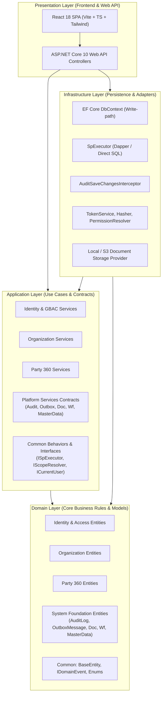

# 15 — BẢN ĐỒ MODULE & QUY TẮC PHỤ THUỘC (MODULE ARCHITECTURE & DEPENDENCY MAP)

---

### 1. Phân tầng Kiến trúc & Hướng phụ thuộc (Dependency Direction)

- **Quy tắc phụ thuộc bất biến (Dependency Inversion Principle):**
  1. `Domain` không được phụ thuộc vào bất kỳ layer nào khác (Zero external references).
  2. `Application` chỉ phụ thuộc vào `Domain`.
  3. `Infrastructure` triển khai các interfaces được định nghĩa tại `Application` và `Domain`.
  4. `Api` chỉ đóng vai trò Composition Root, tiếp nhận HTTP Request, ủy quyền cho `Application Services` và trả kết quả chuẩn hóa `ApiResponse<T>`.

---

### 2. Bản đồ Phân định Module (Module Boundaries & Cross-Module Rules)

| Module | Nhiệm vụ chính | Phụ thuộc cho phép | Giao tiếp đối ngoại |
|---|---|---|---|
| **Identity & Access** | Quản lý User, UserGroup, Direct GBAC v4.2, JWT Tokens, Passwords. | `Domain.Common` | Cung cấp `IPermissionResolver`, `IScopeResolver`, `ICurrentUser` cho toàn bộ hệ thống. |
| **Organization** | Quản lý Pháp nhân (LegalEntity), Đơn vị (BusinessUnit), Cơ sở đào tạo (Branch/Campus). | `Identity` (qua Scope IDs) | Cung cấp thông tin cấu trúc tổ chức và phân cấp quản lý. |
| **Party 360** | Quản lý định danh Khách hàng, Học viên, Phụ huynh, Đối tác, Giảng viên dùng chung. | `Organization` (Roles theo LegalEntity) | Cung cấp Party Profile, Roles, Contacts cho các module nghiệp vụ tương lai. |
| **Foundation Platform** | Cung cấp Audit Logging, Outbox Pattern, Document Management, Workflow State Machine, Master Data. | `Domain.Common`, `Organization`, `Party` | Cung cấp các Platform Services cho tất cả các modules thông qua interfaces dùng chung. |

---

### 3. Quy tắc Giao tiếp Giữa các Module (Inter-Module Communication)

1. **Truy vấn đọc (Read queries):**
   - Không được phép cross-join trực tiếp các bảng nghiệp vụ của module khác mà không có sự phê duyệt kiến trúc.
   - Khi cần hiển thị dữ liệu tổng hợp (Ví dụ: Danh sách Branch hiển thị tên LegalEntity), sử dụng Stored Procedure chuyên biệt ở tầng Infrastructure.
2. **Thao tác ghi (Commands / State Changes):**
   - Nghiêm cấm việc Application Service của Module A trực tiếp gọi `_context.Set<EntityB>().Add()` của Module B.
   - Nếu Module A cần tạo dữ liệu hoặc thông báo cho Module B, có 2 phương thức hợp lệ:
     - **Đồng bộ (Synchronous):** Gọi thông qua Application Service Interface của Module B (Ví dụ: `IPartyWriteService.CreatePersonAsync(...)`).
     - **Bất đồng bộ (Asynchronous / Event-driven):** Bắn ra `DomainEvent`, tự động ghi vào `System_OutboxMessages` và được xử lý tuần tự bởi background processor.

