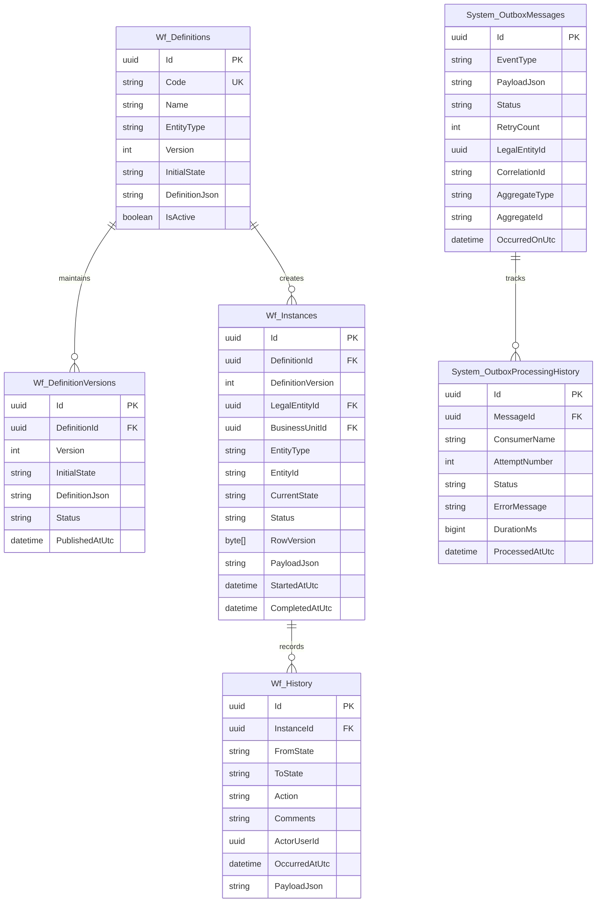
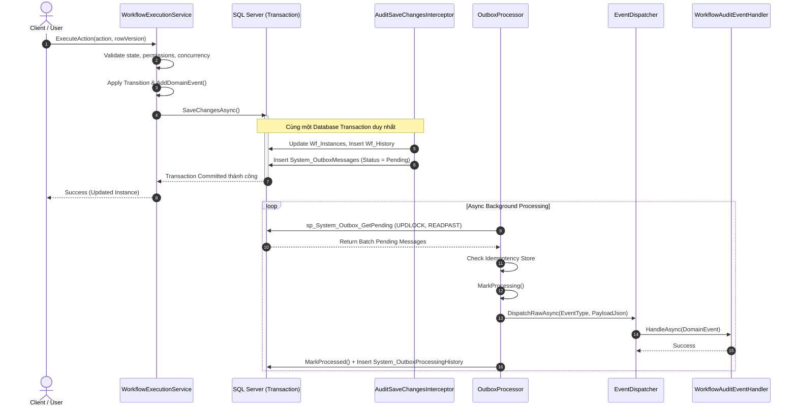

# 20 — KIẾN TRÚC WORKFLOW ENGINE & EVENT FOUNDATION (FND-03)

---

### 1. Bối cảnh & Mục tiêu Kiến trúc (Executive Summary & Architecture Principles)

Trong hệ thống ERP đa công ty **SHD OneERP**, các phân hệ nghiệp vụ tương lai (như Quản lý Khách hàng, Tuyển sinh, Quản lý Đào tạo, Xử lý Hồ sơ Du học - Visa và Tài chính - Kế toán) đều có nhu cầu luân chuyển hồ sơ, phê duyệt đa cấp và phối hợp bất đồng bộ giữa các đơn vị thành viên.

Nếu để từng phân hệ tự phát triển logic máy trạng thái (State machine) và cơ chế phát tán sự kiện riêng lẻ, hệ thống sẽ gặp các rủi ro kiến trúc nghiêm trọng:
1. **Trùng lặp mã nguồn (Code duplication):** Mỗi nghiệp vụ lại tự viết bảng lịch sử duyệt, tự quản lý trạng thái, dẫn tới khó bảo trì và phân mảnh.
2. **Lỗ hổng bảo mật phân quyền đa pháp nhân:** Không thể áp dụng nhất quán cơ chế phân quyền Direct GBAC và giới hạn dữ liệu đa tầng (Legal Entity / Business Unit scope).
3. **Bất nhất dữ liệu (Dual-write problem):** Việc vừa commit dữ liệu nghiệp vụ vào Database vừa gọi Message Broker hoặc Notification service bên ngoài dễ dẫn tới mất mát thông điệp hoặc mất đồng bộ khi xảy ra sự cố mạng.
4. **Vi phạm kiểm toán (Auditability & Compliance):** Thiếu cơ chế ghi vết bất biến (Immutable Audit Trail) khiến lịch sử phê duyệt có nguy cơ bị sửa đổi hoặc xóa bỏ.

Phân hệ nền tảng **FND-03 (Workflow Engine & Event Foundation)** giải quyết triệt để các bài toán trên thông qua 2 trụ cột độc lập domain (Domain-Agnostic):
- **Generic Workflow State Machine Engine:** Động cơ điều phối trạng thái độc lập domain, có quản lý phiên bản (`WorkflowDefinitionVersion`), kiểm soát khóa lạc quan (`RowVersion`), xác thực bảo mật Direct GBAC kèm Legal Entity / Business Unit scope tại từng bước chuyển trạng thái, bảo đảm bất biến lịch sử (`WorkflowTransitionHistory`), và cam kết các transition bị từ chối tuyệt đối không làm thay đổi dữ liệu.
- **Transactional Outbox & Business Event Foundation:** Đảm bảo 100% tính nhất quán (Eventual Consistency), chống mất mát dữ liệu theo chuẩn Transactional Outbox Pattern (lưu Outbox Message trong cùng Transaction với Entity thông qua `AuditSaveChangesInterceptor`), cơ chế chống trùng lặp (`IIdempotencyStore`), ghi nhận lịch sử xử lý sự kiện chi tiết (`OutboxProcessingHistory`), hỗ trợ Retry Backoff và Dead-Letter Queue.

---

### 2. Kiến trúc Workflow State Machine Engine

#### 2.1. Mô hình Thực thể (Domain Entities)

Mô hình thực thể của Workflow Engine được phân tách chuẩn mực theo Clean Architecture:



#### 2.2. Chi tiết các Thành phần Thực thể

1. **`WorkflowDefinition`:** Danh mục định nghĩa quy trình cấp cao (Header). Quản lý mã quy trình (`Code`, duy nhất hệ thống), tên, phân loại thực thể (`EntityType`), trạng thái khởi tạo (`InitialState`), trạng thái kích hoạt (`IsActive`) và phiên bản mới nhất (`Version`).
2. **`WorkflowDefinitionVersion`:** Đại diện cho một phiên bản State Machine Schema đã được xuất bản (Published). Cố định và bất biến, lưu trữ toàn bộ JSON Schema của version đó, phục vụ cho các instances đã khởi tạo theo version tương ứng.
3. **`WorkflowState` / `WorkflowStateDefinition`:** Mô hình trạng thái nghiệp vụ trong Schema (Code, Name, StateType [Initial, Normal, TerminalApproved, TerminalRejected, TerminalCancelled], Description, AllowedGroupCodes).
4. **`WorkflowTransition` / `WorkflowTransitionDefinition`:** Định nghĩa bước chuyển trạng thái (FromState, ToState, Action, RequiredPermission, TargetStatus, ConditionExpression, RequiresComment).
5. **`WorkflowInstance`:** Phiên bản thực thi của một quy trình gắn với một thực thể cụ thể (`EntityType`, `EntityId`). Quản lý phạm vi đa công ty (`LegalEntityId`, `BusinessUnitId`), người khởi tạo (`RequesterUserId`), người/nhóm được phân công (`AssignedUserId`, `AssignedUserGroupId`), trạng thái hiện tại (`CurrentState`), trạng thái tổng quan (`Status`) và Token khóa lạc quan (`RowVersion`).
6. **`WorkflowTransitionHistory` (alias `WorkflowHistory`):** Nhật ký chuyển đổi trạng thái bất biến (Append-Only), ghi vết người thực hiện (`ActorUserId`), hành động (`Action`), trạng thái trước/sau (`FromState`, `ToState`), ý kiến phê duyệt (`Comments`), Snapshot dữ liệu payload và thời điểm chính xác (`OccurredAtUtc`).

#### 2.3. Cấu trúc Schema State Machine (Generic JSON Schema)

Định nghĩa quy trình nghiệp vụ được mô hình hóa dưới dạng JSON linh hoạt, cho phép khai báo trạng thái và các bước chuyển tiếp kèm theo yêu cầu quyền truy cập:

```json
{
  "version": 1,
  "initialState": "Draft",
  "states": [
    {
      "code": "Draft",
      "name": "Bản nháp",
      "stateType": 1,
      "description": "Văn bản hoặc chứng từ mới tạo"
    },
    {
      "code": "PendingReview",
      "name": "Chờ thẩm định",
      "stateType": 2,
      "description": "Hồ sơ đang chờ người có thẩm quyền xem xét"
    },
    {
      "code": "Approved",
      "name": "Đã phê duyệt",
      "stateType": 3,
      "description": "Hồ sơ được chấp thuận chính thức"
    },
    {
      "code": "Rejected",
      "name": "Bị từ chối",
      "stateType": 4,
      "description": "Hồ sơ không đáp ứng tiêu chuẩn"
    },
    {
      "code": "Cancelled",
      "name": "Đã hủy",
      "stateType": 5,
      "description": "Quy trình đã bị hủy bỏ bởi người nộp"
    }
  ],
  "transitions": [
    {
      "id": "t1",
      "fromState": "Draft",
      "toState": "PendingReview",
      "action": "Submit",
      "targetStatus": 1,
      "requiresComment": false
    },
    {
      "id": "t2",
      "fromState": "PendingReview",
      "toState": "Approved",
      "action": "Approve",
      "requiredPermission": "workflow.action",
      "targetStatus": 2,
      "requiresComment": false
    },
    {
      "id": "t3",
      "fromState": "PendingReview",
      "toState": "Rejected",
      "action": "Reject",
      "requiredPermission": "workflow.action",
      "targetStatus": 3,
      "requiresComment": true
    },
    {
      "id": "t4",
      "fromState": "PendingReview",
      "toState": "Draft",
      "action": "RequestChanges",
      "requiredPermission": "workflow.action",
      "targetStatus": 1,
      "requiresComment": true
    },
    {
      "id": "t5",
      "fromState": "Draft",
      "toState": "Cancelled",
      "action": "Cancel",
      "targetStatus": 4,
      "requiresComment": false
    },
    {
      "id": "t6",
      "fromState": "PendingReview",
      "toState": "Cancelled",
      "action": "Cancel",
      "targetStatus": 4,
      "requiresComment": true
    }
  ]
}
```

#### 2.4. Quy tắc Kiểm tra Chuyển đổi Trạng thái & Các Bất biến Nền tảng (Platform Invariants)

Khi có yêu cầu chuyển trạng thái (`ExecuteWorkflowActionRequest`) được gửi tới `WorkflowExecutionService`:

1. **Phân giải Schema phiên bản tương ứng:** Nạp Schema JSON từ `Definition.DefinitionJson` của phiên bản quy trình và xác thực tính hợp lệ của Action từ `CurrentState`.
2. **Kiểm tra Trạng thái Kết thúc (Terminal States):** Nếu instance đang ở một trạng thái kết thúc (`Approved`, `Rejected`, `Cancelled`), toàn bộ các thao tác tiếp theo đều bị chặn với mã lỗi `WORKFLOW_TERMINATED`.
3. **Phân quyền Đa tầng kèm Phạm vi Dữ liệu (Scoped GBAC Authorization):**
   - Nếu Transition cấu hình `RequiredPermission`, hệ thống gọi:
     ```csharp
     await _permissionResolver.HasPermissionAsync(
         userId: actorUserId,
         permissionCode: transition.RequiredPermission,
         legalEntityId: instance.LegalEntityId,
         businessUnitId: instance.BusinessUnitId,
         cancellationToken: cancellationToken);
     ```
   - Nếu người dùng không có quyền trong phạm vi Legal Entity hoặc Business Unit của hồ sơ, thao tác bị từ chối ngay với mã lỗi `UNAUTHORIZED_TRANSITION`.
4. **Khóa Lạc quan (Optimistic Concurrency Control):** Kiểm tra `RowVersion` gửi kèm so với phiên bản trong cơ sở dữ liệu. Nếu có người khác đã chuyển trạng thái trước đó hoặc xảy ra tranh chấp cập nhật, hệ thống ném lỗi `CONCURRENCY_CONFLICT`.
5. **Bất biến Dữ liệu khi Bị Từ chối (Rejection Data Invariant):** Toàn bộ các bước kiểm tra (State, Action, Permission, Comment, Concurrency) được thực thi **trước** khi thay đổi trạng thái entity hoặc gọi `SaveChangesAsync`. Nếu có bất kỳ vi phạm nào, hàm kết thúc ngay lập tức: trạng thái, dữ liệu payload và bảng lịch sử hoàn toàn được giữ nguyên vẹn, không sinh bản ghi rác.
6. **Lịch sử Bất biến (Immutable History Invariant):** Bản ghi trong `Wf_History` chỉ được thêm mới (Append-Only) khi transition thành công. Không có bất kỳ API, hàm cập nhật hoặc xóa lịch sử nào trong toàn bộ hệ sinh thái OneERP.
7. **Phát Domain Event tự động:** Thực thể `WorkflowInstance` tự động phát sinh `WorkflowTransitionedDomainEvent` (và `WorkflowCompletedDomainEvent` nếu đến trạng thái kết thúc) để Interceptor tự động đưa vào Outbox trong cùng transaction.

---

### 3. Kiến trúc Transactional Outbox & Business Event Foundation

#### 3.1. Giải quyết triệt để Dual-Write Problem

Trong kiến trúc phân tán hoặc tích hợp nhiều module, việc vừa cập nhật cơ sở dữ liệu vừa gửi thông điệp ra message broker/event handler có thể dẫn tới bất nhất nếu một trong hai bước gặp sự cố.

SHD OneERP áp dụng **Transactional Outbox Pattern**:
1. Domain Events được lưu trực tiếp vào bảng `System_OutboxMessages` **trong cùng một Database Transaction** với entity nghiệp vụ (thông qua `AuditSaveChangesInterceptor.SavingChangesAsync`).
2. Tiến trình xử lý nền (`OutboxProcessor`) quét các message có trạng thái `Pending` hoặc `Failed` (chưa vượt quá max retries) để dispatch tới các Event Handlers đăng ký trong hệ thống.



#### 3.2. Cấu trúc Enterprise Event Envelope

Toàn bộ Domain Event được đóng gói trong một Event Envelope chuẩn mực (`IEventEnvelope` / `EventEnvelope<TEvent>`):

| Thuộc tính | Kiểu dữ liệu | Ý nghĩa |
| :--- | :--- | :--- |
| `EventId` | `Guid` | Mã định danh duy nhất của sự kiện (dùng cho Idempotency Store) |
| `EventType` | `string` | Tên Assembly Qualified hoặc FQCN của loại sự kiện |
| `AggregateType` | `string` | Tên của Aggregate Root (ví dụ: `WorkflowInstance`) |
| `AggregateId` | `string` | Mã định danh của Aggregate Root |
| `CorrelationId` | `string?` | Khóa liên kết xuyên suốt vết yêu cầu người dùng |
| `CausationId` | `string?` | Mã sự kiện nguồn trực tiếp dẫn đến sự kiện hiện tại |
| `LegalEntityId`| `Guid?` | Pháp nhân chịu tác động của sự kiện |
| `UserId` | `Guid?` | Người dùng gây ra biến động |
| `Payload` | `TEvent` / JSON | Dữ liệu chi tiết của sự kiện |
| `OccurredOnUtc` | `DateTime` | Thời điểm phát sinh sự kiện |

#### 3.3. Tính Bất biến (Idempotency) & Lịch sử Thực thi (Event Processing History)

- **Idempotency Store (`IIdempotencyStore` / `MemoryIdempotencyStore`):** Trước khi dispatch thông điệp, hệ thống kiểm tra cache Idempotency theo cặp `(MessageId, ConsumerName)`. Nếu sự kiện đã được xử lý thành công trong cửa sổ TTL (mặc định 24 giờ), thông điệp được đánh dấu `Processed` và bỏ qua việc gọi handler lần 2, ngăn ngừa triệt để các tác dụng phụ ngoài ý muốn (Duplicate side-effects).
- **Lịch sử Thực thi Bất biến (`System_OutboxProcessingHistory`):** Mọi lần thử dispatch (kể cả thành công, thất bại hay kích hoạt bộ đệm Idempotency) đều được ghi nhận vào bảng `System_OutboxProcessingHistory` với thông tin: `MessageId`, `ConsumerName`, `AttemptNumber`, `Status`, `ErrorMessage`, thời gian thực thi `DurationMs` và thời điểm chính xác `ProcessedAtUtc`.
- **Cơ chế Thử lại (Retry Backoff):** Khi handler ném ngoại lệ, `OutboxProcessor` ghi nhận lỗi, tăng `RetryCount`. Nếu `RetryCount < MaxRetries` (mặc định 5 lần), trạng thái được chuyển thành `Failed` để chờ đợt quét tiếp theo.
- **Hàng đợi Chết (Dead-Letter Queue):** Khi số lần retry chạm ngưỡng tối đa (5 lần), thông điệp chuyển sang trạng thái `DeadLetter`. Lỗi chi tiết được lưu trong trường `Error` của message và bảng processing history. Quản trị viên có thể theo dõi và kích hoạt API `POST /api/v1/system/outbox/reprocess-failed` để khôi phục xử lý sau khi giải quyết sự cố kỹ thuật.

---

### 4. Thiết kế Cơ sở Dữ liệu & CQRS Read-side

#### 4.1. File Migration Viết tay Chuẩn mực

Toàn bộ cấu trúc cơ sở dữ liệu của FND-03 được quản lý độc lập tại file migration:
`database/migrations/20261027_0013_WorkflowEngineAndOutboxEnhancement.sql`.

Tuân thủ nguyên tắc không sửa đổi các file migration đã có (`20261025_*` và `20261026_*`).

#### 4.2. Danh mục Stored Procedures Đọc Tối ưu

1. **`sp_Workflow_Instance_GetPaged`:** Phân trang và lọc danh sách instance theo `WorkflowCode`, `LegalEntityId`, `BusinessUnitId`, `EntityType`, `EntityId`, `Status`, `RequesterUserId`. Hỗ trợ trả về tên pháp nhân, đơn vị kinh doanh, người nộp, nhóm duyệt và token concurrency `RowVersion`.
2. **`sp_Workflow_Instance_GetById`:** Truy vấn chi tiết một instance kèm theo thông tin tổ chức, người được phân công và schema phiên bản tương ứng.
3. **`sp_Workflow_Instance_GetHistory`:** Truy vấn danh sách lịch sử luân chuyển sắp xếp theo thời gian tăng dần (`OccurredAtUtc ASC`), phục vụ hiển thị Timeline tiến trình.
4. **`sp_Workflow_Definition_GetByCode`:** Lấy định nghĩa quy trình active mới nhất theo mã quy trình.
5. **`sp_System_Outbox_GetPending`:** Sử dụng gợi ý khóa `WITH (UPDLOCK, READPAST)` để cho phép nhiều worker chạy song song mà không bị dead-lock hoặc đọc trùng message.

#### 4.3. Dữ liệu Mầm Nền tảng (Generic Seed Data)

Tuân thủ nguyên tắc không tự phát minh quy trình nghiệp vụ chuyên ngành khi chưa có khảo sát, file migration chỉ khởi tạo quy trình văn bản mẫu dùng chung:
- **Mã quy trình:** `GENERIC_DOCUMENT_APPROVAL`
- **Tên quy trình:** Quy trình Phê duyệt Văn bản Dùng chung
- **Các bước:** Draft -> PendingReview -> Approved / Rejected / Cancelled.
- **Các quy trình nghiệp vụ CRM, Tuyển sinh, Visa, Đào tạo, Tài chính:** Đánh dấu **TBD** và chỉ triển khai khi có tài liệu đặc tả nghiệp vụ được phê duyệt.

---

### 5. Bằng chứng Kiểm thử Tự động (Automated Test Evidence)

Toàn bộ hệ thống kiểm thử xUnit bao phủ 100% các tiêu chí nghiệm thu (Acceptance Criteria):

```text
Test run for ShdOneErp.Tests.dll (.NETCoreApp,Version=v10.0)
A total of 1 test files matched the specified pattern.

Passed!  - Failed: 0, Passed: 141, Skipped: 0, Total: 141, Duration: 605 ms - ShdOneErp.Tests.dll (net10.0)
```

#### Chi tiết các Test Suite của FND-03:

1. **`WorkflowStateMachineParserTests`:**
   - `ParseAndValidate_WithValidSchema_ReturnsValidWorkflowSchema`: Phân tích cú pháp JSON State Machine thành công.
   - `ParseAndValidate_WhenMissingInitialState_ThrowsException`: Bắt lỗi khi Schema thiếu trạng thái khởi tạo.
   - `ParseAndValidate_WhenTransitionTargetInvalid_ThrowsException`: Bắt lỗi khi bước chuyển trỏ đến trạng thái không tồn tại.
   - `ParseAndValidate_WhenNoTerminalState_ThrowsException`: Bắt lỗi khi Schema không có trạng thái kết thúc hợp lệ.

2. **`WorkflowExecutionServiceTests`:**
   - `StartAsync_WhenDefinitionExists_CreatesInstanceAndHistory`: Khởi tạo instance và ghi nhận bản ghi lịch sử đầu tiên.
   - `StartAsync_WhenDuplicatePendingInstance_ReturnsFailure`: Ngăn chặn tạo trùng lặp quy trình đang chờ xử lý cho cùng thực thể.
   - `ExecuteActionAsync_ValidTransition_UpdatesStateAndStatus`: Chuyển trạng thái thành công, cập nhật state và status tương ứng.
   - `ExecuteActionAsync_InvalidAction_ReturnsInvalidTransition`: Từ chối hành động không hợp lệ từ trạng thái hiện tại.
   - `ExecuteActionAsync_MissingRequiredPermission_ReturnsUnauthorized`: Chặn người dùng thiếu quyền thao tác.
   - `ExecuteActionAsync_CommentRequired_WhenEmpty_ReturnsFailure`: Bắt buộc nhập ý kiến đối với transition yêu cầu comment.
   - `CancelAsync_ByRequester_CancelsInstance`: Cho phép người khởi tạo hoặc Admin hủy bỏ quy trình.
   - **`ExecuteActionAsync_WhenTransitionRejected_DoesNotAlterInstanceOrHistoryData`:** Kiểm tra invariant: khi transition bị từ chối, dữ liệu instance và bảng history hoàn toàn giữ nguyên, không sinh bản ghi thừa.
   - **`ExecuteActionAsync_WithBusinessUnitScope_EnforcesScopedPermissionCheck`:** Kiểm tra xác thực quyền hạn có xét đồng thời cả `LegalEntityId` và `BusinessUnitId`.
   - **`WorkflowDefinition_VersionTracking_PreservedInInstance`:** Kiểm tra instance lưu giữ chính xác phiên bản của Workflow Definition tại thời điểm khởi tạo.
   - **`TransitionHistory_CapturesImmutableAuditTrail`:** Kiểm tra toàn bộ chuỗi lịch sử luân chuyển (Submit -> Review -> Approve) lưu vết đầy đủ người thực hiện, ý kiến và thời gian.

3. **`OutboxAndEventPlatformTests`:**
   - `EventDispatcher_DispatchesToRegisteredHandlers`: Phân phối domain event đến đúng các `IEventHandler<T>` đã đăng ký.
   - `MemoryIdempotencyStore_TracksProcessedMessages`: Đảm bảo tính Idempotent, chống xử lý lặp lại thông điệp.
   - `OutboxProcessor_ProcessesPendingMessages_Successfully`: Quét và xử lý thành công batch outbox messages, cập nhật trạng thái `Processed`.
   - `OutboxProcessor_WhenDispatcherFails_IncrementsRetryCount`: Ghi nhận lỗi và tăng biến đếm retry khi handler gặp sự cố.
   - `OutboxProcessor_WhenMaxRetriesReached_MarksDeadLetter`: Chuyển thông điệp sang `DeadLetter` khi vượt quá 5 lần retry.
   - **`OutboxProcessor_RecordsProcessingHistory_ForEveryAttempt`:** Kiểm tra mỗi lần quét xử lý thông điệp đều ghi vết chi tiết vào `OutboxProcessingHistories` kèm thời gian thực thi (ms).
   - **`AuditSaveChangesInterceptor_EnqueuesDomainEventsToOutbox_Atomically`:** Kiểm tra cơ chế Transactional Outbox: Domain Events tự động được bóc tách và thêm vào `OutboxMessages` trong cùng transaction với entity nghiệp vụ.

---

### 6. Hướng dẫn Tích hợp & Mở rộng cho Các Phân hệ Nghiệp vụ Tương lai

Khi các phân hệ nghiệp vụ như CRM, Tuyển sinh, Quản lý Đào tạo, Du học hoặc Tài chính được cấp phép triển khai, các nhóm phát triển sử dụng trực tiếp Foundation theo các bước:

1. **Khai báo Workflow Definition trong Database:**
   Chèn bản ghi vào `Wf_Definitions` và `Wf_DefinitionVersions` với mã quy trình (ví dụ: `STUDENT_ADMISSION_APPROVAL` hoặc `VISA_PROCESSING`) và Schema JSON tương ứng.
2. **Khởi tạo quy trình thông qua Service hoặc `IWorkflowEngine`:**
   ```csharp
   var result = await _workflowExecutionService.StartAsync(new StartWorkflowRequest
   {
       WorkflowCode = "VISA_PROCESSING",
       LegalEntityId = visaApp.LegalEntityId,
       BusinessUnitId = visaApp.BusinessUnitId,
       EntityType = "VisaApplication",
       EntityId = visaApp.Id.ToString(),
       PayloadJson = JsonSerializer.Serialize(new { ApplicationCode = visaApp.Code })
   });
   ```
3. **Thực hiện duyệt / chuyển trạng thái:**
   ```csharp
   var actionResult = await _workflowExecutionService.ExecuteActionAsync(instanceId, new ExecuteWorkflowActionRequest
   {
       Action = "Approve",
       Comments = "Hồ sơ đạt yêu cầu lãnh sự",
       RowVersionBase64 = currentInstance.RowVersionBase64
   });
   ```
4. **Lắng nghe sự kiện để phối hợp liên phân hệ:**
   ```csharp
   public class VisaWorkflowCompletedHandler : IEventHandler<WorkflowCompletedDomainEvent>
   {
       public async Task HandleAsync(WorkflowCompletedDomainEvent domainEvent, CancellationToken ct)
       {
           if (domainEvent.EntityType == "VisaApplication" && domainEvent.FinalStatus == WorkflowStatus.Approved)
           {
               // Tự động kích hoạt thông báo cho du học sinh và cập nhật trạng thái tuyển sinh
           }
       }
   }
   ```

---

### 7. Danh sách Nội dung Cần Product Owner (PO) Phê duyệt

Trước khi đưa Workflow Engine vào phục vụ các nghiệp vụ chuyên ngành cụ thể, cần Product Owner phê duyệt các nội dung sau:

| STT | Nội dung cần phê duyệt | Hiện trạng (FND-03) | Đề xuất lấy ý kiến PO |
| :--- | :--- | :--- | :--- |
| 1 | **Chính sách phân quyền Phê duyệt (Approval Matrix)** | Dùng permission dạng `workflow.action` và Direct GBAC scope | Phê duyệt ma trận quyền phê duyệt chi tiết cho từng phân hệ (Hạn mức duyệt chi, Cấp thẩm quyền tuyển sinh, Thẩm quyền cấp visa). |
| 2 | **Cơ chế Timeout & Auto-Escalation** | Chưa kích hoạt (TBD) | Quy định thời gian tối đa cho mỗi bước duyệt hồ sơ (ví dụ: quá 48h tự động chuyển lên cấp quản lý cao hơn). |
| 3 | **Chính sách Lưu trữ Outbox & Purge History** | Đang lưu vĩnh viễn trong DB | Phê duyệt chính sách lưu trữ (Retention Policy) cho `System_OutboxMessages` và `System_OutboxProcessingHistory` (ví dụ: dọn dẹp các message thành công sau 90 ngày). |
| 4 | **Lựa chọn Message Broker phân tán** | Đang dùng In-Process Event Dispatcher + DB Polling | Khi quy mô hệ thống vượt 10,000 sự kiện/ngày, PO phê duyệt việc tích hợp RabbitMQ hoặc Azure Service Bus. |
| 5 | **Đặc tả Quy trình Nghiệp vụ Chuyên ngành** | Đã đánh dấu TBD toàn bộ nghiệp vụ CRM, Tuyển sinh, Du học, Tài chính | Khảo sát và ký duyệt Schema State Machine cho từng nghiệp vụ trước khi triển khai seed data chính thức. |
