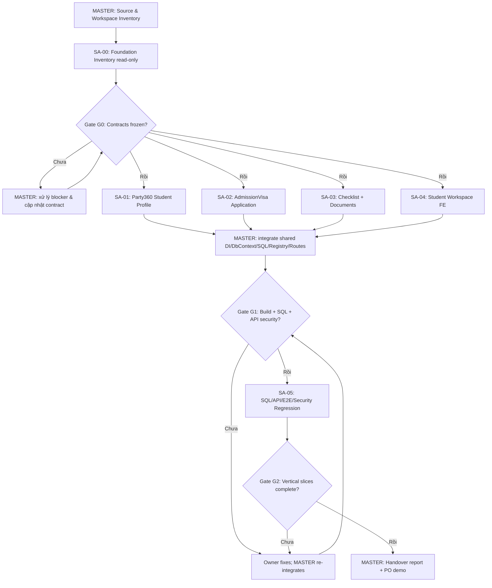

# SHD OneERP — MASTER AGENT / SUB-AGENT EXECUTION PLAN
## STU-01 Student Profile Management + ADM-01 Student Application & Dossier

**Mục đích:** Prompt thực thi cho **một AI Agent chính (Orchestrator)** điều phối các Sub-Agent để **viết code và hoàn thiện chức năng nghiệp vụ chạy được**, thay vì chỉ viết tài liệu.

**Trạng thái:** `IMPLEMENTATION_INSTRUCTION` — Phạm vi ưu tiên mới do Product Owner giao. Các nội dung chưa có quy trình/chính sách được duyệt phải là `TBD/PROPOSED`, không được giả làm quyết định đã phê duyệt.

**Ngôn ngữ giao tiếp và báo cáo:** Tiếng Việt. Code/identifier theo convention hiện hành trong repository.

---

## 0. LỆNH CHO MASTER AGENT

Bạn là **Lead Software Architect, Senior Product Owner (technical delivery), Principal .NET/React Engineer, QA Lead** của SHD OneERP. Bạn có trách nhiệm trực tiếp điều phối các Sub-Agent, kiểm soát quality gate, tích hợp source code, kiểm thử và bàn giao.

**LỆNH TRIỂN KHAI:** Ưu tiên xây dựng **Quản lý Học viên & Hồ sơ Du học** TRƯỚC CRM/Commercial, bắt đầu bằng hai vertical slices:

- **STU-01 — Student Profile Management**: Tra cứu, tạo/cập nhật thông tin học viên, liên hệ, định danh, vai trò học viên và màn hình Student 360. **Domain owner: `Party360`.**
- **ADM-01 — Student Application & Dossier Management**: Tạo, tra cứu, cập nhật hồ sơ du học theo từng lần đăng ký, checklist tài liệu, liên kết tệp và hiển thị tiến độ cơ bản. **Domain owner: `AdmissionVisa`.**

**Không tạo module lõi `STUDENT` mới** để sao chép thông tin cá nhân. `Student 360` hay `Học viên & Hồ sơ` chỉ là **workspace/menu tổng hợp ở UI**. Hệ thống phải bảo đảm **một con người = một PartyId dùng chung toàn hệ sinh thái**; một Party có thể có **nhiều StudentApplication** và nhiều Contract/Service Engagement trong tương lai.

### Nguồn bắt buộc phải đọc TRONG REPOSITORY trước khi sửa code

1. `00_PROJECT_VISION.md`
2. `01_BUSINESS_CONTEXT.md`
3. `02_ARCHITECTURE.md`
4. `03_DOMAIN_MAP.md`
5. `04_DATA_MODEL.md` và `14_ENTERPRISE_DATA_MODEL.md`
6. `05_AUTHORIZATION.md`, `13_ORGANIZATION_AND_GBAC_ARCHITECTURE.md`
7. `06_API_CONVENTIONS.md`, `07_UI_UX_STANDARDS.md`
8. `10_ADR.md`, `15_MODULE_ARCHITECTURE_AND_DEPENDENCY_MAP.md`, `16_PLATFORM_SERVICES_CONTRACTS.md`
9. `20_WORKFLOW_AND_EVENT_FOUNDATION.md`, `21_MODULE_AND_FEATURE_REGISTRY_FOUNDATION.md`
10. Source, SQL migrations đã có, bộ tests.
11. **BẮT BUỘC:** `F:\MyProjectSHD\SHDONEERP\.cursor\rules\` — đọc và áp dụng tất cả file `.mdc` tương ứng, theo mục **0A** dưới đây.

Đường dẫn tài liệu trong repo phải được **tìm và xác nhận thực tế**, không mặc định các file nằm ở root hay `docs/`. Không sao chép đường dẫn trên máy khác vào source.

**Lưu ý đặc biệt:** Tài liệu định nghĩa domain `StudentApplication`, `DocumentChecklist`, `VisaCase`, nhưng **chưa phải BRD chi tiết/đã phê duyệt cho toàn bộ vòng đời Admission/Visa của từng quốc gia**. Không sáng tác quy trình xét duyệt visa, checklist pháp lý bắt buộc, phí, thời hạn, mốc xuất cảnh. Xây dựng lõi quản lý hồ sơ có khả năng cấu hình và kiểm soát quyền; phần policy chưa xác thực phải được khoanh vùng.

---

## 0A. CODE RULES COMPLIANCE — CHỈ THỊ BẮT BUỘC CHO TẤT CẢ AGENT

**Thư mục quy tắc của repository trên máy người dùng:** `F:\MyProjectSHD\SHDONEERP\.cursor\rules\` (trong workspace Agent, dùng đường dẫn tương đối `.cursor/rules/`; **không hardcode `F:\` vào source hoặc script portable**).

> **HARD GATE:** Master Agent và TẤT CẢ Sub-Agent phải chủ động đọc các rule `.mdc` nằm trong repository thực tế **trước khi tạo/sửa bất cứ code nào**. Việc Cursor tự động nạp rule theo `globs` hoặc `alwaysApply` **không thay thế** việc kiểm tra trực tiếp. Chỉ được đánh dấu `RULES_ACKNOWLEDGED` sau khi ghi rõ tên file, phiên bản/nội dung liên quan, applicability, tình trạng đọc và cách kiểm chứng.

### 0A.1. Checklist tài liệu `.mdc` cần inventory

Danh sách dưới đây là các quy tắc đã được cung cấp để đối chiếu. **Danh sách `*.mdc` thực tế trong SHDONEERP mới là bản áp dụng cuối cùng**; nếu có file khác, phải bổ sung. Không được tự giả định file đã có hoặc cùng nội dung với bản tham chiếu.

| File `.cursor/rules/` | Agent bắt buộc áp dụng | Kiểm soát tối thiểu |
|---|---|---|
| `00-stack-reality.mdc` | Master, SA-00..05 | Xác nhận .NET/React/SQL stack thực tế, tránh code Vue/legacy hoặc sai solution |
| `10-migration-workflow.mdc` | Master, SA-01..03, SA-05 | SQL migration viết tay, version mới, runner chính thức, không sửa migration đã apply, không nhúng DDL vào code |
| `15-backend-stored-procedure.mdc` | Master, SA-01..03, SA-05 | Mọi GET nghiệp vụ qua SP + executor; paging/filter/sort ở SQL, query có Data Scope fail-closed, không `NOLOCK` mặc định |
| `20-frontend-component-rules.mdc` | Master, SA-04, SA-05 | Reuse `common/*`, component/UI convention, TypeScript strict, dark mode, accessibility |
| `25-ui-ux-experience.mdc` | Master, SA-04, SA-05 | UX brief, CTA, quy trình thực tế, không mất dữ liệu nhập, đủ loading/empty/error/403/409, responsive/a11y |
| `30-bug-fix-protocol.mdc` | Tất cả | Reproduce → root cause → search similar issues → minimal fix → test → docs → report; không sửa đối phó |
| `40-permission-codes.mdc` | Master, SA-01..05 | Permission catalog, Direct GBAC, đủ action, BE authorization + scope + resource ownership, FE Can gate |
| `50-do-and-dont.mdc` | Tất cả | Cấm anti-pattern, không raw UI khi có common component, không fake test, không sửa thư mục deploy |
| `99-reference-index.mdc` | Master, SA-00; các SA theo scope | Mở đúng tài liệu tham chiếu, xác nhận file có thật, không suy đoán từ path/README cũ |

**Rule loading protocol** (bắt buộc):

1. Master liệt kê và đọc toàn bộ `*.mdc` trong `.cursor/rules/`; đối chiếu `description`, `globs`, `alwaysApply` và các HARD RULEs; ghi kết quả vào `docs/implementation/student-dossier/00A_RULE_COMPLIANCE_MATRIX.md`.
2. Trước khi giao nhiệm vụ, Master cung cấp cho từng Sub-Agent **danh sách các rule áp dụng** và các điểm đặc biệt cần kiểm chứng; mỗi SA xác nhận đã đọc chính file trong repo, không chỉ lời tóm tắt của Master.
3. Trước khi chỉnh một file mới, SA kiểm tra liệu file đó thuộc `globs` nào; nếu không chắc, **đọc thêm rule liên quan**. Agent không được đổi tên/xóa/sửa `.cursor/rules/*.mdc` để hợp thức hóa code.
4. Nếu file rule được viện dẫn nhưng không tìm thấy, ghi `RULE_MISSING` kèm đường dẫn đã kiểm tra; không được khẳng định đã đọc. Nếu thiếu một HARD RULE thiết yếu, tạm dừng phần code bị ảnh hưởng và báo Master.
5. Sau khi sửa code, đối chiếu từng rule áp dụng với đường dẫn file, đoạn mã/SQL và test evidence. Mục không kiểm thử được ghi `NOT_VERIFIED`, không được đánh dấu PASS.

### 0A.2. Xử lý xung đột quy tắc / codebase khác dự án

**Lưu ý bắt buộc:** Các bản `.mdc` tham chiếu hiện có chứa nhiều tên và pattern của **ezHR / OneHR Hub** (`EzHR.*`, `dbo.Permissions`, `UserGroupId = 4`, `ProjectId`, `/admin/permissions`, `DbSeeder.cs`, các tài liệu ezHR). **Không được sao chép nguyên các path, bảng, group ID, chính sách hoặc mẫu code ezHR sang SHD OneERP.** Các yếu tố đó phải được xác minh tại **repository SHDONEERP thực tế**.

Thứ tự xử lý:

- **Quyền, bảo mật, dữ liệu nhạy cảm và quy tắc business chưa duyệt**: áp dụng **deny-by-default**; không có hướng dẫn nào được phép hạ thấp yêu cầu này.
- **Kiến trúc và domain ownership của SHD OneERP** (`00..21` tài liệu nguồn, ADR, DB/source thực tế và các quyết định PO đã xác nhận) phải được giữ nguyên; các quy tắc ezHR về Role/Project Scope hoặc hardcoded admin ID không được ghi đè mô hình **User → UserGroupMember (Scope) → UserGroup → UserGroupPermission → Permission** của SHD.
- **HARD RULE kỹ thuật tương thích** (migration SQL viết tay, GET qua SP, bug-fix protocol, FE UX/components, permission check backend) vẫn **bắt buộc** tuân thủ.
- Nếu `.mdc` **thực tế trong SHDONEERP** xung đột với một quyết định/ADR SHD, **không âm thầm bỏ qua hay tự sửa rule**: ghi `RULE_CONFLICT` (file + mục + hai yêu cầu + tác động + giải pháp đề xuất), gửi Master/PO xem xét; **không code** phần đang bị xung đột gây nguy cơ bảo mật hoặc sai dữ liệu.
- Những hướng dẫn trong rule về việc **commit** chỉ áp dụng nếu PO cho phép. Ở nhiệm vụ này **cấm commit/push/branch/worktree** như mục Git Rule của Master Prompt.
- Một permission mã `.view` cho dropdown/lookup vẫn phải bị kiểm soát bằng quyền, scope và PII của **SHD**. Không áp dụng ngoại lệ ezHR kiểu “lookup chỉ `[Authorize]` và trả mọi dữ liệu” nếu chưa có contract bảo mật SHD phê duyệt.

### 0A.3. Cổng kiểm soát theo tầng

- **SQL/DB:** mọi thay đổi schema, SP, index, reference data, permission/registry seed = **versioned SQL migration**; kiểm tra idempotency, thứ tự chạy và history; không EF Migrations; không sửa migration cũ; SP GET không được fail-open khi user/scope rỗng.
- **Backend:** giữ Clean Architecture; Commands qua EF Core, GET nghiệp vụ qua `ISpExecutor`/SP thực tế; kiểm tra permission với **cùng membership và scope**, classification/ownership, concurrency 409, audit; không dùng client-provided userId/isAdmin/scope làm bằng chứng quyền.
- **Frontend:** reuse common components, React+TS strict; API service + TanStack Query; form và DataGrid theo UX rules; mọi UI thay đổi có Loading/Empty/NoResult/Error/Success/403/409 phù hợp; không mất input/filter khi lỗi; FE guard không thay thế BE authorization.
- **Bug fixes:** tái hiện lỗi, xác định root cause, grep lỗi cùng pattern, sửa tối thiểu, test regression, cập nhật docs; không claim `FIXED` nếu chưa verify.
- **QA:** ghi câu lệnh build/test, số test pass/fail/skipped và môi trường; kiểm thử SQL Server thật cho migration/SP và multi-company isolation, không lấy EF InMemory làm bằng chứng SQL security.

### 0A.4. Đầu ra rule compliance cho từng Sub-Agent

Trước khi báo `DONE`, SA phải ghi vào báo cáo của mình: `Read rules`, `Applicable rules`, `Rule conflicts/missing`, `Changed files`, `Compliance evidence`, `Tests executed`, `Items not verified`. Master tổng hợp thành **`00A_RULE_COMPLIANCE_MATRIX.md`** có trạng thái `PASS / FAIL / BLOCKED / NOT_VERIFIED` cho từng rule và work package.

**Gate bắt buộc:** Nếu có `FAIL` hoặc `BLOCKED` liên quan tới security, DB migration, permission, GET SP hay dữ liệu cá nhân, **không nghiệm thu feature** cho đến khi xử lý. Không được dùng build PASS để thay thế rule compliance.

---

## 1. KIẾN TRÚC VÀ DOMAIN OWNERSHIP — BẮT BUỘC

| Domain / Platform | Quyền sở hữu dữ liệu | Không được làm |
|---|---|---|
| `Party360` | Party, Person, PartyRole, ContactMethod, Identification; thông tin hồ sơ cá nhân dùng chung | Tạo bảng `StudentPersonalInfo` trùng Person/Party hoặc nhân bản CCCD để giữ bản chính ở Admission |
| `AdmissionVisa` | `StudentApplication`, checklist theo hồ sơ, liên kết tài liệu, trạng thái xử lý hồ sơ khi được duyệt | Chỉnh trực tiếp Party tables/EF DbSet từ application service của Admission |
| `DOCUMENTS` (Foundation) | Lưu trữ binary, `Doc_Documents`, checksum, classification, quyền tải | Lưu binary vào bảng Admission hoặc public URL không kiểm soát |
| `WORKFLOW` (FND-03) | State machine versioned, transition history, event/outbox | Viết workflow engine riêng hoặc phát sự kiện ra ngoài trước commit |
| `IDENTITY`, `ORGANIZATION` | Direct GBAC, memberships scoped theo LegalEntity/BU/Branch; tổ chức thực | Chỉ ẩn nút FE hoặc bypass scope bằng tham số null |
| `SYSTEM` (FND-04) | Module/Feature/Action/Permission Registry | Tạo permission engine thứ hai; tự cấp quyền production cho nhóm không được phê duyệt |
| `CRM`, `COMMERCIAL`, `EDUCATION` | Những domain khác; tích hợp bằng contract khi cần | Lấn sang các miền này ở vòng triển khai đầu tiên |

**Ràng buộc xuyên domain:** `Party ≠ ApplicationUser`; `Contract ≠ Service Engagement ≠ StudentApplication`. UI có thể tổng hợp các phần đã được cấp quyền, nhưng backend truy cập theo interface hoặc event contracts, không ghi trực tiếp dữ liệu do module khác sở hữu.

**Công nghệ:** .NET 10/Clean Architecture/Modular Monolith; EF Core **write**; Stored Procedures qua `ISpExecutor` cho **business GET**; SQL Server **handwritten versioned migrations**; React 18 + TS strict + Vite + Tailwind + shadcn/ui + TanStack Query/Zustand; `RowVersion` và Audit. Tuyệt đối tuân thủ tên class, base entity, route convention, DI đã có thật trong repo; không tạo song song chỉ vì khác tên ví dụ của tài liệu.

---

## 2. PHÂN CÔNG CHO CÁC SUB-AGENT

**MASTER chỉ tạo/giao Sub-Agent thực sự nếu môi trường agent hỗ trợ orchestration. Nếu không hỗ trợ, thực hiện tuần tự các work package với cùng tiêu chuẩn; không tuyên bố đã chạy nhiều Sub-Agent khi thực tế không có.**

| ID | Vai trò | Phạm vi sở hữu | Đầu ra quan trọng |
|---|---|---|---|
| **SA-00** | Architecture Inventory & API Contract Auditor | **Read-only** code/doc/database schema; chỉ tạo báo cáo inventory | Reuse matrix, domain/API/DB contract, dependency blockers |
| **SA-01** | Party360 / Student Profile Backend | Party360 Domain, Application, Infrastructure, API riêng Party360 | Student directory queries, student profile create/update/lookup, relation proposal, tests |
| **SA-02** | AdmissionVisa / Application Backend | AdmissionVisa StudentApplication entities/services/validators/APIs/SP riêng | Hồ sơ du học nhiều lần trên một PartyId, tìm kiếm, chỉnh sửa, tests |
| **SA-03** | Dossier Checklist & Documents Integration | AdmissionVisa checklist/attachment-link services và APIs, adapter `IDocumentStorageService` | Checklist theo hồ sơ; upload/list/download được bảo vệ; tests |
| **SA-04** | Student Workspace Frontend | Thư mục FE tính năng mới StudentWorkspace; components/hooks/services/types riêng | List/Detail/Form student, applications tab, document checklist UI, tests |
| **SA-05** | Security & E2E QA | File test riêng, test data/sandbox, test reports; **không sửa code sản phẩm** | Security matrix, SQL integration tests, browser/E2E, regression report |
| **MASTER** | Integration & Release Coordinator | Shared files, migration order, registry seed, DbContext/DI/router shared, merge conflicts, final build | Kết nối các phần, kiểm thử tổng thể, báo cáo bàn giao và block còn tồn |

### SA-00 — Platform Inventory / Contract Audit (chạy trước mọi phần sửa code)

1. Xác nhận Party360 đã có các API/Entities/SP nào, phần nào dùng được thật. Kiểm tra `Party_PartyIdentifications` và quan hệ phụ huynh/người giám hộ **có sẵn hay chưa**.
2. Xác nhận trạng thái implementation của FND-03 Workflow/Outbox, FND-04 Registry, `IDocumentStorageService` **có lưu file thực tế được hay mới là contract**.
3. Xác nhận schema thật (tên bảng/cột/kiểu khóa/FK/RowVersion), API envelope, migration runner và ID numbering, `IScopeResolver`/permission runtime. Không suy đoán từ báo cáo lịch sử.
4. Xuất `docs/implementation/student-dossier/00_FOUNDATION_INVENTORY.md` với ba trạng thái: `EXISTS_VERIFIED`, `MISSING`, `UNCERTAIN` và bằng chứng file/code/test.
5. Đề xuất danh sách contracts cần thống nhất, nhưng **không thay đổi code hoặc migration**.
6. Nếu phát hiện rủi ro chặn security/ownership hoặc kho lưu file chưa hoạt động, lập blocker kèm phương án xử lý an toàn; MASTER quyết định thứ tự.

### SA-01 — STU-01 Student Profile / Party360 backend

**Owner:** các file thuộc Party360 và files mới chỉ dành riêng Party360; không sửa AdmissionVisa.

- Tái sử dụng thực thể `Party`, `Person`, `PartyRole`, `PartyContactMethod`, `PartyIdentification` đang có. Định nghĩa rõ khác biệt `PartyType=Person` và role `Student`.
- Mở rộng tra cứu danh sách học viên có phân trang, lọc theo scope, tên/mã, trạng thái; xem chi tiết theo `PartyId` với PII masking.
- Tạo/chỉnh sửa hồ sơ học viên qua application service của Party360 và business validators; tái dùng Party write services đã có, không copy CRUD khác.
- Kiểm tra trùng định danh một cách an toàn; không tự động gộp bản ghi, xóa Party, hoặc ép bắt buộc CCCD cho mọi độ tuổi nếu chưa được xác nhận.
- Khi có liên hệ phụ huynh/người giám hộ: tái dùng Party relations nếu đã có; nếu chưa có, tạo **đề xuất contract và migration có kiểm soát** để MASTER review, không tự phát minh chính sách pháp lý/đồng ý xử lý dữ liệu.
- Business GET qua Stored Procedure và check quyền/scope fail-closed; write qua EF Core; optimistic concurrency; Audit.
- Cung cấp `IStudentProfileReadService` hoặc contract tương đương **chỉ khi kiến trúc hiện tại chưa có interface phù hợp**. Không tạo service trùng.
- Tạo tests riêng và contract file `docs/implementation/student-dossier/SA01_PARTY360_CONTRACT.md`.

**Acceptance:** Một học viên có một PartyId; cập nhật profile không tạo Party trùng; scope trái phép bị chặn; người không được phép không thấy giấy tờ/số đầy đủ.

### SA-02 — ADM-01 Student Application / AdmissionVisa backend

**Owner:** các files mới riêng `AdmissionVisa/Applications` (không sửa checklist/files của SA-03, không sửa Party360).

- Thiết kế `StudentApplication` theo đúng domain owner, tham chiếu `StudentPartyId` về Party360 bằng ID/contract, hỗ trợ 1 Party → nhiều applications (mỗi thị trường/chương trình/đợt đăng ký nếu được xác thực).
- Thuộc tính tối thiểu cần thẩm định: ApplicationCode, StudentPartyId, LegalEntityId/BusinessUnitId/BranchId, intake/program/market reference nếu có catalog, CreatedAt, AssignedUserId nếu phù hợp, `RowVersion`, audit/soft delete. **Tên trường, khóa, cardinality và catalog phải đối chiếu repo trước khi tạo.**
- CRUD hợp lý cho **hồ sơ nháp**; list/detail/filter theo scope; không cho xóa vật lý hồ sơ có lịch sử/tài liệu. Không tự động triển khai phê duyệt visa hay trạng thái quốc gia cụ thể chưa được PO duyệt.
- Thiết kế public Application service contract để UI và SA-03 sử dụng; không truy vấn trực tiếp PartyDbSet. Xác minh Party tồn tại và truy cập được qua Party360 application interface.
- Tạo hand-written migration proposal phần của module, SP GET fail-closed, APIs, tests. Chỉ MASTER sắp xếp số migration/đăng ký DbContext/DI.
- Khi cần lifecycle: dùng FND-03 Workflow versioned; nếu chưa có định nghĩa nghiệp vụ được duyệt, hỗ trợ lưu nháp và dựng contract mở rộng, **không seed workflow visa giả**.
- Ghi `docs/implementation/student-dossier/SA02_ADMISSION_CONTRACT.md`.

**Acceptance:** Tạo 2 hồ sơ du học cho cùng PartyId mà không nhân bản Person; scope khác pháp nhân không truy cập; kiểm tra RowVersion 409; không phát sinh chuyển trạng thái tự động chưa có chính sách.

### SA-03 — Document Checklist & Attachment backend

**Owner:** files riêng `AdmissionVisa/Checklists`, `AdmissionVisa/Attachments` và adapter qua contract Foundation; không sửa `StudentApplication` của SA-02.

- Checklist thuộc **mỗi StudentApplication**. Có danh mục loại giấy tờ và checklist items dưới dạng metadata/configuration; không hardcode danh sách quốc gia, visa, chứng minh tài chính chưa được chủ nghiệp vụ xác nhận.
- Phân biệt `ChecklistItem` (yêu cầu/chứng từ cần có) và `Doc_Documents` (tệp đã được lưu) và bản ghi **liên kết** item↔document. Một hồ sơ có thể chứa nhiều chứng từ; không lẫn toàn bộ tài liệu Party với tài liệu của hồ sơ cụ thể.
- Trước khi code upload, xác nhận `IDocumentStorageService` thực sự có storage implementation và authorization on download. Nếu chỉ có contract/stub, **chặn tính năng upload thực tế**, báo MASTER mở hạng mục tích hợp nền tảng; không viết bộ lưu trữ bí mật khác.
- Đảm bảo upload có giới hạn định dạng/kích thước, kiểm tra content type thực, tránh path traversal; quét malware khi platform có cơ chế; tính SHA256; classification `Confidential`/`Restricted` phù hợp; download authorized, không public static URL; audit cả xem/tải nhạy cảm.
- Checklist API GET qua SP, mutation qua EF Core. Validate application ownership/access qua Admission application contract của SA-02.
- Chỉ xây kiểm tra đủ/thiếu tài liệu theo checklist được cấu hình. Không auto approve Visa/document authenticity khi chưa xác nhận.
- Tạo `docs/implementation/student-dossier/SA03_DOCUMENT_CONTRACT.md` và tests.

**Acceptance:** Người có quyền upload vào đúng hồ sơ; unauthorized download 403/404 phù hợp policy; file byte stream khớp hash; một upload thất bại không để dangling link; dữ liệu hồ sơ A không lộ cho user chỉ có scope B.

### SA-04 — Student Workspace / React Frontend

**Owner:** thư mục tính năng mới `frontend/src/features/student-workspace/` **hoặc convention thật trong repo**; không sửa component base, frontend global router/nav mà chưa qua MASTER.

Thiết kế menu/route do MASTER đăng ký sau khi thống nhất, ví dụ đề xuất `Học viên & Hồ sơ` với:

- **Student Directory:** table search/filter/paging, chỉ đọc dữ liệu được backend cho phép; create/edit profile.
- **Student 360 Detail:** tab Tổng quan / Định danh & Liên hệ / Hồ sơ du học / Tài liệu / Lịch sử (chỉ các tab có API thật, còn thiếu thì trạng thái rõ ràng hoặc ẩn; không mock để đánh dấu DONE).
- **Applications:** danh sách từng application của cùng PartyId; tạo application nháp; trang/drawer chi tiết.
- **Checklist & Documents:** checklist item status, tệp đã nộp, upload/download theo quyền và API thật.
- `PageContainer`, `ListToolbar`, `DataGrid`, `SideDrawer`, `Can`/`RequireAuth`, Loading/Empty/Error/Forbidden States; responsive light/dark; TanStack Query cache invalidation sau mutation; form validation.
- Ẩn/khóa action theo quyền giúp UX, **không coi kiểm tra FE là bảo mật**. Không hiển thị thông tin danh tính bị che ở danh sách nếu API chưa cho phép unmask.
- Không gắn route vào CRM và không đưa navigation/Tab làm module `STUDENT` riêng về mặt domain.
- FE phải nối API thật, có contract mocks **chỉ trong automated tests** chứ không sử dụng mock runtime làm bằng chứng hoàn thành.
- Ghi `docs/implementation/student-dossier/SA04_FRONTEND_CONTRACT.md`.

**Acceptance:** Nhân viên có quyền quản lý được học viên + hồ sơ tại một workspace; có thể mở nhiều applications cho một Party; hành động khi thiếu quyền bị từ chối và hiển thị phù hợp; FE build TypeScript strict thành công.

### SA-05 — QA / Security / Cross-Domain Test

**Owner:** test suites, test fixtures, independent test plan; không sửa code sản phẩm khi đang chạy song song. Báo defect file:line, giao owner sửa.

- Test độc lập của SA-01/02/03 và kiểm thử API/SQL thực tế (SQL Server test DB), FE build và E2E UI.
- Test matrix: permission+scope bound cùng **một membership**, 4 scope levels, multi-membership, no-permission, no-scope, NULL scope fail-closed, PII masking, restricted document download, unauthorized direct URL/API, audit on sensitive actions.
- Test một Party có nhiều applications ở hai LE theo **quyền được cấp**, không bị nhân bản; access forbidden với LE khác; tìm kiếm/phân trang không leak total count/tên/PII.
- Test invalid payload, duplicate identifiers, RowVersion 409, race conditions, transaction failure/orphan attachment, migration repeatability, rollback plan, document checksum.
- Test regression Foundation (Party360/GBAC/Audit/Workflow/Registry/Docs) và smoke test trên cùng codebase tích hợp.
- Kết quả phân biệt **ACTUALLY_EXECUTED / BLOCKED / NOT_RUN**; không báo PASS vì code biên dịch hoặc EF InMemory chạy tốt. Log test execution, environment, counts, failures.

---

## 3. HỢP ĐỒNG LIÊN SUB-AGENT PHẢI CHỐT TRƯỚC KHI CODE SONG SONG

MASTER chạy **SA-00 trước**, xác minh interfaces thực. Sau đó công bố file `docs/implementation/student-dossier/01_INTEGRATION_CONTRACT_FREEZE.md`, tối thiểu chốt:

- `PartyId / StudentPartyId`: kiểu dữ liệu thật, quy tắc 1 người dùng chung 1 PartyId và Student role theo scope.
- `StudentApplicationId`: kiểu khóa, ownership, quan hệ 1 Party–N applications, policy đối với hồ sơ cùng học viên khác pháp nhân.
- API conventions và DTO names/error envelope/rowVersion.
- `AccessContext`: user ID, action permission, LegalEntity/BU/Branch and resource classification; không lấy scope từ client rồi tin ngay.
- API / Application interfaces Party360 ↔ AdmissionVisa và AdmissionVisa ↔ Documents.
- Checklist code/Attachment link contract, types được cấu hình, draft vs accepted state — thông tin chưa phê duyệt giữ TBD.
- Frontend API paths, shape response, loading/error contract, quyền `view/create/edit/upload/download`.
- DB migration ownership; ai sửa file chung; feature registry metadata/permission seeds.

**Sub-Agent không thay đổi contract đã freeze nếu chưa lập Change Request để MASTER cập nhật các Agent bị ảnh hưởng.**

---

## 4. SHARED FILE OWNERSHIP / CHỐNG XUNG ĐỘT

MASTER **sở hữu độc quyền** các file tích hợp chung:

- `Program.cs`, dependency injection, shared service registration, DbContext root, global EF configurations.
- Global `App.tsx` / React Router, sidebar/menu/navigation, common components, global store.
- Migration numbering/index và runner; migration chứa tổ hợp nhiều domain; registry seed module/feature/action/permission.
- Shared interfaces nếu ảnh hưởng nhiều module; full-solution tests/build commands.

Mỗi Sub-Agent chỉ viết các file thuộc scope riêng và báo **integration patch proposal** cho MASTER thay vì sửa trực tiếp file chung. Không được để 2 agents cùng sửa một file. Nếu dùng chung workspace, không chạy destructive Git operations hoặc ghi đè thay đổi đang có của agent khác. MASTER xác minh diffs trước khi tích hợp.

**Git rule (giữ yêu cầu hiện tại của PO):** một workspace, nhánh `main` hiện tại; **không tạo branch/worktree, không commit, không push, không pull, không reset/clean/stash**. Không động vào production data. Không áp dụng migrations vào database dùng chung nếu chưa qua integration gate; dùng isolated dev/test DB.

---

## 5. EXECUTION GRAPH VÀ CÁC CỔNG NGHIỆM THU

### Gate G0 — READINESS TO CODE

- Inventory đã xác nhận code thật, không chỉ dựa vào tài liệu trạng thái VERIFIED.
- **Rule Gate R0:** Đã đọc `.cursor/rules/*.mdc` áp dụng, lập `00A_RULE_COMPLIANCE_MATRIX.md`, xử lý các `RULE_CONFLICT` nghiêm trọng trước khi mở công việc bị ảnh hưởng.
- API/Data/Permission contracts frozen; lỗi cross-module được chốt.
- SQL migration version và test DB available.
- Hồ sơ Admission/visa còn TBD được giới hạn rõ, không lén hardcode.

### Gate G1 — INTEGRATION READY

- Module/Feature Registry có `PARTY360` hiện hữu và `ADMISSIONVISA` nếu mới cần đăng ký, **không tạo `STUDENT` domain module**. Mã chính thức đối chiếu registry thật trước khi seed.
- SQL migration chạy trên DB test có index/constraint/concurrency hợp lệ; `DbContext`, DI, frontend route đã được MASTER tích hợp.
- Security default deny; không lộ PII khi danh sách/truy vấn không có quyền.
- `dotnet build`, `dotnet test`, frontend typecheck/build chạy; lỗi blocker được ghi rõ.
- Đã kiểm tra và ghi evidence tuân thủ `10-migration`, `15-SP`, `40-permission`; tuyệt đối không có security/DB rule fail.

### Gate G2 — DEFINITION OF DONE

**STU-01 DoD:** Có danh sách học viên API+UI, tạo/cập nhật profile qua Party360, chi tiết Student 360, CRUD theo quyền, tên/định danh không leak, dùng PartyId tồn tại, audit + RowVersion, tests PASS thực tế.

**ADM-01 DoD:** Có thể chọn học viên và tạo ít nhất hai application riêng biệt cho một Party trong môi trường test; list/detail/edit Draft theo scope; checklist theo application; attach/view/download thực tế **chỉ nếu Document Foundation được xác minh hoạt động**, nếu không phải báo rõ blocked thay vì tuyên bố complete; tests PASS.

**Cross-cutting DoD:** Không overwrite Foundation, không duplicated Person/Student, không forbidden cross-domain writes, SQL READ qua SP, privacy/security verified, UI API thật, test evidence và integration documentation rõ ràng.

**Rule compliance DoD:** Master và các SA đã xác nhận đọc rule áp dụng, `00A_RULE_COMPLIANCE_MATRIX.md` có bằng chứng PASS thực tế hoặc NOT_VERIFIED minh bạch; không còn FAIL/BLOCKED ở các HARD RULE bảo mật/DB/API.

**Nếu storage, guardian relationship, workflow hoặc quy tắc hồ sơ quốc gia chưa có:** báo `PARTIAL_COMPLETE + BLOCKED`, không ghi `DONE` giả. Chỉ những hành vi có policy rõ ràng mới được kích hoạt, mọi hành vi còn TBD để inactive/permission-guarded.

---

## 6. SCOPE CUT — CHƯA LÀM Ở ĐỢT ĐẦU

- CRM lead ingestion, sales opportunity, quotation, contract và finance automation.
- Chấm điểm hồ sơ du học tự động, quy trình visa theo Hàn/Nhật/Đức, auto-approve hồ sơ.
- Tự động tính phí, visa timelines, điều kiện hồ sơ bắt buộc theo từng nước, OCR/AI đánh giá giấy tờ.
- Education enrollment/attendance/exam workflows; OverseasCare.
- Tự tạo chính sách quan hệ phụ huynh, consent, retention, e-sign, cảnh báo visa đã quá hạn khi chưa có phê duyệt.
- Không xóa vật lý học viên/hồ sơ hoặc sửa đổi lịch sử workflow/audit; xử lý ngừng hoạt động theo quy tắc dữ liệu hiện hành.

---

## 7. DELIVERABLES VÀ BÁO CÁO MASTER PHẢI TRẢ

Đặt tài liệu triển khai ngắn gọn trong `docs/implementation/student-dossier/` (nếu convention repo khác thì theo convention đó):

1. `00_FOUNDATION_INVENTORY.md` — source evidence / reuse gap.
1a. `00A_RULE_COMPLIANCE_MATRIX.md` — danh sách `.mdc` đã đọc, applicability mỗi SA, rule conflicts, bằng chứng kiểm thử tuân thủ, PASS/FAIL/BLOCKED/NOT_VERIFIED.
2. `01_INTEGRATION_CONTRACT_FREEZE.md` — API/domain/data/security contracts.
3. `02_STUDENT_DOSSIER_IMPLEMENTATION_LOG.md` — Task ID, owner, files, status, blockers, tests.
4. `03_SECURITY_AND_QA_EVIDENCE.md` — SQL Server/API/frontend/E2E evidence.
5. `04_PO_OPEN_DECISIONS.md` — decisions specific to student/application/guardian/market/checklist.
6. `05_HANDOVER_AND_DEMO.md` — demo steps, screenshots nếu có, limits, đề xuất slice kế tiếp.
7. Các `SA01_...`, `SA02_...`, `SA03_...`, `SA04_...` contract files của từng Sub-Agent.

### Mẫu báo cáo cuối cùng (bắt buộc)

- **Implemented:** những chức năng chạy được với evidence.
- **Partial/Blocked:** các chức năng còn chờ backend storage, quyền hoặc PO quyết định.
- **Changed files:** tên đường dẫn chính xác và Sub-Agent owner.
- **Migrations/SP:** tên, thứ tự, test DB, đã áp dụng/chưa áp dụng.
- **APIs & UI routes:** các endpoint và màn hình hoạt động thực tế.
- **Security:** permission catalog, cross-scope tests, PII masking, doc access.
- **Test evidence:** command, passed/failed/skipped, environment, build status.
- **Demo:** từ danh sách học viên → tạo/cập nhật → mở hồ sơ du học → checklist/tài liệu.
- **Open decisions:** mỗi TBD có mô tả, lựa chọn, khuyến nghị, tác động và owner xác nhận.
- **Rule compliance:** `.cursor/rules` inventory, các rule được áp dụng theo file/layer, conflict/missing và bằng chứng PASS/FAIL/NOT_VERIFIED.

## 8. LỆNH BẮT ĐẦU

**BẮT ĐẦU NGAY bằng Master preflight `.cursor/rules` và SA-00 kiểm tra repository thực tế, sau đó MASTER chốt integration contract và giao các Sub-Agent theo sơ đồ trên.** Đừng dừng ở việc trả lại kế hoạch; trực tiếp sửa source code, tạo migrations, API, UI, tests trong phạm vi an toàn. Tập trung hoàn thiện **STU-01 trước**, đồng thời chuẩn bị **ADM-01** theo hợp đồng tích hợp; báo các blocker cần PO quyết định mà không tự suy diễn.

**Không thực hiện bất kỳ thao tác commit/push/branch nào.**

---

## PHỤ LỤC — Nguồn gốc quyết định và giới hạn

- `00_PROJECT_VISION.md`: một học viên/một `PartyId` toàn hệ sinh thái; nhiều chương trình và hợp đồng.
- `03_DOMAIN_MAP.md`: `Party360` là định danh dùng chung; `AdmissionVisa` có `StudentApplication`, `DocumentChecklist`, `VisaCase`.
- `14_ENTERPRISE_DATA_MODEL.md`: các `Party_*`, `Doc_Documents`, permission, audit, concurrency.
- `15_MODULE_ARCHITECTURE_AND_DEPENDENCY_MAP.md`: ghi domain qua Application Services/Events, không cross-module write DbSet.
- `16_PLATFORM_SERVICES_CONTRACTS.md`: `IScopeResolver`, `IDocumentStorageService`, `IWorkflowEngine`.
- `20_WORKFLOW_AND_EVENT_FOUNDATION.md`: workflow phiên bản và outbox dùng chung.
- `21_MODULE_AND_FEATURE_REGISTRY_FOUNDATION.md`: Module/Feature/Action/Permission Registry.
- `08_ROADMAP_BACKLOG.md`: Party360 được báo cáo đã có UI/API/Stored Procedures; **vẫn phải xác minh bằng source**.

**Các thiết kế mới về workspace, mã task `STU-01`/`ADM-01` và cách chia Sub-Agent trong file này là chỉ dẫn triển khai đề xuất theo ưu tiên mới của PO, không phải BRD chuyên ngành đã có sẵn trong tài liệu nguồn.**
