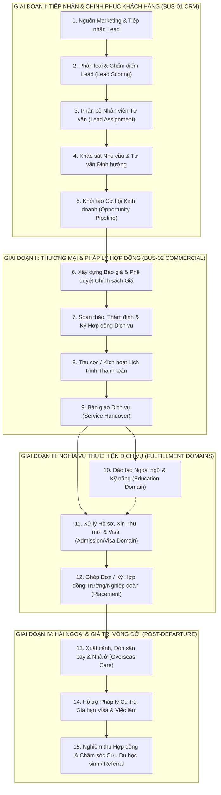
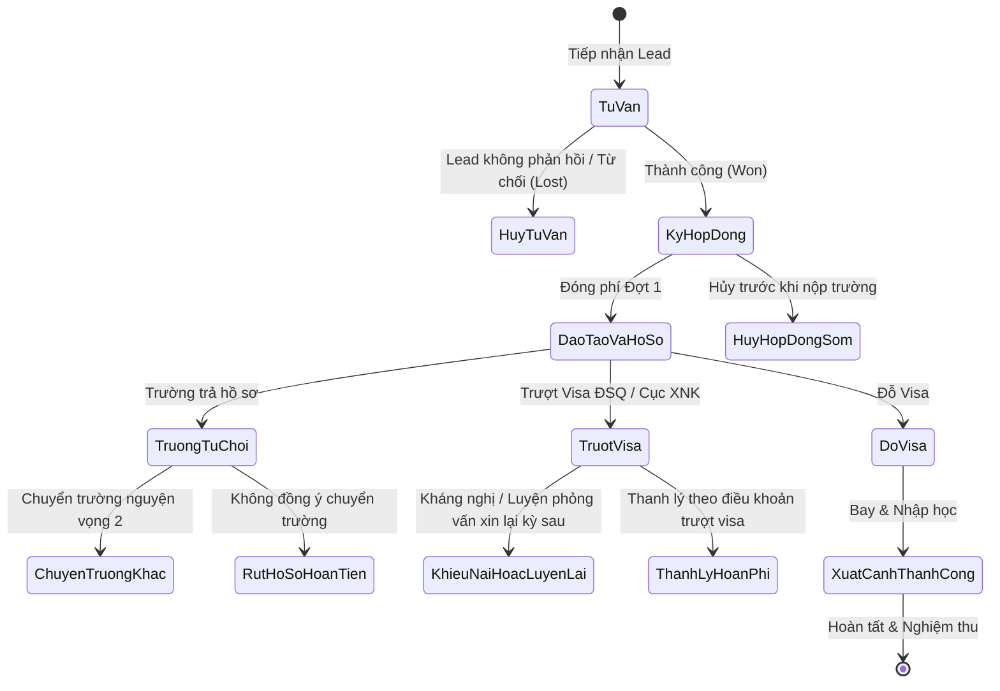

# HÀNH TRÌNH KHÁCH HÀNG TOÀN DIỆN (END-TO-END CUSTOMER JOURNEY)
Mã tài liệu: `BUS-DOC-01-02` | Phiên bản: `1.0.0` | Ngày hiệu lực: `2026-10-28`  
Phụ trách: **Senior Product Owner / Enterprise Business Analyst / Solution Architect**  
Trạng thái: `PROPOSED` (Mô hình hóa tham chiếu cho toàn bộ hệ sinh thái SHD Corp)

---

## 1. TỔNG QUAN HÀNH TRÌNH KHÁCH HÀNG (CUSTOMER LIFECYCLE OVERVIEW)

Hành trình khách hàng trong hệ sinh thái SHD Corp bắt đầu từ khi khách hàng tiềm năng tiếp cận với thương hiệu qua các chiến dịch truyền thông, trải qua quá trình tư vấn hướng nghiệp chuyên sâu, ký hợp đồng dịch vụ pháp lý, tham gia đào tạo ngoại ngữ, thẩm định hồ sơ xin visa, xuất cảnh, và được bảo trợ toàn diện tại nước ngoài cho đến khi hòa nhập cộng đồng cựu học viên.

---

## 2. CHI TIẾT CÁC CÔNG ĐOẠN NGHIỆP VỤ (STAGE-BY-STAGE SPECIFICATION)

### Công đoạn 1: Nguồn Marketing & Tiếp nhận Lead (Lead Acquisition)
- **Mục tiêu:** Thu thập thông tin ứng viên tiềm năng từ tất cả các kênh tiếp thị về một phễu dữ liệu tập trung.
- **Kênh tiếp nhận:**
  - Facebook Ads / Google Ads / TikTok Ads (Webform / Lead Form API).
  - Website chính thức (Landing page shd.edu.vn, shdkorea.com).
  - Sự kiện trực tiếp: Hội thảo du học tại các trường THPT/Đại học, Ngày hội việc làm quốc tế.
  - Mạng lưới Cộng tác viên (CTV) và Giới thiệu từ Cựu học viên (Referral).
  - Walk-in (Khách hàng đến trực tiếp văn phòng tư vấn).
- **Dữ liệu đầu vào:** Họ tên, Số điện thoại, Email (nếu có), Tỉnh/Thành phố sinh sống, Năm sinh, Trình độ học vấn hiện tại, Thị trường quan tâm (Hàn/Đức/Nhật), Kênh tiếp cận (UTM Source, Campaign ID).
- **Dữ liệu đầu ra:** Bản ghi `Crm_Leads` với mã định danh duy nhất (VD: `LEAD-202610-0089`).
- **Nghiệp vụ cốt lõi:**
  - Kiểm tra trùng lặp (Duplicate Detection): Nếu Số điện thoại đã tồn tại trong vòng 90 ngày, hợp nhất lịch sử tương tác và gắn cờ Re-engagement thay vì tạo Lead mới gây tranh chấp hoa hồng (`BR-CRM-001`).
  - Gắn nguồn nguồn gốc (Lead Source Attribution) phục vụ đo lường ROI Marketing.

### Công đoạn 2: Phân loại & Chấm điểm Lead (Lead Scoring & Qualification)
- **Mục tiêu:** Sàng lọc sơ bộ tính khả thi về điều kiện tài chính và học vấn trước khi chuyển sang tư vấn chuyên sâu.
- **Tiêu chí đánh giá:**
  - Điểm trung bình học bạ THPT (GPA): $\ge 6.5$ (Đủ điều kiện visa Hàn/Đức), $< 6.0$ (Cần đánh giá ngoại lệ).
  - Năm tốt nghiệp cấp học cao nhất: Khoảng trống (Gap year) $\le 2 - 3$ năm.
  - Vùng miền (Hộ khẩu): Nhận diện các khu vực hạn chế visa theo quy định của Đại sứ quán tại từng thời điểm.
  - Khả năng tài chính gia đình: Đủ điều kiện chứng minh sổ tiết kiệm ngân hàng (Financial solvency).
- **Kết quả:** Phân hạng Lead thành:
  - **Hot:** Nhu cầu cấp thiết, đủ điều kiện học tập và tài chính, muốn đi trong kỳ tuyển sinh gần nhất.
  - **Warm:** Có nhu cầu nhưng đang cân nhắc thời điểm hoặc cần bổ sung tài chính/ngoại ngữ.
  - **Cold:** Khảo sát thông tin chung, chưa đủ điều kiện cơ bản.
  - **Unqualified:** Sai số điện thoại, không đủ tuổi, vi phạm lệnh cấm xuất cảnh.

### Công đoạn 3: Phân bổ Nhân viên Tư vấn (Lead Assignment)
- **Mục tiêu:** Bàn giao Lead cho nhân viên tư vấn tuyển sinh (Counselor) phù hợp nhất theo thời gian thực.
- **Cơ chế phân bổ (`PROPOSED`):**
  1. *Rule-based Routing:* Phân bổ theo Thị trường (Lead quan tâm Hàn Quốc chuyển cho Team Du học Hàn Quốc).
  2. *Geo-location Routing:* Phân bổ theo Chi nhánh/Vùng miền gần nhất (Khách hàng miền Nam chuyển về Chi nhánh TP.HCM).
  3. *Round-robin Balancing:* Phân chia đều số lượng Lead cho các chuyên viên đang trực ca làm việc.
  4. *Direct Referral Assignment:* Nếu Lead do CTV chỉ định chuyên viên, ưu tiên phân bổ trực tiếp.
- **Cam kết SLA (Service Level Agreement):**
  - Lead Hot: Bắt buộc liên hệ cuộc gọi đầu tiên trong vòng **15 phút** kể từ khi nhận Lead trong giờ hành chính.
  - Lead Warm: Liên hệ trong vòng **2 giờ**.
  - Quá hạn SLA mà chuyên viên chưa cập nhật lịch sử cuộc gọi: Tự động thu hồi và phân bổ cho người khác (`BR-CRM-004`).

### Công đoạn 4: Khảo sát Nhu cầu & Tư vấn Định hướng (Consultation & Profiling)
- **Mục tiêu:** Lắng nghe nguyện vọng học tập/nghề nghiệp, đối soát điều kiện thực tế và tư vấn lộ trình học tập, tài chính tối ưu.
- **Hình thức:** Gọi điện thoại, nhắn tin Zalo Official Account, Video call Zoom hoặc gặp gỡ trực tiếp tại văn phòng.
- **Nội dung thu thập:**
  - Hồ sơ năng lực (Academic Profile): Học bạ, bằng cấp, chứng chỉ ngoại ngữ hiện có.
  - Nguyện vọng ngành nghề: Khối kỹ thuật, kinh tế, du lịch khách sạn, điều dưỡng, CNTT,...
  - Khả năng chi trả: Mức ngân sách gia đình có thể đáp ứng cho toàn bộ lộ trình.
- **Lịch sử tương tác:** Ghi nhận toàn diện nhật ký cuộc gọi (`Crm_ConsultationLogs`), ghi chú cảm xúc khách hàng, ngày hẹn tái tương tác (Follow-up Date).

### Công đoạn 5: Khởi tạo Cơ hội Kinh doanh (Opportunity Progression)
- **Mục tiêu:** Chuyển đổi Lead tiềm năng thành Cơ hội kinh doanh chính thức (Sales Opportunity) khi khách hàng thể hiện rõ ý định ký hợp đồng.
- **Điều kiện kích hoạt (Stage Gate):** Khách hàng đồng ý tham gia lộ trình chi tiết và yêu cầu báo giá cụ thể.
- **Quy trình thực hiện:**
  - Khởi tạo `Crm_Opportunities` gắn với `LeadId`.
  - Khởi tạo hoặc liên kết thực thể `Party_Parties` (Individual) trong Party 360 để quản lý định danh pháp lý duy nhất của học viên và phụ huynh.
  - Thiết lập giá trị dự kiến hợp đồng (Estimated Value), xác suất thành công (Probability %), ngày dự kiến chốt (Expected Close Date).

### Công đoạn 6: Xây dựng Báo giá & Phê duyệt Chính sách Giá (Quotation Formulation)
- **Mục tiêu:** Cung cấp cho khách hàng bảng chi phí minh bạch, chuẩn xác theo gói dịch vụ đã chọn, kèm các ưu đãi/học bổng hợp lệ.
- **Quy trình:**
  - Nhân viên tư vấn chọn Gói sản phẩm từ Danh mục Sản phẩm Doanh nghiệp (BUS-02 Product Catalog) ví dụ: *Gói Du học Hàn Quốc D4-1 Trọn gói Kỳ Mùa Thu*.
  - Hệ thống tự động bóc tách các dòng chi phí: Phí dịch vụ du học, Học phí khóa tiếng tại Việt Nam, Ký túc xá, Phí nộp visa Đại sứ quán, Vé máy bay tạm tính.
  - Áp dụng Chính sách Khuyến mại / Chiết khấu (Discount Policy): Nếu mức giảm giá vượt quá quyền hạn của nhân viên (ví dụ > 1.000.000 VNĐ đến 5.000.000 VNĐ), hệ thống tự động khởi tạo luồng phê duyệt Workflow chuyển lên Trưởng phòng hoặc Giám đốc Chi nhánh (`BR-COM-012`).
  - Xuất file Báo giá PDF chuẩn mẫu thương hiệu gửi cho khách hàng qua Zalo/Email.

### Công đoạn 7: Soạn thảo, Thẩm định & Ký Hợp đồng Dịch vụ (Contract Execution)
- **Mục tiêu:** Xác lập cam kết pháp lý ràng buộc giữa Khách hàng (Học viên & Người giám hộ/Bảo lãnh) và Pháp nhân thuộc SHD Corp.
- **Đặc thù Đa thực thể:**
  - Xác định chính xác **Pháp nhân ký kết (Contracting Legal Entity)** có giấy phép hoạt động tư vấn du học hợp pháp.
  - Xác định **Đơn vị Bán hàng (Selling Business Unit)** để tính doanh số và hoa hồng.
- **Quy trình ký:**
  - Ký trực tiếp tại cơ sở: In hợp đồng từ hệ thống theo mẫu quy chuẩn, ký tươi và đóng dấu tròn pháp nhân.
  - Ký từ xa: Gửi hợp đồng qua chuyển phát nhanh hoặc Ký hợp đồng điện tử qua xác thực OTP SMS/Zalo (e-Contract) kèm lưu vết mã băm toàn vẹn SHA256 (`Doc_Documents`).

### Công đoạn 8: Thu Cọc & Kích hoạt Lịch trình Thanh toán (Billing Inception)
- **Mục tiêu:** Thu khoản phí mở hồ sơ / cọc hợp đồng ban đầu để chính thức đưa hợp đồng vào trạng thái hiệu lực (`Active`).
- **Nghiệp vụ:**
  - Kế toán hoặc Thủ quỹ ghi nhận Phiếu thu (Payment Receipt) gắn mã tham chiếu Hợp đồng (`ContractCode`).
  - Hợp đồng chuyển trạng thái từ `Draft/PendingSignature` sang `Active / UnderFulfillment`.
  - Hệ thống tự động sinh Lịch trình Thanh toán (Payment Milestones):
    - Đợt 1: Đặt cọc mở hồ sơ và nhập học khóa tiếng (ngay khi ký).
    - Đợt 2: Nộp hồ sơ sang trường nước ngoài / Có hóa đơn học phí của trường (Invoice).
    - Đợt 3: Nhận Visa / Chuẩn bị xuất cảnh.

### Công đoạn 9: Bàn giao Dịch vụ (Service Handover)
- **Mục tiêu:** Chuyển giao thông tin học viên và nghĩa vụ hợp đồng từ Khối Kinh doanh sang các Khối Vận hành chuyên trách.
- **Nghĩa vụ phân rã:**
  - **Nghĩa vụ Đào tạo (Education Obligation):** Bàn giao học viên cho Khối Học viện để xếp lớp tiếng, cấp giáo trình, điểm danh.
  - **Nghĩa vụ Xử lý Hồ sơ (Admission & Visa Obligation):** Bàn giao danh mục giấy tờ gốc cho Chuyên viên Hồ sơ để bắt đầu dịch thuật công chứng và thẩm thực.
- **Quy tắc chuyển giao:** Chỉ kích hoạt sau khi Kế toán xác nhận học viên đã hoàn tất đóng khoản phí Đợt 1 tối thiểu theo quy định (`BR-COM-020`, `BR-COM-025`).

### Công đoạn 10: Thực hiện Đào tạo Ngoại ngữ & Kỹ năng (Education Delivery)
- Khách hàng tham gia khóa học ngoại ngữ tập trung tại cơ sở đào tạo của SHD.
- Hệ thống theo dõi điểm danh, điểm kiểm tra định kỳ, kết quả thi thử Topik/JLPT/Goethe.
- Kết quả học tập được đồng bộ về Hồ sơ Party 360 để Chuyên viên Hồ sơ nắm bắt tiến độ sẵn sàng nộp trường.

### Công đoạn 11: Xử lý Hồ sơ, Thư mời & Visa (Admission & Visa Processing)
- Tiếp nhận và lưu trữ số hóa hồ sơ gốc (Học bạ, Bằng cấp, Sổ hộ khẩu, CCCD, Sao kê tài chính).
- Nộp hồ sơ xin thư mời tới Trường đối tác (Partner School) tại nước ngoài.
- Nhận Thư mời / Hóa đơn học phí trường (Invoice) $\rightarrow$ Học viên nộp tiền học phí trực tiếp cho trường hoặc qua tài khoản chỉ định.
- Nộp hồ sơ xin Visa tại Cục Xuất nhập cảnh nước sở tại hoặc Đại sứ quán/Lãnh sự quán tại Việt Nam.
- Luyện phỏng vấn chuyên sâu 1-1 cho học viên.
- Nhận kết quả Visa.

### Công đoạn 12: Xuất cảnh, Đón Sân Bay & Nhà ở (Overseas Care Handover)
- Điều phối vé máy bay, bảo hiểm quốc tế, tập huấn trước khi bay (Pre-departure Orientation).
- Chuyển giao thông tin chuyến bay cho Văn phòng Đại diện Hải ngoại (SHD Global / Chi nhánh nước ngoài).
- Cán bộ hải ngoại đón tại sân bay, đưa về Ký túc xá / Nhà trọ, mua SIM điện thoại, hướng dẫn mở tài khoản ngân hàng và làm Thẻ cư trú (ARC).

### Công đoạn 13: Nghiệm thu Hợp đồng & Chăm sóc Cựu Du học sinh (Contract Settlement & Alumni)
- Hợp đồng dịch vụ du học được nghiệm thu hoàn thành khi học viên nhập học ổn định tại trường và hết thời hạn bảo trợ ban đầu (thường là 30 - 90 ngày sau khi nhập học).
- Học viên chuyển vai trò trong Party 360 sang `Alumni` (Cựu học viên).
- Cựu học viên được mời tham gia mạng lưới Cộng tác viên giới thiệu khóa sau (Referral) kèm chính sách hoa hồng thưởng rõ ràng.

---

## 3. NGOẠI LỆ & XỬ LÝ SỰ CỐ NGHIỆP VỤ (EXCEPTIONS & CONTINGENCY PATHS)

1. **Khách hàng xin rút hồ sơ / Hủy hợp đồng đơn phương:**
   - Căn cứ vào điều khoản hợp đồng đã ký và giai đoạn hồ sơ hiện tại.
   - Các khoản phí dịch vụ đã thực hiện (dịch thuật công chứng, nộp phí xét hồ sơ cho trường) không hoàn lại; phí đào tạo được khấu trừ theo số buổi thực tế.
   - Khởi tạo quy trình Phê duyệt Hoàn phí (`Workflow Refund Approval`) chuyển Kế toán và Giám đốc Pháp nhân ký duyệt.
2. **Trượt Visa (Visa Denial):**
   - Phân tích nguyên nhân trượt từ phiếu trả lời của Đại sứ quán (tài chính, năng lực ngôn ngữ, nghi vấn mục đích).
   - *Phương án A:* Khắc phục hồ sơ và đăng ký nộp lại vào kỳ tuyển sinh kế tiếp (kèm phụ lục hợp đồng gia hạn).
   - *Phương án B:* Hủy hợp đồng và áp dụng chính sách bảo lãnh hoàn phí theo cam kết hợp đồng (Trừ chi phí hành chính thực chi).
3. **Trường đối tác từ chối nhận học viên:**
   - Bộ phận Hồ sơ chủ động tư vấn phương án chuyển trường khác có tiêu chí phù hợp mà không thu thêm phí dịch vụ xử lý.

