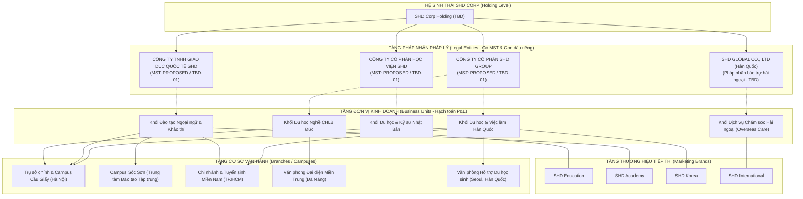
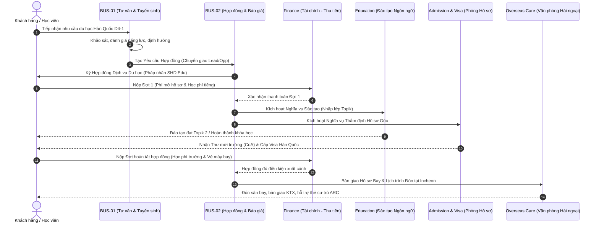

# SHD ONEERP — BỐI CẢNH DOANH NGHIỆP & CƠ CẤU HỆ SINH THÁI SHD CORP
Mã tài liệu: `BUS-DOC-01-01` | Phiên bản: `1.0.0` | Ngày hiệu lực: `2026-10-28`  
Phụ trách: **Senior Product Owner / Enterprise Business Analyst / Solution Architect**  
Trạng thái tài liệu: `PROPOSED` (Chờ phê duyệt chính thức từ Hội đồng Quản trị & PO SHD Corp)

---

## 1. TỔNG QUAN HỆ SINH THÁI SHD CORP

### 1.1. Tầm nhìn & Lĩnh vực Hoạt động
**SHD Corp** là tập đoàn giáo dục, đào tạo quốc tế và cung ứng nguồn nhân lực toàn cầu, vận hành hệ sinh thái đa lĩnh vực bao gồm:
1. **Đào tạo Ngoại ngữ & Kỹ năng nền tảng:** Tiếng Hàn (Topik 1 - 6), Tiếng Nhật (JLPT N5 - N1), Tiếng Đức, Tiếng Anh du học và kỹ năng phỏng vấn học bổng/visa.
2. **Tư vấn Du học & Du học Nghề:** Du học tiếng (D4-1), Du học chuyên ngành Cao đẳng/Đại học (D2-1, D2-2), Du học Thạc sĩ/Tiến sĩ (D2-3, D2-4), Du học nghề CHLB Đức (Ausbildung), Du học Nhật Bản và các thị trường tiềm năng khác.
3. **Kết nối Nghề nghiệp & Việc làm Quốc tế:** Chương trình thực tập sinh kỹ năng, kỹ sư chất lượng cao (E7-1 Hàn Quốc, Tokutei Ginou Nhật Bản), kết nối doanh nghiệp và nghiệp đoàn tuyển dụng quốc tế.
4. **Xử lý Hồ sơ & Dịch vụ Pháp lý Di trú:** Dịch thuật công chứng, thẩm định hồ sơ học tập/tài chính, xin thư mời nhập học (Admission Letter / Certificate of Admission - CoA), xin mã code visa, luyện phỏng vấn Đại sứ quán / Tổng Lãnh sự quán.
5. **Dịch vụ Chăm sóc Học viên Nước ngoài (Overseas Care):** Đưa đón sân bay, bố trí ký túc xá/nhà ở, quản lý sinh viên ngoại trú, giám hộ pháp lý, hỗ trợ thủ tục cư trú (Alien Registration Card - ARC), bảo hiểm y tế và hỗ trợ việc làm thêm (Part-time job).
6. **Các dịch vụ phát sinh khác:** Khảo thí ngôn ngữ, bán học liệu/giáo trình, bảo hiểm du học, vé máy bay và hỗ trợ chuyển tiền quốc tế hợp pháp.

---

## 2. KIẾN TRÚC TỔ CHỨC ĐA THỰC THỂ (MULTI-ENTITY TOPOLOGY)

Trong kiến trúc SHD OneERP, việc mô hình hóa cơ cấu doanh nghiệp phải tuân thủ nghiêm ngặt nguyên tắc tách biệt giữa **Pháp nhân pháp lý**, **Khối kinh doanh nghiệp vụ**, **Thương hiệu thương mại** và **Địa điểm cơ sở vận hành**. Tuyệt đối không được đồng nhất thương hiệu với pháp nhân khi chưa có bằng chứng pháp lý.

### 2.1. Phân định Vai trò Thực thể
1. **Legal Entity (Pháp nhân):**
   - Đơn vị có tư cách pháp nhân độc lập, mã số thuế, tài khoản ngân hàng, con dấu và báo cáo tài chính riêng.
   - Là chủ thể đứng tên trên **Hợp đồng cung cấp dịch vụ du học / đào tạo** với khách hàng (Bên B).
   - Chịu trách nhiệm pháp lý cao nhất trước pháp luật Việt Nam và pháp luật nước sở tại.
   - *Trạng thái:* `TBD-01` (Danh sách MST và tên đầy đủ đang chờ PO SHD xác nhận).
2. **Business Unit (Đơn vị Kinh doanh / Khối Nghiệp vụ):**
   - Bộ phận hạch toán nội bộ phụ trách từng dòng sản phẩm dịch vụ chiến lược (Hàn Quốc, Đức, Nhật Bản, Đào tạo Ngôn ngữ).
   - Quản lý đội ngũ tư vấn tuyển sinh, chi phí marketing và hiệu quả kinh doanh (P&L).
   - Một Business Unit có thể phối hợp dịch vụ với một Legal Entity khác thông qua cơ chế phân bổ doanh thu nội bộ (Internal Transfer Pricing).
3. **Marketing Brand (Thương hiệu Tiếp thị):**
   - Bộ nhận diện nhãn hiệu hướng tới thị trường (Fanpage, Website, Poster tuyển sinh, Hội thảo du học).
   - Ví dụ: Học viên biết đến thương hiệu *SHD Korea*, nhưng khi ký hợp đồng có thể ký với *Công ty TNHH Giáo dục Quốc tế SHD*.
4. **Branch / Campus (Chi nhánh / Cơ sở Vận hành):**
   - Địa điểm vật lý nơi tổ chức lớp học ngôn ngữ, phỏng vấn trực tiếp, thu nhận hồ sơ gốc và tổ chức sự kiện.
   - Gắn với phạm vi phân quyền dữ liệu (`ScopeBranchId`) trong nền tảng Direct GBAC v4.2.

---

## 3. CƠ CHẾ GIAO TIẾP VÀ PHÂN CHIA NGHĨA VỤ LIÊN ĐƠN VỊ (CROSS-ENTITY COOPERATION)

Trong thực tế vận hành của SHD Corp, một đơn hàng dịch vụ du học thường xuyên có sự tham gia của nhiều đơn vị:
- **Đơn vị Bán hàng (Selling Unit):** Tư vấn, chốt hợp đồng và ghi nhận doanh số tuyển sinh (ví dụ: Chi nhánh TP.HCM thuộc Khối Du học Hàn Quốc).
- **Pháp nhân Ký Hợp đồng (Contracting Legal Entity):** Đứng tên ký hợp đồng và xuất hóa đơn dịch vụ (ví dụ: Công ty TNHH Giáo dục Quốc tế SHD).
- **Đơn vị Thực hiện Đào tạo (Language Training Fulfillment Unit):** Trung tâm đào tạo tiếng tại Cơ sở Sóc Sơn (Hà Nội).
- **Đơn vị Xử lý Visa (Dossier & Visa Processing Unit):** Phòng Hồ sơ chuyên trách thẩm định và nộp Đại sứ quán.
- **Đơn vị Bảo trợ Nước ngoài (Overseas Care Unit):** Văn phòng đại diện tại Seoul (Hàn Quốc) lo thủ tục đón sân bay và thuê nhà.

---

## 4. MA TRẬN BẰNG CHỨNG XÁC THỰC (EVIDENCE & CONFIRMATION MATRIX)

| Mã Hạng Mục | Nội dung Nghiệp vụ | Nguồn Căn cứ (Source) | Đánh giá Hiện trạng | Trạng thái Phê duyệt |
|---|---|---|---|---|
| `EV-01` | Nền tảng Đa pháp nhân (Legal Entity, BU, Branch) | Migration `20261025_0003_OrganizationSchema.sql`, `Org_LegalEntities` | Đã có sẵn cấu trúc DB và CRUD API | `VERIFIED` |
| `EV-02` | Định danh Chủ thể Dùng chung Party 360 | Migration `20261025_0004_Party360Schema.sql`, `Party_Parties` | Đã có sẵn mô hình Person, Org, Role, Contact | `VERIFIED` |
| `EV-03` | Quản lý Phân quyền Direct GBAC v4.2 & Data Scope | Migration `20261025_0002_IdentityAndAuthorizationSchema.sql` | Scope: Global, LegalEntity, BU, Branch, Self | `VERIFIED` |
| `EV-04` | Máy trạng thái Phê duyệt Đa cấp (Workflow Engine) | Migration `20261027_0013_WorkflowEngineAndOutboxEnhancement.sql` | `Wf_Definitions`, `Wf_Instances`, `Wf_History` | `VERIFIED` |
| `EV-05` | Transactional Outbox Pattern cho Sự kiện Miền | `System_OutboxMessages`, `AuditSaveChangesInterceptor` | Cơ chế Outbox bất đồng bộ và chống trùng lặp | `VERIFIED` |
| `EV-06` | Danh sách Pháp nhân, MST và Địa chỉ Trụ sở thực tế | Chưa có tài liệu pháp lý chính thức từ SHD Corp | Đang dùng dữ liệu mẫu minh họa | `TBD — Cần PO cung cấp` |
| `EV-07` | Quy chế Phân chia Doanh thu & Hạch toán Nội bộ (Transfer Pricing) | Chưa có quy chế tài chính tập đoàn | Cần họp thống nhất với Kế toán trưởng | `TBD — Chờ Kế toán trưởng` |
| `EV-08` | Mức trần Chiết khấu / Giảm giá theo Cấp bậc Quản lý | Chưa có ma trận thẩm quyền duyệt giá | Đề xuất khung tạm thời trong BRD | `PROPOSED` |
| `EV-09` | Quy định Ký số điện tử (E-Signature) cho Hợp đồng Du học | Khách hàng là học viên / phụ huynh ở xa | Đề xuất giải pháp ký OTP SMS/Zalo hoặc VNPT SmartCA | `PROPOSED` |
| `EV-10` | Quy chuẩn Bảo vệ Dữ liệu Cá nhân Học viên (Nghị định 13/2023) | CCCD, Hộ chiếu, Học bạ, Tài khoản ngân hàng | Che giấu hiển thị (Masking) + Audit log truy cập | `PROPOSED` |

