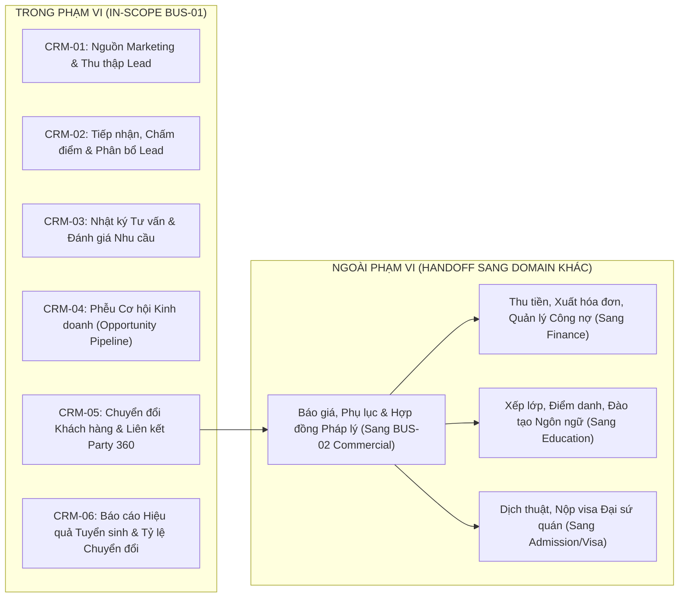

# TÀI LIỆU YÊU CẦU NGHIỆP VỤ — PHÂN HỆ CRM & TUYỂN SINH (BUS-01)
Mã tài liệu: `BUS-DOC-02-01` | Phiên bản: `1.0.0` | Ngày hiệu lực: `2026-10-28`  
Phụ trách: **Senior Product Owner / Enterprise Business Analyst / Solution Architect**  
Mã Module: `CRM` | Tên Module: **Quản trị Quan hệ Khách hàng & Tuyển sinh Toàn Hệ sinh thái**  
Trạng thái: `PROPOSED` (Sẵn sàng cho thẩm định và phát triển vertical slice)

---

## 1. MỤC TIÊU & TẦM NHÌN CHIẾN LƯỢC

### 1.1. Bối cảnh & Vấn đề Cần Giải Quyết
Trước khi triển khai SHD OneERP, các đơn vị thành viên của SHD Corp (SHD Education, SHD Academy, SHD Korea, v.v.) hoạt động với các công cụ quản lý khách hàng phân tán (Google Sheets, Zalo cá nhân, các phần mềm CRM bán lẻ rời rạc). Điều này dẫn đến các vấn đề nghiêm trọng:
1. **Thất thoát & Tranh chấp Khách hàng:** Một số điện thoại học viên được nhiều nhân viên của các thương hiệu khác nhau cùng tiếp cận và tư vấn chồng chéo, gây bức xúc cho phụ huynh và tranh chấp hoa hồng nội bộ.
2. **Thiếu Tích hợp Định danh (Party 360):** Khi học viên đồng ý đăng ký, thông tin phải nhập lại từ đầu vào hồ sơ đào tạo và hợp đồng, gây sai lệch thông tin cá nhân và số CCCD.
3. **Không Đo lường được Hiệu quả Marketing (ROI):** Không truy vết được học viên ký hợp đồng du học thực tế đến từ chiến dịch quảng cáo Facebook, kênh Google hay từ mạng lưới cựu học viên giới thiệu.
4. **Vi phạm SLA Tư vấn Tuyển sinh:** Tỷ lệ bỏ sót Lead nóng (Lead chưa được gọi sau 24h) cao do thiếu cơ chế tự động phân bổ và cảnh báo vi phạm thời gian cam kết.

### 1.2. Mục tiêu Nghiệp vụ của BUS-01
- **Tập trung hóa Dữ liệu Lead Toàn Hệ sinh thái:** 100% khách hàng tiềm năng từ mọi nguồn tiếp thị được thu thập về một phễu dữ liệu duy nhất, quản lý phân quyền theo chi nhánh và khối kinh doanh.
- **Tự động hóa Tiếp nhận & Chống Trùng lặp Thông minh:** Nhận diện trùng số điện thoại trong cửa sổ 60 ngày, hợp nhất lịch sử tương tác và ghi nhận đa nguồn tiếp thị (Multi-touch attribution).
- **Phân bổ Tối ưu & Kiểm soát SLA:** Phân bổ Lead theo ca trực, thị trường và địa bàn; cảnh báo hoặc tự động thu hồi Lead nếu tư vấn viên không liên hệ trong vòng 15 phút (Lead Hot).
- **Chuyển giao Liền mạch Sang Báo giá & Hợp đồng (BUS-02):** Chuyển đổi Lead đủ điều kiện thành Opportunity và liên kết trực tiếp với hồ sơ Party 360, cho phép tạo Báo giá/Hợp đồng chỉ bằng một thao tác click chuột.
- **Tuân thủ Tuyệt đối Quy định Bảo mật Dữ liệu:** Che giấu (masking) thông tin nhạy cảm của học viên chưa ký hợp đồng theo tinh thần Nghị định 13/2023/NĐ-CP.

---

## 2. PHẠM VI NGHIỆP VỤ (SCOPE OF DOMAIN)

---

## 3. CHI TIẾT CÁC PHÂN HỆ NGHIỆP VỤ (CAPABILITY BREAKDOWN)

### CRM-01: Quản lý Nguồn Tiếp thị & Thu thập Lead (Marketing Source & Lead Acquisition)
- **Quản lý Nguồn Tiếp thị (Marketing Sources):** Phân cấp nguồn khách hàng:
  - Nguồn cấp 1 (Kênh): `Digital Ads`, `Website/SEO`, `Offline Event`, `School Workshop`, `Referral/CTV`, `Walk-in`.
  - Nguồn cấp 2 (Chi tiết): `Facebook Fanpage SHD Korea`, `Google Search Campaign Sep2026`, `Hội thảo THPT Chuyên Sư Phạm`, `TikTok Live`.
- **Chiến dịch Marketing (Marketing Campaigns):** Thiết lập chiến dịch tuyển sinh kèm mã UTM, ngân sách dự kiến, thời gian hiệu lực và mục tiêu số lượng Lead.
- **Lead Ingestion API & Webhook:** Tiếp nhận dữ liệu tự động từ Landing page, Facebook Lead Ads Webhook và Google Webhook.
- **Lead Batch Import:** Hỗ trợ nhập danh sách dữ liệu học viên từ file Excel (sau các đợt hội thảo tại trường cấp 3), tự động kiểm tra định dạng số điện thoại, bắt lỗi trùng lặp trước khi commit vào database.
- **Lead Duplicate Detection & Attribution:** Nhận diện trùng lặp dựa trên Số điện thoại (chính) và Email (phụ). Lưu vết toàn bộ các lần chạm (Touchpoints) để báo cáo chính xác nguồn nào mang lại Lead đầu tiên (First-touch) và nguồn nào chốt đơn (Last-touch).

### CRM-02: Quản lý & Phân bổ Khách hàng Tiềm năng (Lead Management & Routing)
- **Tiếp nhận & Chuẩn hóa Dữ liệu:** Chuẩn hóa họ tên tiếng Việt (viết hoa chữ cái đầu), định dạng số điện thoại chuẩn E.164 (`+84...` hoặc `0...`), định danh tỉnh thành cư trú.
- **Phân loại & Chấm điểm (Lead Scoring):** Đánh giá tính khả thi theo các tiêu chí: GPA, năm trống, độ tuổi, tài chính gia đình $\rightarrow$ Gán nhãn `Hot`, `Warm`, `Cold`.
- **Cơ chế Phân bổ (Routing Engine):**
  - Phân bổ theo Thị trường quan tâm (Hàn / Đức / Nhật) đến đúng Khối Kinh doanh tương ứng.
  - Phân bổ theo Địa lý (Chi nhánh Hà Nội, TP.HCM, Đà Nẵng).
  - Phân bổ xoay vòng công bằng (Round-robin) giữa các tư vấn viên trong cùng chi nhánh/nhóm.
  - Phân bổ trực tiếp cho tư vấn viên theo mã CTV chỉ định.
- **Quản lý Thời hạn Phản hồi (SLA Response Monitoring):** Đồng hồ đếm ngược thời gian phản hồi. Cảnh báo cấp quản lý khi vi phạm SLA. Tự động thu hồi Lead đưa vào Lead Pool nếu chuyên viên không thực hiện tương tác trong thời gian quy định.

### CRM-03: Quản lý Hoạt động Tư vấn (Consultation Management)
- **Lập kế hoạch & Lịch hẹn Tư vấn:** Đặt lịch gọi điện, lịch gặp trực tiếp tại văn phòng hoặc buổi tư vấn online qua Zoom/Google Meet.
- **Nhật ký Tương tác (Consultation Logs):** Ghi nhận chi tiết kết quả cuộc gọi:
  - Kết quả tương tác: `Connected - Interested`, `Busy - Call Later`, `No Answer`, `Wrong Number`, `Not Interested`.
  - Ghi chú nội dung trao đổi: Nguyện vọng học tập, băn khoăn của phụ huynh, rào cản tài chính.
- **Đánh giá Nhu cầu Chi tiết (Needs Assessment Questionnaire):** Bảng khảo sát chuẩn hóa bao gồm: nguyện vọng trường, chuyên ngành dự kiến, khả năng học tiếng tại Việt Nam, điều kiện ký túc xá.
- **Theo dõi & Nhắc hẹn (Follow-up Reminders):** Cảnh báo danh sách khách hàng cần gọi lại trong ngày trên màn hình làm việc cá nhân của tư vấn viên.

### CRM-04: Quản lý Cơ hội Kinh doanh (Opportunity & Sales Pipeline)
- **Khởi tạo Opportunity:** Chuyển trạng thái khi khách hàng xác nhận lộ trình cụ thể và yêu cầu báo giá.
- **Quản lý Phễu Bán hàng (Sales Pipeline Stages):**
  1. `Discovery` (Tìm hiểu chi tiết): Đang thẩm định hồ sơ học tập và tài chính.
  2. `ValueProposition` (Đề xuất lộ trình): Đã gửi lộ trình chương trình và thông tin trường đối tác.
  3. `ProposalSent` (Gửi báo giá): Đã gửi báo giá chi tiết, đang chờ phụ huynh cân nhắc.
  4. `Negotiation` (Thương lượng điều khoản): Thảo luận về ưu đãi, điều khoản hợp đồng hoặc phương thức thanh toán.
  5. `ClosedWon` (Thành công): Đã ký hợp đồng và nộp tiền cọc đợt 1.
  6. `ClosedLost` (Thất bại): Khách hàng từ chối hoặc chọn trung tâm khác.
- **Phân tích Nguyên nhân Thất bại (Lost Reason Analysis):** Bắt buộc chọn lý do thất bại (Ví dụ: *Chi phí cao*, *Không đủ điều kiện tài chính*, *Gia đình đổi kế hoạch*, *Chọn đối thủ cạnh tranh*, *Trượt kỳ tuyển sinh*).

### CRM-05: Chuyển đổi Khách hàng & Tích hợp Party 360 (Customer Conversion)
- **Định danh Duy nhất (Party 360 Linking):** Khi chuyển đổi cơ hội thành công, hệ thống tự động kiểm tra xem khách hàng đã có trong bảng `Party_Parties` chưa. Nếu chưa có, tạo bản ghi Party mới (Type `Person`), mở rộng `Party_Persons`, gán Role `Student` và liên kết quan hệ phụ huynh (`Parent`).
- **Khởi tạo Yêu cầu Hợp đồng (Trigger Commercial Contract):** Tự động chuyển toàn bộ dữ liệu ứng viên, gói dịch vụ đã chọn và giá trị dự kiến sang phân hệ Hợp đồng (BUS-02) mà không cần nhập lại dữ liệu.

### CRM-06: Báo cáo & Phân tích Hiệu suất Tuyển sinh (Sales Analytics)
- **Tỷ lệ Chuyển đổi (Conversion Funnel):** Đo lường tỷ lệ chuyển đổi qua từng giai đoạn: $Lead \rightarrow Qualified \rightarrow Opportunity \rightarrow Closed Won$.
- **Hiệu quả Kênh Tiếp thị (Campaign ROI):** Báo cáo số lượng Lead, chi phí trên mỗi Lead (CPL), số hợp đồng thành công và doanh thu mang lại theo từng chiến dịch.
- **Hiệu suất Tư vấn viên (Counselor Performance):** Báo cáo số cuộc gọi thực hiện, thời gian phản hồi trung bình (Average Response Time), tỷ lệ chốt đơn và doanh số lũy kế theo tháng của từng cá nhân/nhóm.

---

## 4. MA TRẬN PHÂN LOẠI CHỨC NĂNG THEO LỘ TRÌNH (MVP vs FUTURE)

| Mã Chức Năng | Tên Tính Năng | Phân Loại | Lý Do Phân Bổ |
|---|---|:---:|---|
| `CRM-01.1` | Quản lý Nguồn Tiếp thị & Chiến dịch cơ bản | **MVP** | Cần thiết để ghi nhận nguồn gốc Lead ngay từ ngày đầu |
| `CRM-01.2` | Tiếp nhận Lead thủ công & Excel Import | **MVP** | Đảm bảo nhập dữ liệu cho tư vấn viên và sự kiện |
| `CRM-01.3` | Lead Ingestion API / Webhook (Facebook/Google) | **MVP** | Tự động hóa tiếp nhận khách hàng từ quảng cáo số |
| `CRM-01.4` | Tự động phát hiện & Chặn trùng lặp Lead (60 ngày) | **MVP** | Ngăn chặn mâu thuẫn tranh chấp hoa hồng nội bộ |
| `CRM-02.1` | Phân loại & Chấm điểm Lead (Hot/Warm/Cold) | **MVP** | Giúp tư vấn viên tập trung vào khách hàng tiềm năng cao |
| `CRM-02.2` | Phân bổ Round-robin theo Thị trường & Chi nhánh | **MVP** | Đảm bảo công bằng và tốc độ xử lý tuyển sinh |
| `CRM-02.3` | Giám sát SLA & Cảnh báo quá hạn cuộc gọi | **MVP** | Duy trì chất lượng dịch vụ khách hàng |
| `CRM-02.4` | AI Routing (Tự động gán cho tư vấn viên có tỷ lệ chốt cao nhất) | *Future* | Yêu cầu lượng dữ liệu lịch sử lớn để huấn luyện mô hình |
| `CRM-03.1` | Ghi nhận Nhật ký Cuộc gọi & Lịch sử tương tác | **MVP** | Bắt buộc để kiểm soát tiến độ chăm sóc khách hàng |
| `CRM-03.2` | Đặt lịch hẹn & Cảnh báo nhắc việc tư vấn viên | **MVP** | Hỗ trợ tư vấn viên không bỏ sót khách hàng |
| `CRM-03.3` | Tích hợp Tổng đài Ảo (VoIP / Click-to-Call & Ghi âm) | *Phase 2* | Phụ thuộc vào đấu nối nhà mạng viễn thông |
| `CRM-04.1` | Quản lý Phễu Cơ hội Kinh doanh (Opportunity Kanban) | **MVP** | Trực quan hóa tiến độ chốt hợp đồng cho cấp quản lý |
| `CRM-04.2` | Bắt buộc ghi nhận Lý do Thất bại (Lost Reason) | **MVP** | Phục vụ cải tiến chất lượng sản phẩm và đào tạo tư vấn |
| `CRM-05.1` | Tự động đồng bộ Party 360 & Tạo Yêu cầu Hợp đồng | **MVP** | Khâu bản lề kết nối BUS-01 và BUS-02 |
| `CRM-06.1` | Dashboard Phễu Tuyển sinh & Báo cáo Doanh số cơ bản | **MVP** | Phục vụ điều hành hàng ngày của Trưởng phòng & Giám đốc |
| `CRM-06.2` | Phân tích Đa điểm chạm (Multi-touch Attribution AI) | *Future* | Bổ sung khi hệ sinh thái tích hợp dữ liệu hành vi website |

