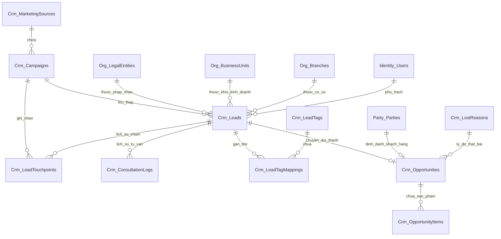

# MÔ HÌNH DỮ LIỆU CHI TIẾT — PHÂN HỆ CRM (CRM DATA MODEL)
Mã tài liệu: `BUS-DOC-02-06` | Phiên bản: `1.0.0` | Ngày hiệu lực: `2026-10-28`  
Phụ trách: **Senior Product Owner / Enterprise Business Analyst / Solution Architect**  
Kiến trúc: **Clean Architecture + CQRS (EF Core Write-side / Stored Procedures Read-side)**

---

## 1. SƠ ĐỒ THỰC THỂ QUAN HỆ CRM (CRM ERD)



---

## 2. TỪ ĐIỂN DỮ LIỆU BẢNG GHI (TABLE DATA DICTIONARY)

### 2.1. Bảng `Crm_MarketingSources` (Nguồn Tiếp thị Phân cấp)
Lưu trữ danh mục nguồn tiếp thị khách hàng (Facebook Ads, Google, Sự kiện trường học, Giới thiệu...).

| Tên Cột | Kiểu Dữ Liệu | Ràng Buộc | Ý Nghĩa Nghiệp Vụ |
|---|---|---|---|
| `Id` | `UNIQUEIDENTIFIER` | PK, NOT NULL | Khóa chính duy nhất. |
| `Code` | `NVARCHAR(50)` | UQ, NOT NULL | Mã nguồn chuẩn hóa (VD: `FACEBOOK_ADS`, `GOOGLE_SEARCH`, `OFFLINE_EVENT`). |
| `Name` | `NVARCHAR(150)` | NOT NULL | Tên hiển thị nguồn tiếp thị. |
| `ParentSourceId` | `UNIQUEIDENTIFIER` | FK, NULL | Trỏ tới nguồn cha (hỗ trợ phân cấp nhóm nguồn). |
| `ChannelType` | `NVARCHAR(50)` | NOT NULL | Loại kênh: `Digital`, `Offline`, `Referral`, `Direct`. |
| `IsActive` | `BIT` | NOT NULL, DEFAULT 1 | Cờ kích hoạt sử dụng. |
| `CreatedAtUtc` | `DATETIME2(7)` | NOT NULL | Thời điểm tạo bản ghi. |

### 2.2. Bảng `Crm_Campaigns` (Chiến dịch Tuyển sinh)
Quản lý các chiến dịch marketing tuyển sinh theo mùa hoặc theo sự kiện.

| Tên Cột | Kiểu Dữ Liệu | Ràng Buộc | Ý Nghĩa Nghiệp Vụ |
|---|---|---|---|
| `Id` | `UNIQUEIDENTIFIER` | PK, NOT NULL | Khóa chính chiến dịch. |
| `SourceId` | `UNIQUEIDENTIFIER` | FK, NOT NULL | Trỏ tới `Crm_MarketingSources(Id)`. |
| `Code` | `NVARCHAR(50)` | UQ, NOT NULL | Mã chiến dịch (VD: `CAMP_KR_AUTUMN_2026`). |
| `Name` | `NVARCHAR(200)` | NOT NULL | Tên chiến dịch tuyển sinh. |
| `TargetMarket` | `NVARCHAR(50)` | NOT NULL | Thị trường mục tiêu: `Korea`, `Germany`, `Japan`, `General`. |
| `BudgetAmount` | `DECIMAL(18,2)` | NULL | Ngân sách dự kiến phân bổ cho chiến dịch. |
| `StartDateUtc` | `DATETIME2(7)` | NOT NULL | Ngày bắt đầu chiến dịch. |
| `EndDateUtc` | `DATETIME2(7)` | NULL | Ngày kết thúc chiến dịch. |
| `Status` | `NVARCHAR(30)` | NOT NULL | Trạng thái: `Draft`, `Active`, `Paused`, `Completed`. |
| `RowVersion` | `ROWVERSION` | NOT NULL | Khóa lạc quan chống xung đột đồng thời. |

### 2.3. Bảng `Crm_Leads` (Khách hàng Tiềm năng)
Thực thể trung tâm quản trị toàn bộ ứng viên trước khi chuyển đổi thành hợp đồng.

| Tên Cột | Kiểu Dữ Liệu | Ràng Buộc | Ý Nghĩa Nghiệp Vụ |
|---|---|---|---|
| `Id` | `UNIQUEIDENTIFIER` | PK, NOT NULL | Khóa chính Lead. |
| `LeadCode` | `NVARCHAR(30)` | UQ, NOT NULL | Mã hiển thị khách hàng (VD: `LD-202610-00123`). |
| `FullName` | `NVARCHAR(150)` | NOT NULL | Họ và tên khách hàng tiềm năng. |
| `PhoneNumber` | `NVARCHAR(20)` | NOT NULL, INDEX | Số điện thoại chuẩn E.164 (Khóa phát hiện trùng lặp). |
| `Email` | `NVARCHAR(150)` | NULL | Hòm thư điện tử. |
| `DateOfBirth` | `DATE` | NULL | Ngày sinh học viên. |
| `Gender` | `NVARCHAR(10)` | NULL | Giới tính: `Male`, `Female`, `Other`. |
| `ProvinceCode` | `NVARCHAR(20)` | NULL | Mã tỉnh/thành phố cư trú (VD: `HN`, `HCM`, `DN`). |
| `HighSchoolGpa` | `DECIMAL(4,2)` | NULL | Điểm trung bình học bạ THPT (để chấm điểm). |
| `GraduationYear` | `INT` | NULL | Năm tốt nghiệp cấp học gần nhất. |
| `TargetProgram` | `NVARCHAR(50)` | NOT NULL | Chương trình quan tâm: `Korea_D4`, `Korea_D2`, `Germany_Vocational`, `Japan`. |
| `LeadScore` | `INT` | NOT NULL, DEFAULT 0| Điểm đánh giá tiềm năng ($0 - 100$). |
| `PriorityTier` | `NVARCHAR(20)` | NOT NULL | Phân hạng ưu tiên: `Hot`, `Warm`, `Cold`. |
| `Status` | `NVARCHAR(30)` | NOT NULL, INDEX | Trạng thái vòng đời: `New`, `Assigned`, `Contacted`, `Qualified`, `Converted`, `Disqualified`, `Lost`, `Recycled`. |
| `CampaignId` | `UNIQUEIDENTIFIER` | FK, NULL | Trỏ tới chiến dịch tiếp nhận đầu tiên. |
| `ReferralPartyId` | `UNIQUEIDENTIFIER` | FK, NULL | Trỏ tới CTV / Cựu học viên giới thiệu (`Party_Parties`). |
| `ScopeLegalEntityId`| `UNIQUEIDENTIFIER`| FK, NOT NULL | Pháp nhân sở hữu Lead. |
| `ScopeBusinessUnitId`| `UNIQUEIDENTIFIER`| FK, NOT NULL | Khối kinh doanh phụ trách (VD: Khối Du học Hàn Quốc). |
| `ScopeBranchId` | `UNIQUEIDENTIFIER` | FK, NULL | Chi nhánh quản lý tiếp nhận. |
| `AssignedToUserId`| `UNIQUEIDENTIFIER` | FK, NULL | Nhân viên tư vấn được phân bổ phụ trách. |
| `AssignedAtUtc` | `DATETIME2(7)` | NULL | Thời điểm phân bổ cho nhân viên. |
| `SlaDeadlineUtc` | `DATETIME2(7)` | NULL | Thời hạn tối đa phải thực hiện cuộc gọi đầu tiên. |
| `FirstContactedAtUtc`|`DATETIME2(7)` | NULL | Thời điểm thực tế nhân viên liên hệ lần đầu. |
| `IsSlaBreached` | `BIT` | NOT NULL, DEFAULT 0| Cờ đánh dấu vi phạm thời gian cam kết SLA. |
| `LastInteractedAtUtc`|`DATETIME2(7)` | NOT NULL | Thời điểm tương tác gần nhất (để tính cửa sổ 60 ngày). |
| `TouchpointCount` | `INT` | NOT NULL, DEFAULT 1| Số lần khách hàng điền form hoặc tương tác lại. |
| `ConvertedPartyId`| `UNIQUEIDENTIFIER`| FK, NULL | Trỏ tới Party Master khi đã chốt hợp đồng. |
| `IsDeleted` | `BIT` | NOT NULL, DEFAULT 0| Cờ xóa mềm (Soft Delete). |
| `CreatedAtUtc` | `DATETIME2(7)` | NOT NULL | Thời điểm tạo Lead. |
| `CreatedByUserId` | `UNIQUEIDENTIFIER` | NULL | Người nhập Lead (nếu nhập tay). |
| `RowVersion` | `ROWVERSION` | NOT NULL | Concurrency token. |

### 2.4. Bảng `Crm_LeadTouchpoints` (Lịch sử Đa Điểm Chạm)
Ghi nhận toàn bộ các lần khách hàng tương tác với các kênh truyền thông của SHD Corp (Multi-touch Attribution).

| Tên Cột | Kiểu Dữ Liệu | Ràng Buộc | Ý Nghĩa Nghiệp Vụ |
|---|---|---|---|
| `Id` | `UNIQUEIDENTIFIER` | PK, NOT NULL | Khóa chính. |
| `LeadId` | `UNIQUEIDENTIFIER` | FK, NOT NULL | Trỏ tới `Crm_Leads(Id)`. |
| `CampaignId` | `UNIQUEIDENTIFIER` | FK, NULL | Trỏ tới `Crm_Campaigns(Id)`. |
| `UtmSource` | `NVARCHAR(100)` | NULL | Nguồn tiếp thị UTM Source. |
| `UtmMedium` | `NVARCHAR(100)` | NULL | Kênh truyền thông UTM Medium. |
| `FormPayloadJson` | `NVARCHAR(MAX)` | NULL | Lưu trữ toàn bộ dữ liệu form gốc khách hàng đã submit. |
| `IpAddress` | `NVARCHAR(50)` | NULL | Địa chỉ IP của người dùng. |
| `OccurredAtUtc` | `DATETIME2(7)` | NOT NULL | Thời điểm ghi nhận tương tác. |

### 2.5. Bảng `Crm_ConsultationLogs` (Nhật ký Tư vấn & Tương tác)
Lưu vết từng cuộc gọi, tin nhắn, buổi gặp trực tiếp giữa tư vấn viên và phụ huynh/học viên.

| Tên Cột | Kiểu Dữ Liệu | Ràng Buộc | Ý Nghĩa Nghiệp Vụ |
|---|---|---|---|
| `Id` | `UNIQUEIDENTIFIER` | PK, NOT NULL | Khóa chính nhật ký. |
| `LeadId` | `UNIQUEIDENTIFIER` | FK, NOT NULL | Trỏ tới `Crm_Leads(Id)`. |
| `CounselorUserId` | `UNIQUEIDENTIFIER` | FK, NOT NULL | Tư vấn viên thực hiện. |
| `ContactMethod` | `NVARCHAR(50)` | NOT NULL | Phương thức: `PhoneCall`, `ZaloMessage`, `DirectMeeting`, `VideoCall`. |
| `CallOutcome` | `NVARCHAR(50)` | NOT NULL | Kết quả: `Connected_Interested`, `Busy_CallLater`, `NoAnswer`, `WrongNumber`, `NotInterested`. |
| `DurationSeconds` | `INT` | NULL | Thời lượng cuộc gọi (giây). |
| `Notes` | `NVARCHAR(2000)`| NOT NULL | Nội dung tóm tắt buổi tư vấn, ghi chú nguyện vọng học viên. |
| `FollowUpDateUtc` | `DATETIME2(7)` | NULL | Ngày hẹn liên hệ lại tiếp theo. |
| `NextAction` | `NVARCHAR(100)` | NULL | Hành động tiếp theo: `SendBrochure`, `InviteToCampus`, `SubmitContract`. |
| `CreatedAtUtc` | `DATETIME2(7)` | NOT NULL | Thời điểm lập nhật ký. |

### 2.6. Bảng `Crm_Opportunities` (Cơ hội Kinh doanh / Phễu Tuyển sinh)
Quản trị cơ hội bán hàng đã được xác thực nhu cầu và chuẩn bị lập báo giá, hợp đồng.

| Tên Cột | Kiểu Dữ Liệu | Ràng Buộc | Ý Nghĩa Nghiệp Vụ |
|---|---|---|---|
| `Id` | `UNIQUEIDENTIFIER` | PK, NOT NULL | Khóa chính Cơ hội. |
| `OpportunityCode`| `NVARCHAR(30)` | UQ, NOT NULL | Mã cơ hội (VD: `OPP-202610-00045`). |
| `LeadId` | `UNIQUEIDENTIFIER` | FK, NOT NULL | Trỏ tới `Crm_Leads(Id)`. |
| `PartyId` | `UNIQUEIDENTIFIER` | FK, NULL | Trỏ tới `Party_Parties(Id)` (khi đã định danh). |
| `Title` | `NVARCHAR(200)` | NOT NULL | Tên cơ hội (VD: `Hồ sơ du học Hàn Quốc kỳ T9/2026 - Nguyễn Văn A`). |
| `Stage` | `NVARCHAR(50)` | NOT NULL, INDEX | Giai đoạn phễu: `Discovery`, `ValueProposition`, `ProposalSent`, `Negotiation`, `ClosedWon`, `ClosedLost`. |
| `ProbabilityPercent`|`INT` | NOT NULL | Xác suất thành công ($10, 25, 50, 75, 100, 0$). |
| `EstimatedValue` | `DECIMAL(18,2)` | NOT NULL | Giá trị dự kiến của hợp đồng (VNĐ). |
| `ExpectedCloseDate`|`DATE` | NOT NULL | Ngày dự kiến chốt hợp đồng. |
| `TargetIntake` | `NVARCHAR(20)` | NOT NULL | Kỳ tuyển sinh mục tiêu (VD: `2026-Q3`, `2027-Q1`). |
| `OwnerUserId` | `UNIQUEIDENTIFIER` | FK, NOT NULL | Nhân viên tư vấn sở hữu cơ hội. |
| `ScopeLegalEntityId`|`UNIQUEIDENTIFIER`| FK, NOT NULL | Pháp nhân dự kiến ký hợp đồng. |
| `ScopeBusinessUnitId`|`UNIQUEIDENTIFIER`| FK, NOT NULL | Khối kinh doanh quản lý cơ hội. |
| `ScopeBranchId` | `UNIQUEIDENTIFIER` | FK, NULL | Chi nhánh vận hành. |
| `LostReasonId` | `UNIQUEIDENTIFIER` | FK, NULL | Trỏ tới `Crm_LostReasons(Id)` khi ở trạng thái `ClosedLost`. |
| `LostReasonNotes`| `NVARCHAR(1000)`| NULL | Diễn giải chi tiết lý do thất bại. |
| `ClosedAtUtc` | `DATETIME2(7)` | NULL | Thời điểm đóng cơ hội (Thành công hoặc Thất bại). |
| `IsDeleted` | `BIT` | NOT NULL, DEFAULT 0| Cờ xóa mềm. |
| `RowVersion` | `ROWVERSION` | NOT NULL | Concurrency token. |

---

## 3. THIẾT KẾ STORED PROCEDURES ĐỌC DỮ LIỆU HIỆU NĂNG CAO (READ-SIDE CQRS)

Theo nguyên tắc **ADR-002**, toàn bộ thao tác truy vấn danh sách phân trang và báo cáo bắt buộc phải thông qua Stored Procedures tối ưu hóa execution plan.

### 3.1. Stored Procedure: `sp_Crm_Lead_GetPagedList` (Fail-Closed Security & Direct GBAC v4.2)
```sql
CREATE OR ALTER PROCEDURE [dbo].[sp_Crm_Lead_GetPagedList]
    @SearchTerm NVARCHAR(100) = NULL,
    @Status NVARCHAR(30) = NULL,
    @PriorityTier NVARCHAR(20) = NULL,
    @AssignedToUserId UNIQUEIDENTIFIER = NULL,
    @ScopeLegalEntityId UNIQUEIDENTIFIER = NULL,
    @ScopeBusinessUnitId UNIQUEIDENTIFIER = NULL,
    @ScopeBranchId UNIQUEIDENTIFIER = NULL,
    @IsSlaBreached BIT = NULL,
    @PageIndex INT = 1,
    @PageSize INT = 20,
    @SortColumn NVARCHAR(50) = 'CreatedAtUtc',
    @SortDirection NVARCHAR(4) = 'DESC',
    @RequestingUserId UNIQUEIDENTIFIER = NULL,
    @TotalCount INT = 0 OUTPUT
AS
BEGIN
    SET NOCOUNT ON;

    -- FAIL-CLOSED CHECK 1: Yêu cầu bắt buộc @RequestingUserId
    IF @RequestingUserId IS NULL
    BEGIN
        SET @TotalCount = 0;
        SELECT TOP 0 
            CAST(NULL AS UNIQUEIDENTIFIER) AS [Id],
            CAST(NULL AS NVARCHAR(50)) AS [LeadCode],
            CAST(NULL AS NVARCHAR(150)) AS [FullName],
            CAST(NULL AS NVARCHAR(50)) AS [PhoneNumber],
            CAST(NULL AS NVARCHAR(150)) AS [Email],
            CAST(NULL AS NVARCHAR(100)) AS [TargetProgram],
            CAST(NULL AS NVARCHAR(20)) AS [PriorityTier],
            CAST(0 AS INT) AS [LeadScore],
            CAST(NULL AS NVARCHAR(30)) AS [Status],
            CAST(NULL AS UNIQUEIDENTIFIER) AS [AssignedToUserId],
            CAST(NULL AS NVARCHAR(150)) AS [AssignedToUserName],
            CAST(NULL AS DATETIME2(7)) AS [AssignedAtUtc],
            CAST(NULL AS DATETIME2(7)) AS [SlaDeadlineUtc],
            CAST(0 AS BIT) AS [IsSlaBreached],
            CAST(NULL AS DATETIME2(7)) AS [LastInteractedAtUtc],
            CAST(0 AS INT) AS [TouchpointCount],
            CAST(NULL AS DATETIME2(7)) AS [CreatedAtUtc],
            CAST(0 AS INT) AS [TotalCount];
        RETURN;
    END;

    IF @PageIndex < 1 SET @PageIndex = 1;
    IF @PageSize < 1 SET @PageSize = 20;
    IF @PageSize > 100 SET @PageSize = 100;
    DECLARE @Offset INT = (@PageIndex - 1) * @PageSize;
    SET @SearchTerm = NULLIF(LTRIM(RTRIM(@SearchTerm)), '');

    -- Xác định quyền Admin hoặc Global Scope
    DECLARE @IsAdmin BIT = 0;
    DECLARE @HasGlobalScope BIT = 0;
    DECLARE @HasFullPiiAccess BIT = 0;

    IF EXISTS (
        SELECT 1 FROM [dbo].[Identity_UserGroupMembers] ugm
        JOIN [dbo].[Identity_UserGroups] ug ON ug.[Id] = ugm.[UserGroupId]
        WHERE ugm.[UserId] = @RequestingUserId
          AND ug.[Code] = 'ADMINISTRATORS'
          AND ug.[IsActive] = 1
    )
    BEGIN
        SET @IsAdmin = 1;
        SET @HasGlobalScope = 1;
        SET @HasFullPiiAccess = 1;
    END;

    -- Kiểm tra quyền crm.lead.view và các phạm vi được cấp
    DECLARE @UserScopes TABLE (
        [ScopeType] NVARCHAR(50),
        [LegalEntityId] UNIQUEIDENTIFIER,
        [BusinessUnitId] UNIQUEIDENTIFIER,
        [BranchId] UNIQUEIDENTIFIER
    );

    IF @IsAdmin = 0
    BEGIN
        INSERT INTO @UserScopes ([ScopeType], [LegalEntityId], [BusinessUnitId], [BranchId])
        SELECT DISTINCT
            ug.[ScopeType],
            ugm.[ScopeLegalEntityId],
            ugm.[ScopeBusinessUnitId],
            ugm.[ScopeBranchId]
        FROM [dbo].[Identity_UserGroupMembers] ugm
        JOIN [dbo].[Identity_UserGroups] ug ON ug.[Id] = ugm.[UserGroupId]
        JOIN [dbo].[Identity_UserGroupPermissions] ugp ON ugp.[UserGroupId] = ug.[Id]
        JOIN [dbo].[Identity_Permissions] p ON p.[Id] = ugp.[PermissionId]
        WHERE ugm.[UserId] = @RequestingUserId
          AND ug.[IsActive] = 1
          AND p.[Code] = 'crm.lead.view';

        IF EXISTS (SELECT 1 FROM @UserScopes WHERE [ScopeType] = 'Global')
        BEGIN
            SET @HasGlobalScope = 1;
            SET @HasFullPiiAccess = 1;
        END;
    END;

    -- FAIL-CLOSED CHECK 2: Phân vùng dữ liệu (Row Visibility)
    WITH VisibleLeads AS (
        SELECT l.[Id]
        FROM [dbo].[Crm_Leads] l
        WHERE l.[IsDeleted] = 0
          AND (
              @HasGlobalScope = 1
              OR l.[AssignedToUserId] = @RequestingUserId
              OR EXISTS (
                  SELECT 1 FROM @UserScopes s
                  WHERE (s.[ScopeType] = 'Branch' AND s.[BranchId] = l.[ScopeBranchId])
                     OR (s.[ScopeType] = 'BusinessUnit' AND s.[BusinessUnitId] = l.[ScopeBusinessUnitId])
                     OR (s.[ScopeType] = 'LegalEntity' AND s.[LegalEntityId] = l.[ScopeLegalEntityId])
              )
          )
          AND (@ScopeLegalEntityId IS NULL OR l.[ScopeLegalEntityId] = @ScopeLegalEntityId)
          AND (@ScopeBusinessUnitId IS NULL OR l.[ScopeBusinessUnitId] = @ScopeBusinessUnitId)
          AND (@ScopeBranchId IS NULL OR l.[ScopeBranchId] = @ScopeBranchId)
          AND (@Status IS NULL OR l.[Status] = @Status)
          AND (@PriorityTier IS NULL OR l.[PriorityTier] = @PriorityTier)
          AND (@AssignedToUserId IS NULL OR l.[AssignedToUserId] = @AssignedToUserId)
          AND (@IsSlaBreached IS NULL OR l.[IsSlaBreached] = @IsSlaBreached)
          AND (
              @SearchTerm IS NULL 
              OR l.[FullName] LIKE N'%' + @SearchTerm + '%'
              OR l.[PhoneNumber] LIKE '%' + @SearchTerm + '%'
              OR l.[LeadCode] LIKE '%' + @SearchTerm + '%'
          )
    )
    SELECT @TotalCount = COUNT(1) FROM VisibleLeads;

    -- Trả về dữ liệu kèm PII Masking (Fail-Closed)
    SELECT 
        l.[Id], l.[LeadCode], l.[FullName],
        CASE 
            WHEN @HasFullPiiAccess = 1 OR l.[AssignedToUserId] = @RequestingUserId
                OR EXISTS (
                    SELECT 1 FROM @UserScopes s
                    WHERE (s.[ScopeType] = 'Branch' AND s.[BranchId] = l.[ScopeBranchId])
                       OR (s.[ScopeType] = 'BusinessUnit' AND s.[BusinessUnitId] = l.[ScopeBusinessUnitId])
                       OR (s.[ScopeType] = 'LegalEntity' AND s.[LegalEntityId] = l.[ScopeLegalEntityId])
                )
            THEN l.[PhoneNumber]
            WHEN l.[PhoneNumber] IS NOT NULL AND LEN(l.[PhoneNumber]) >= 7
            THEN SUBSTRING(l.[PhoneNumber], 1, 4) + '***' + RIGHT(l.[PhoneNumber], 3)
            ELSE '***'
        END AS [PhoneNumber],
        CASE 
            WHEN @HasFullPiiAccess = 1 OR l.[AssignedToUserId] = @RequestingUserId
            THEN l.[Email]
            WHEN l.[Email] IS NOT NULL AND CHARINDEX('@', l.[Email]) > 2
            THEN SUBSTRING(l.[Email], 1, 2) + '***@' + SUBSTRING(l.[Email], CHARINDEX('@', l.[Email]) + 1, LEN(l.[Email]))
            ELSE '***'
        END AS [Email],
        l.[TargetProgram], l.[PriorityTier], l.[LeadScore], l.[Status],
        l.[AssignedToUserId], u.[FullName] AS [AssignedToUserName],
        l.[AssignedAtUtc], l.[SlaDeadlineUtc], l.[IsSlaBreached],
        l.[LastInteractedAtUtc], l.[TouchpointCount],
        l.[CreatedAtUtc],
        @TotalCount AS [TotalCount]
    FROM [dbo].[Crm_Leads] l
    JOIN (
        SELECT [Id] FROM VisibleLeads
        ORDER BY [Id]
        OFFSET @Offset ROWS FETCH NEXT @PageSize ROWS ONLY
    ) v ON v.[Id] = l.[Id]
    LEFT JOIN [dbo].[Identity_Users] u ON u.[Id] = l.[AssignedToUserId]
    ORDER BY 
        CASE WHEN @SortDirection = 'ASC' AND @SortColumn = 'CreatedAtUtc' THEN l.[CreatedAtUtc] END ASC,
        CASE WHEN @SortDirection = 'DESC' AND @SortColumn = 'CreatedAtUtc' THEN l.[CreatedAtUtc] END DESC,
        CASE WHEN @SortDirection = 'ASC' AND @SortColumn = 'LeadScore' THEN l.[LeadScore] END ASC,
        CASE WHEN @SortDirection = 'DESC' AND @SortColumn = 'LeadScore' THEN l.[LeadScore] END DESC,
        l.[CreatedAtUtc] DESC;
END;
GO
```

