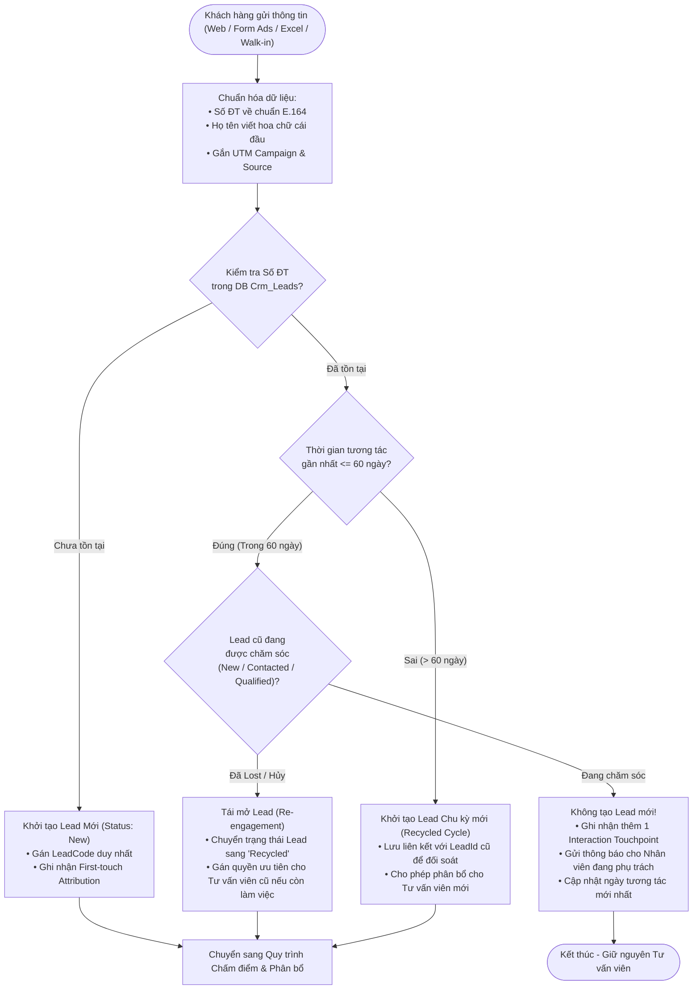
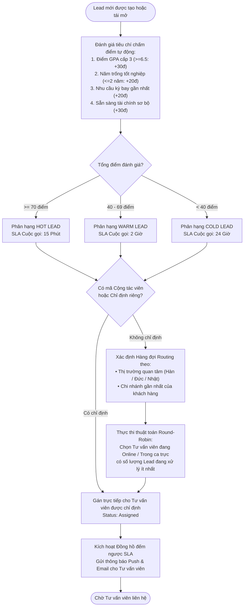
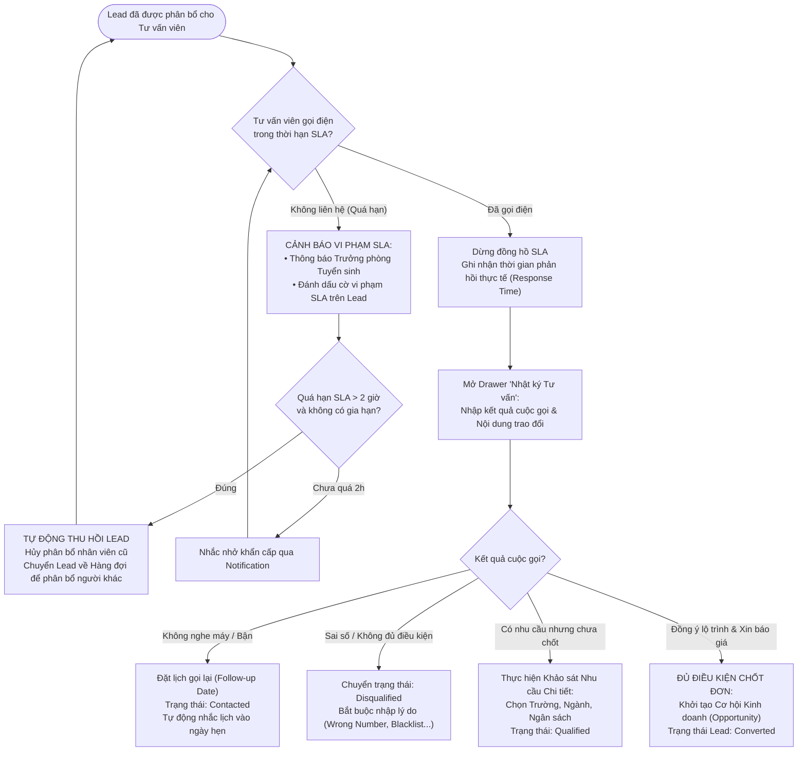
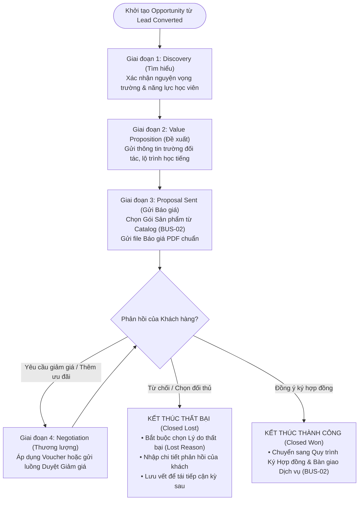
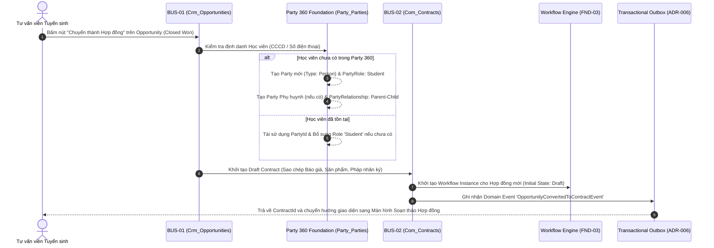

# BẢN ĐỒ QUY TRÌNH NGHIỆP VỤ — PHÂN HỆ CRM & TUYỂN SINH (CRM PROCESS MAPS)
Mã tài liệu: `BUS-DOC-02-02` | Phiên bản: `1.0.0` | Ngày hiệu lực: `2026-10-28`  
Phụ trách: **Senior Product Owner / Enterprise Business Analyst / Solution Architect**  
Trạng thái: `PROPOSED` (Mô hình hóa quy trình chuẩn vận hành cho SHD Corp)

---

## 1. QUY TRÌNH TIẾP NHẬN & PHÁT HIỆN TRÙNG LẶP LEAD (LEAD INGESTION & DEDUPLICATION)

Quy trình đảm bảo mọi dữ liệu khách hàng từ các kênh trực tuyến và trực tiếp đều được kiểm soát trùng lặp tự động trước khi đi vào phễu phân bổ tuyển sinh.

---

## 2. QUY TRÌNH CHẤM ĐIỂM & PHÂN BỔ LEAD (LEAD SCORING & SMART ROUTING)

Quy trình sàng lọc năng lực học tập/tài chính sơ bộ và điều phối Lead tới tư vấn viên theo ca trực và địa bàn phụ trách.

---

## 3. QUY TRÌNH TƯ VẤN, ĐÁNH GIÁ NHU CẦU & KIỂM SOÁT SLA (CONSULTATION & SLA ESCALATION)

Quy trình theo dõi hoạt động tư vấn thực tế của nhân viên và cơ chế tự động can thiệp nếu xảy ra vi phạm thời gian phản hồi khách hàng.

---

## 4. QUY TRÌNH PHỄU CƠ HỘI KINH DOANH (SALES PIPELINE PROGRESSION)

Quản trị toàn bộ các bước từ lúc có cơ hội bán hàng đến khi thương lượng và đóng hợp đồng.

---

## 5. QUY TRÌNH CHUYỂN GIAO CRM $\rightarrow$ HỢP ĐỒNG & PARTY 360 (CRM-TO-COMMERCIAL HANDOFF)

Khâu then chốt kết nối hai phân hệ BUS-01 và BUS-02, bảo đảm tính nhất quán dữ liệu và loại bỏ hoàn toàn việc nhập lại dữ liệu thủ công.

