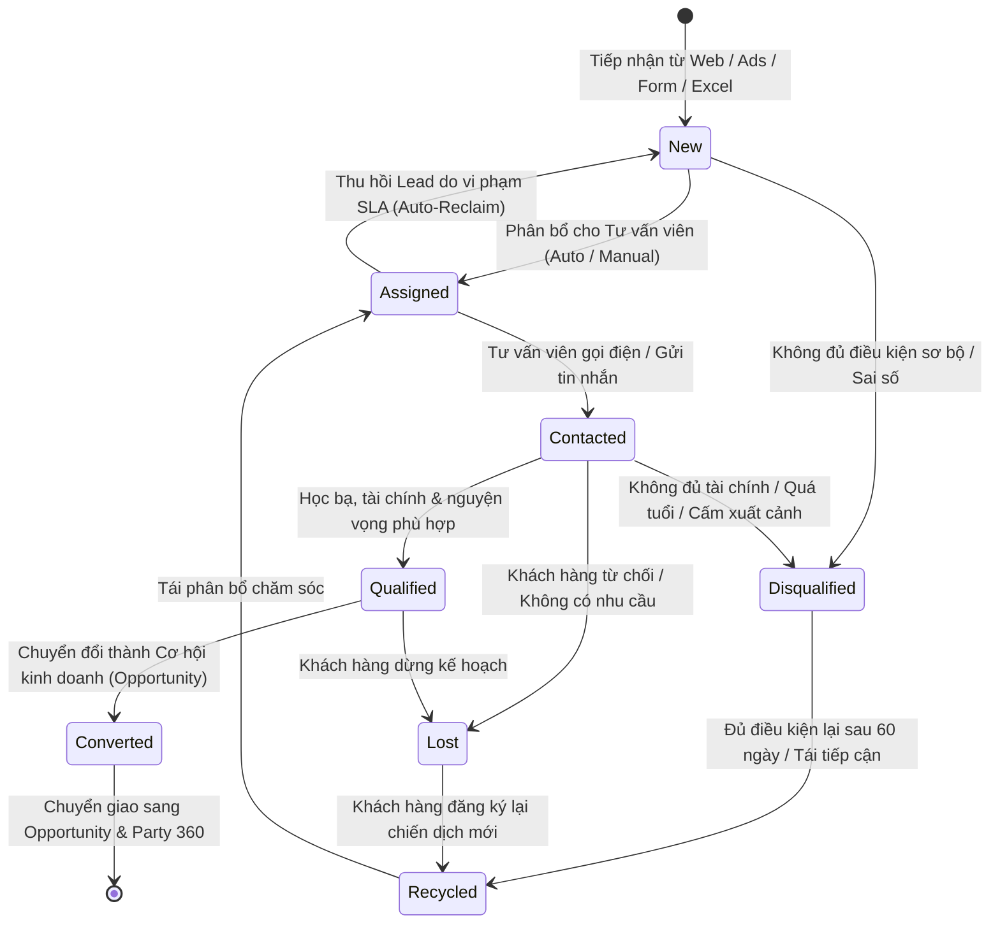
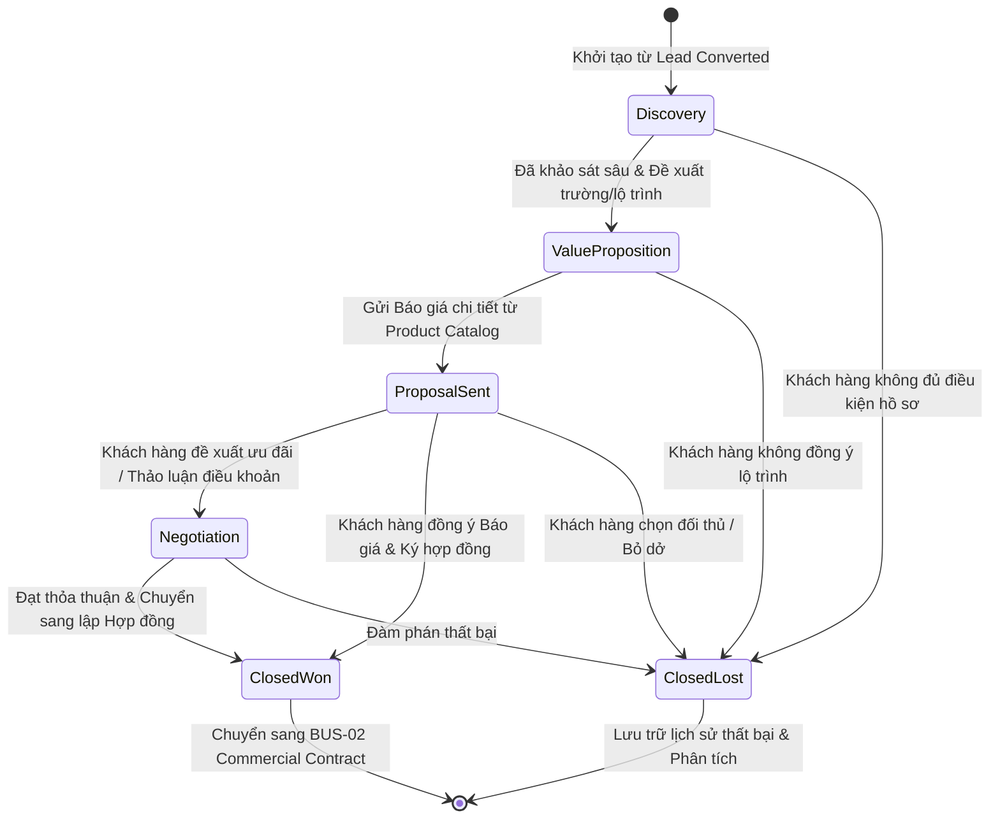
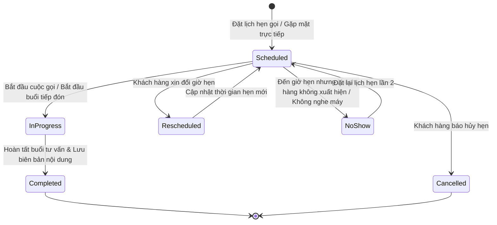

# MÁY TRẠNG THÁI NGHIỆP VỤ — PHÂN HỆ CRM (CRM STATE MACHINES)
Mã tài liệu: `BUS-DOC-02-05` | Phiên bản: `1.0.0` | Ngày hiệu lực: `2026-10-28`  
Phụ trách: **Senior Product Owner / Enterprise Business Analyst / Solution Architect**  
Tương thích: **Generic Workflow Engine (FND-03) & Clean Architecture State Pattern**

---

## 1. MÁY TRẠNG THÁI VÒNG ĐỜI KHÁCH HÀNG TIỀM NĂNG (LEAD LIFECYCLE STATE MACHINE)

### 1.1. Sơ đồ Chuyển dịch Trạng thái Lead

### 1.2. Bảng Đặc tả Chuyển dịch Trạng thái Lead (Transition Matrix)

| Trạng Thái Ban Đầu | Hành Động (Action) | Trạng Thái Đích | Điều Kiện Ràng Buộc (Guards) | Tác Nhân Thực Hiện | Sự Kiện Phát Sinh (Events) |
|---|---|---|---|---|---|
| `[*]` | `INGEST` | `New` | SĐT hợp lệ, không trùng trong 60 ngày | Webhook / System | `LeadIngestedEvent` |
| `New` | `ASSIGN` | `Assigned` | Đã chọn nhân viên phụ trách hợp lệ | System / Sales Leader | `LeadAssignedEvent` |
| `New` | `DISQUALIFY` | `Disqualified` | Bắt buộc nhập lý do từ chối sơ bộ | System / Sales Leader | `LeadDisqualifiedEvent` |
| `Assigned` | `RECLAIM` | `New` | Quá hạn SLA $> 120$ phút & chưa có log | System Background Job | `LeadReclaimedEvent` |
| `Assigned` | `LOG_CONTACT` | `Contacted` | Đã tạo ít nhất 01 Consultation Log | Tư vấn viên phụ trách | `LeadContactedEvent` |
| `Contacted` | `QUALIFY` | `Qualified` | GPA, tài chính sơ bộ đạt chuẩn | Tư vấn viên phụ trách | `LeadQualifiedEvent` |
| `Contacted` | `DISQUALIFY` | `Disqualified` | Bắt buộc chọn mã lý do không đạt | Tư vấn viên phụ trách | `LeadDisqualifiedEvent` |
| `Contacted` | `MARK_LOST` | `Lost` | Bắt buộc chọn mã lý do thất bại | Tư vấn viên phụ trách | `LeadLostEvent` |
| `Qualified` | `CONVERT` | `Converted` | Đã nhập đủ thông tin tạo Opportunity | Tư vấn viên phụ trách | `LeadConvertedEvent` |
| `Qualified` | `MARK_LOST` | `Lost` | Bắt buộc chọn mã lý do khách từ chối | Tư vấn viên phụ trách | `LeadLostEvent` |
| `Lost` / `Disqualified`| `RECYCLE` | `Recycled` | Khách đăng ký lại sau 60 ngày | System Ingestion | `LeadRecycledEvent` |
| `Recycled` | `ASSIGN` | `Assigned` | Gán cho nhân viên tư vấn xử lý | System / Sales Leader | `LeadAssignedEvent` |

---

## 2. MÁY TRẠNG THÁI PHỄU CƠ HỘI KINH DOANH (OPPORTUNITY PIPELINE STATE MACHINE)

### 2.1. Sơ đồ Chuyển dịch Giai đoạn Opportunity

### 2.2. Bảng Chi tiết Giai đoạn Phễu & Xác suất Thành công (Probability Weights)

| Giai Đoạn (Stage) | Tên Hiển Thị | Xác Suất (%) | Tiêu Chí Hoàn Thành (Exit Criteria) |
|---|---|:---:|---|
| `Discovery` | Khảo sát & Định hướng | 10% | Xác định trường, chuyên ngành và năm tốt nghiệp của học viên. |
| `ValueProposition` | Đề xuất Lộ trình | 25% | Đã tư vấn danh sách 2-3 trường phù hợp, phụ huynh đồng ý phương án. |
| `ProposalSent` | Đã Gửi Báo giá | 50% | Đã xuất và gửi bảng Báo giá chính thức (có mã Báo giá từ BUS-02). |
| `Negotiation` | Đàm phán & Thương lượng | 75% | Đang xin duyệt chiết khấu hoặc chỉnh sửa điều khoản thanh toán. |
| `ClosedWon` | Thành công (Chốt Hợp đồng) | 100% | Phụ huynh đồng ý ký, chuyển sang phân hệ Hợp đồng để thu tiền cọc. |
| `ClosedLost` | Thất bại (Đóng Cơ hội) | 0% | Khách hàng ngừng giao dịch, bắt buộc nhập lý do thất bại. |

> [!IMPORTANT]
> **Điểm Kích Hoạt Chuyển Dịch ClosedWon (`PO_DECISION_REQUIRED` - `DEC-13`):**
> Hiện tại có 3 phương án về thời điểm Opportunity chuyển sang `ClosedWon`:
> - **Phương án 1 (Handoff to Draft):** Chuyển `ClosedWon` ngay khi tạo Hợp đồng nháp `Draft` (tương ứng với hành động hoàn thành phễu bán hàng của tư vấn viên).
> - **Phương án 2 (Contract Signed - Khuyến nghị kỹ thuật):** Giữ Opportunity ở `Negotiation` (hoặc `ContractDrafted`) và chỉ chuyển sang `ClosedWon` khi Hợp đồng đạt trạng thái `Signed`. Nếu khách hàng từ chối ký, Opportunity có thể chuyển về lại tư vấn hoặc `ClosedLost`.
> - **Phương án 3 (Contract Activated):** Chỉ chuyển `ClosedWon` khi kế toán xác nhận nộp cọc Đợt 1 và hợp đồng `Active`.
> Trạng thái kỹ thuật đề xuất mặc định đang chờ PO chính thức phê duyệt tại [PO_DECISION_REGISTER.md](file:///f:/MyProjectSHD/SHDONEERP/docs/business/PO_DECISION_REGISTER.md).

---

## 3. MÁY TRẠNG THÁI HOẠT ĐỘNG TƯ VẤN (CONSULTATION ACTIVITY STATE MACHINE)

### 3.1. Sơ đồ Trạng thái Lịch hẹn Tư vấn

### 3.2. Quy tắc Chuyển trạng thái Lịch hẹn
- **Tự động kích hoạt thông báo nhắc nhở:** Khi lịch hẹn ở trạng thái `Scheduled`, hệ thống tự động bắn Notification nhắc nhở trước **30 phút** cho cả Tư vấn viên và gửi tin nhắn Zalo/SMS cho Khách hàng.
- **Xử lý Khách không đến (No-Show):** Nếu sau 15 phút so với giờ hẹn mà nhân viên không bấm "Bắt đầu cuộc gọi/buổi tư vấn", hệ thống đánh dấu trạng thái `NoShow` và yêu cầu nhân viên ghi chú lý do.
- **Điều kiện Hoàn tất (`Completed`):** Bắt buộc phải có ghi chú tóm tắt nội dung trao đổi tối thiểu 20 ký tự và chọn ít nhất 01 hành động tiếp theo (Next Action).

