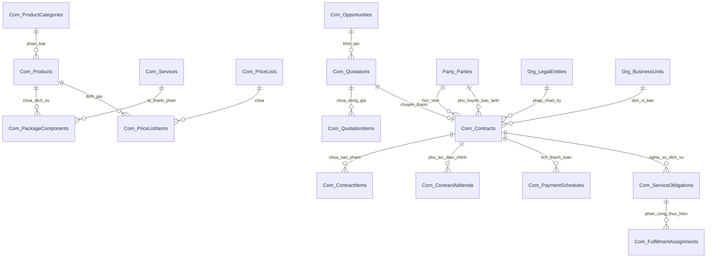

# MÔ HÌNH DỮ LIỆU CHI TIẾT — PHÂN HỆ THƯƠNG MẠI & HỢP ĐỒNG (COMMERCIAL DATA MODEL)
Mã tài liệu: `BUS-DOC-03-06` | Phiên bản: `1.0.0` | Ngày hiệu lực: `2026-10-28`  
Phụ trách: **Senior Product Owner / Enterprise Business Analyst / Solution Architect**  
Kiến trúc: **Clean Architecture + CQRS (EF Core Write-side / Stored Procedures Read-side)**

---

## 1. SƠ ĐỒ THỰC THỂ QUAN HỆ THƯƠNG MẠI (COMMERCIAL ERD)



---

## 2. TỪ ĐIỂN DỮ LIỆU BẢNG GHI (TABLE DATA DICTIONARY)

### 2.1. Bảng `Com_Products` (Danh mục Sản phẩm Thương mại)
Lưu trữ các sản phẩm, gói dịch vụ bán cho khách hàng.

| Tên Cột | Kiểu Dữ Liệu | Ràng Buộc | Ý Nghĩa Nghiệp Vụ |
|---|---|---|---|
| `Id` | `UNIQUEIDENTIFIER` | PK, NOT NULL | Khóa chính sản phẩm. |
| `Code` | `NVARCHAR(50)` | UQ, NOT NULL | Mã sản phẩm (VD: `PRD_KR_D4_FULL`, `PRD_LANG_TOPIK2`). |
| `Name` | `NVARCHAR(200)` | NOT NULL | Tên thương mại của sản phẩm/gói dịch vụ. |
| `CategoryId` | `UNIQUEIDENTIFIER` | FK, NOT NULL | Phân loại danh mục (Du học tiếng, Du học nghề, Đào tạo). |
| `ProductType` | `NVARCHAR(30)` | NOT NULL | Loại: `SingleService`, `CompositePackage`, `Material`. |
| `OwningLegalEntityId`| `UNIQUEIDENTIFIER`| FK, NOT NULL | Pháp nhân sở hữu sản phẩm/bản quyền. |
| `BasePrice` | `DECIMAL(18,2)` | NOT NULL | Giá niêm yết chuẩn (VNĐ). |
| `VatRate` | `DECIMAL(5,2)` | NOT NULL, DEFAULT 0| Thuế suất VAT (0%, 8%, 10%). |
| `IsActive` | `BIT` | NOT NULL, DEFAULT 1| Cờ kích hoạt kinh doanh. |
| `RowVersion` | `ROWVERSION` | NOT NULL | Khóa lạc quan. |

### 2.2. Bảng `Com_PackageComponents` (Định mức Cấu phần Gói)
Bóc tách các dịch vụ thành phần trong một gói du học trọn gói.

| Tên Cột | Kiểu Dữ Liệu | Ràng Buộc | Ý Nghĩa Nghiệp Vụ |
|---|---|---|---|
| `Id` | `UNIQUEIDENTIFIER` | PK, NOT NULL | Khóa chính. |
| `PackageProductId` | `UNIQUEIDENTIFIER` | FK, NOT NULL | Trỏ tới `Com_Products(Id)` (Gói cha). |
| `ComponentServiceId`| `UNIQUEIDENTIFIER` | FK, NOT NULL | Trỏ tới `Com_Services(Id)` (Dịch vụ thành phần). |
| `Quantity` | `INT` | NOT NULL, DEFAULT 1| Số lượng định mức trong gói. |
| `IsMandatory` | `BIT` | NOT NULL, DEFAULT 1| Cờ bắt buộc hay tùy chọn (Add-on). |
| `AllocatedPrice` | `DECIMAL(18,2)` | NOT NULL | Giá phân bổ nội bộ phục vụ hạch toán. |

### 2.3. Bảng `Com_Quotations` (Báo giá Thương mại)
Lưu thông tin bảng tính chi phí gửi cho phụ huynh học viên.

| Tên Cột | Kiểu Dữ Liệu | Ràng Buộc | Ý Nghĩa Nghiệp Vụ |
|---|---|---|---|
| `Id` | `UNIQUEIDENTIFIER` | PK, NOT NULL | Khóa chính báo giá. |
| `QuotationCode` | `NVARCHAR(30)` | UQ, NOT NULL | Mã báo giá (VD: `BG-202610-0089-V1`). |
| `OpportunityId` | `UNIQUEIDENTIFIER` | FK, NULL | Trỏ tới Cơ hội kinh doanh nguồn. |
| `PartyId` | `UNIQUEIDENTIFIER` | FK, NULL | Trỏ tới học viên trong Party 360 (nếu có). |
| `CustomerName` | `NVARCHAR(150)` | NOT NULL | Tên học viên / Khách hàng nhận báo giá. |
| `VersionNumber` | `INT` | NOT NULL, DEFAULT 1| Số phiên bản sửa đổi (1, 2, 3...). |
| `TotalBeforeDiscount`|`DECIMAL(18,2)` | NOT NULL | Tổng tiền nguyên giá trước chiết khấu. |
| `DiscountAmount` | `DECIMAL(18,2)` | NOT NULL, DEFAULT 0| Tổng số tiền giảm trừ / học bổng. |
| `TotalTaxAmount` | `DECIMAL(18,2)` | NOT NULL, DEFAULT 0| Tổng tiền thuế VAT. |
| `GrandTotal` | `DECIMAL(18,2)` | NOT NULL | Tổng số tiền thanh toán thực tế. |
| `Status` | `NVARCHAR(30)` | NOT NULL | Trạng thái: `Draft`, `PendingApproval`, `Approved`, `Sent`, `Accepted`, `Rejected`, `Expired`, `Converted`. |
| `ValidUntilDate` | `DATE` | NOT NULL | Ngày hết hiệu lực của báo giá. |
| `ApprovalWorkflowInstanceId`| `UNIQUEIDENTIFIER`| FK, NULL | Trỏ tới Workflow phê duyệt giảm giá (FND-03). |
| `ScopeLegalEntityId`| `UNIQUEIDENTIFIER`| FK, NOT NULL | Pháp nhân dự kiến ký kết. |
| `CreatedByUserId` | `UNIQUEIDENTIFIER` | FK, NOT NULL | Tư vấn viên lập báo giá. |
| `RowVersion` | `ROWVERSION` | NOT NULL | Concurrency token. |

### 2.4. Bảng `Com_Contracts` (Hợp đồng Dịch vụ Du học)
Thực thể pháp lý ràng buộc cam kết đa bên.

| Tên Cột | Kiểu Dữ Liệu | Ràng Buộc | Ý Nghĩa Nghiệp Vụ |
|---|---|---|---|
| `Id` | `UNIQUEIDENTIFIER` | PK, NOT NULL | Khóa chính hợp đồng. |
| `ContractCode` | `NVARCHAR(50)` | UQ, NOT NULL | Số hợp đồng pháp lý (VD: `HD-202610/SHD-KR/0089`). |
| `ContractType` | `NVARCHAR(50)` | NOT NULL | Loại hợp đồng: `StudyAbroad_KR`, `Vocational_DE`, `StudyAbroad_JP`, `Training_Only`. |
| `QuotationId` | `UNIQUEIDENTIFIER` | FK, NULL | Trỏ tới Báo giá được chấp thuận. |
| `StudentPartyId` | `UNIQUEIDENTIFIER` | FK, NOT NULL | Học viên đứng tên (Bên B) trỏ tới `Party_Parties`. |
| `GuarantorPartyId` | `UNIQUEIDENTIFIER`| FK, NULL | Phụ huynh/Người bảo lãnh (Bên C) trỏ tới `Party_Parties`. |
| `ContractingLegalEntityId`|`UNIQUEIDENTIFIER`| FK, NOT NULL | Pháp nhân SHD Corp ký hợp đồng (Bên A). |
| `SellingBusinessUnitId`|`UNIQUEIDENTIFIER`| FK, NOT NULL | Khối kinh doanh hưởng doanh số. |
| `SellingBranchId` | `UNIQUEIDENTIFIER` | FK, NOT NULL | Chi nhánh lập hợp đồng. |
| `TotalContractValue`|`DECIMAL(18,2)` | NOT NULL | Tổng giá trị hợp đồng dịch vụ (VNĐ). |
| `PaidAmount` | `DECIMAL(18,2)` | NOT NULL, DEFAULT 0| Tổng số tiền khách hàng đã thanh toán thực tế. |
| `OutstandingBalance`|`DECIMAL(18,2)` | NOT NULL | Công nợ còn lại phải thu (`Total - Paid`). |
| `Status` | `NVARCHAR(30)` | NOT NULL, INDEX | Trạng thái vòng đời: `Draft`, `PendingReview`, `Approved`, `PendingSignature`, `Signed`, `Active`, `UnderFulfillment`, `Suspended`, `Disputed`, `Terminated`, `Completed`. |
| `SigningMethod` | `NVARCHAR(30)` | NOT NULL | Phương thức ký: `InPerson_WetInk`, `Remote_EsignOtp`. |
| `SignedAtUtc` | `DATETIME2(7)` | NULL | Thời điểm ký kết hợp đồng. |
| `ActivatedAtUtc` | `DATETIME2(7)` | NULL | Thời điểm kích hoạt sau khi đóng cọc Đợt 1. |
| `CompletedAtUtc` | `DATETIME2(7)` | NULL | Thời điểm hoàn tất nghiệm thu dịch vụ. |
| `SignedDocumentId`| `UNIQUEIDENTIFIER`| FK, NULL | Trỏ tới file scan hợp đồng trong `Doc_Documents`. |
| `IsDeleted` | `BIT` | NOT NULL, DEFAULT 0| Cờ xóa mềm. |
| `RowVersion` | `ROWVERSION` | NOT NULL | Khóa lạc quan chống xung đột đồng thời. |

### 2.5. Bảng `Com_PaymentSchedules` (Lịch trình & Mốc Thanh toán)
Quản lý các đợt nộp tiền theo hợp đồng.

| Tên Cột | Kiểu Dữ Liệu | Ràng Buộc | Ý Nghĩa Nghiệp Vụ |
|---|---|---|---|
| `Id` | `UNIQUEIDENTIFIER` | PK, NOT NULL | Khóa chính. |
| `ContractId` | `UNIQUEIDENTIFIER` | FK, NOT NULL | Trỏ tới `Com_Contracts(Id)`. |
| `MilestoneIndex` | `INT` | NOT NULL | Đợt nộp: `1`, `2`, `3`... |
| `MilestoneName` | `NVARCHAR(150)` | NOT NULL | Tên đợt (VD: `Đợt 1 - Cọc mở hồ sơ & Học phí tiếng`). |
| `ExpectedAmount` | `DECIMAL(18,2)` | NOT NULL | Số tiền phải nộp trong đợt. |
| `ActualPaidAmount`| `DECIMAL(18,2)` | NOT NULL, DEFAULT 0| Số tiền thực tế đã nộp cho đợt này. |
| `DueDate` | `DATE` | NOT NULL | Hạn chót thanh toán. |
| `Status` | `NVARCHAR(30)` | NOT NULL | Trạng thái: `Pending`, `PartiallyPaid`, `FullyPaid`, `Overdue`. |
| `ReceiptReference`| `NVARCHAR(100)` | NULL | Mã tham chiếu phiếu thu từ phân hệ Finance. |
| `UnlocksObligationType`|`NVARCHAR(50)`| NULL | Mở khóa nghĩa vụ nào (`Education`, `Visa`, `Placement`, `Overseas`). |

### 2.6. Bảng `Com_ServiceObligations` (Nghĩa vụ Thực hiện Dịch vụ)
Quản lý các nhiệm vụ bàn giao từ hợp đồng sang các phân hệ vận hành chuyên trách.

| Tên Cột | Kiểu Dữ Liệu | Ràng Buộc | Ý Nghĩa Nghiệp Vụ |
|---|---|---|---|
| `Id` | `UNIQUEIDENTIFIER` | PK, NOT NULL | Khóa chính nghĩa vụ. |
| `ContractId` | `UNIQUEIDENTIFIER` | FK, NOT NULL | Trỏ tới `Com_Contracts(Id)`. |
| `ObligationType` | `NVARCHAR(50)` | NOT NULL | Loại: `LanguageTraining`, `VisaDossier`, `SchoolPlacement`, `OverseasCare`. |
| `TargetDomain` | `NVARCHAR(50)` | NOT NULL | Domain đích: `Education`, `AdmissionVisa`, `Placement`, `OverseasCare`. |
| `FulfillingBusinessUnitId`|`UNIQUEIDENTIFIER`| FK, NOT NULL | Đơn vị vận hành chịu trách nhiệm. |
| `RequiredMilestonePayment`|`INT` | NOT NULL | Yêu cầu phải nộp đủ tiền đợt mấy mới được kích hoạt. |
| `HandoverStatus` | `NVARCHAR(30)` | NOT NULL | Trạng thái bàn giao: `Locked`, `ReadyForHandover`, `HandedOver`, `InProgress`, `Fulfilled`. |
| `ExternalEngagementId`|`NVARCHAR(100)`| NULL | Mã định danh hồ sơ bên phân hệ chuyên trách (VD: `CLASS_2026_01`, `VISA_CASE_889`). |
| `HandedOverAtUtc`| `DATETIME2(7)` | NULL | Thời điểm chuyển giao thành công. |
| `FulfilledAtUtc` | `DATETIME2(7)` | NULL | Thời điểm đơn vị vận hành báo hoàn thành nghĩa vụ. |

---

## 3. THIẾT KẾ STORED PROCEDURES ĐỌC DỮ LIỆU THƯƠNG MẠI (READ-SIDE CQRS)

### Stored Procedure: `sp_Commercial_Contract_GetPagedList` (Fail-Closed Security & Direct GBAC v4.2)
```sql
CREATE OR ALTER PROCEDURE [dbo].[sp_Commercial_Contract_GetPagedList]
    @SearchTerm NVARCHAR(100) = NULL,
    @ContractType NVARCHAR(50) = NULL,
    @Status NVARCHAR(30) = NULL,
    @ContractingLegalEntityId UNIQUEIDENTIFIER = NULL,
    @SellingBusinessUnitId UNIQUEIDENTIFIER = NULL,
    @SellingBranchId UNIQUEIDENTIFIER = NULL,
    @ScopeLegalEntityId UNIQUEIDENTIFIER = NULL,
    @ScopeBusinessUnitId UNIQUEIDENTIFIER = NULL,
    @ScopeBranchId UNIQUEIDENTIFIER = NULL,
    @RequestingUserId UNIQUEIDENTIFIER = NULL,
    @PageIndex INT = 1,
    @PageSize INT = 20,
    @SortColumn NVARCHAR(50) = 'CreatedAtUtc',
    @SortDirection NVARCHAR(4) = 'DESC',
    @TotalCount INT = 0 OUTPUT
AS
BEGIN
    SET NOCOUNT ON;

    -- FAIL-CLOSED CHECK 1: Yêu cầu bắt buộc @RequestingUserId
    IF @RequestingUserId IS NULL
    BEGIN
        SET @TotalCount = 0;
        SELECT TOP 0 
            CAST(NULL AS UNIQUEIDENTIFIER) AS [Id],
            CAST(NULL AS NVARCHAR(50)) AS [ContractCode],
            CAST(NULL AS NVARCHAR(50)) AS [ContractType],
            CAST(NULL AS UNIQUEIDENTIFIER) AS [StudentPartyId],
            CAST(NULL AS NVARCHAR(50)) AS [StudentPartyCode],
            CAST(NULL AS NVARCHAR(150)) AS [StudentFullName],
            CAST(0 AS DECIMAL(18,2)) AS [TotalContractValue],
            CAST(0 AS DECIMAL(18,2)) AS [PaidAmount],
            CAST(0 AS DECIMAL(18,2)) AS [OutstandingBalance],
            CAST(NULL AS NVARCHAR(30)) AS [Status],
            CAST(NULL AS NVARCHAR(50)) AS [SigningMethod],
            CAST(NULL AS DATETIME2(7)) AS [SignedAtUtc],
            CAST(NULL AS DATETIME2(7)) AS [ActivatedAtUtc],
            CAST(NULL AS NVARCHAR(150)) AS [ContractingLegalEntityName],
            CAST(NULL AS NVARCHAR(150)) AS [SellingBusinessUnitName],
            CAST(NULL AS NVARCHAR(150)) AS [SellingBranchName],
            CAST(NULL AS DATETIME2(7)) AS [CreatedAtUtc],
            CAST(0 AS INT) AS [TotalCount];
        RETURN;
    END;

    IF @PageIndex < 1 SET @PageIndex = 1;
    IF @PageSize < 1 SET @PageSize = 20;
    IF @PageSize > 100 SET @PageSize = 100;
    DECLARE @Offset INT = (@PageIndex - 1) * @PageSize;
    SET @SearchTerm = NULLIF(LTRIM(RTRIM(@SearchTerm)), '');

    -- Xác định quyền Admin hoặc Global Scope
    DECLARE @IsAdmin BIT = 0;
    DECLARE @HasGlobalScope BIT = 0;

    IF EXISTS (
        SELECT 1 FROM [dbo].[Identity_UserGroupMembers] ugm
        JOIN [dbo].[Identity_UserGroups] ug ON ug.[Id] = ugm.[UserGroupId]
        WHERE ugm.[UserId] = @RequestingUserId
          AND ug.[Code] = 'ADMINISTRATORS'
          AND ug.[IsActive] = 1
    )
    BEGIN
        SET @IsAdmin = 1;
        SET @HasGlobalScope = 1;
    END;

    -- Kiểm tra quyền commercial.contract.view và các phạm vi được cấp
    DECLARE @UserScopes TABLE (
        [ScopeType] NVARCHAR(50),
        [LegalEntityId] UNIQUEIDENTIFIER,
        [BusinessUnitId] UNIQUEIDENTIFIER,
        [BranchId] UNIQUEIDENTIFIER
    );

    IF @IsAdmin = 0
    BEGIN
        INSERT INTO @UserScopes ([ScopeType], [LegalEntityId], [BusinessUnitId], [BranchId])
        SELECT DISTINCT
            ug.[ScopeType],
            ugm.[ScopeLegalEntityId],
            ugm.[ScopeBusinessUnitId],
            ugm.[ScopeBranchId]
        FROM [dbo].[Identity_UserGroupMembers] ugm
        JOIN [dbo].[Identity_UserGroups] ug ON ug.[Id] = ugm.[UserGroupId]
        JOIN [dbo].[Identity_UserGroupPermissions] ugp ON ugp.[UserGroupId] = ug.[Id]
        JOIN [dbo].[Identity_Permissions] p ON p.[Id] = ugp.[PermissionId]
        WHERE ugm.[UserId] = @RequestingUserId
          AND ug.[IsActive] = 1
          AND p.[Code] = 'commercial.contract.view';

        IF EXISTS (SELECT 1 FROM @UserScopes WHERE [ScopeType] = 'Global')
        BEGIN
            SET @HasGlobalScope = 1;
        END;
    END;

    -- FAIL-CLOSED CHECK 2: Phân vùng dữ liệu theo Data Scope & Quyền sở hữu (Row Visibility)
    WITH VisibleContracts AS (
        SELECT c.[Id]
        FROM [dbo].[Com_Contracts] c
        JOIN [dbo].[Party_Parties] p ON p.[Id] = c.[StudentPartyId]
        LEFT JOIN [dbo].[Party_Persons] per ON per.[PartyId] = p.[Id]
        WHERE c.[IsDeleted] = 0
          AND (
              @HasGlobalScope = 1
              OR EXISTS (
                  SELECT 1 FROM @UserScopes s
                  WHERE (s.[ScopeType] = 'Branch' AND s.[BranchId] = c.[SellingBranchId])
                     OR (s.[ScopeType] = 'BusinessUnit' AND s.[BusinessUnitId] = c.[SellingBusinessUnitId])
                     OR (s.[ScopeType] = 'LegalEntity' AND s.[LegalEntityId] = c.[ContractingLegalEntityId])
              )
          )
          -- Ràng buộc tham số Scope truyền vào từ UI
          AND (@ScopeLegalEntityId IS NULL OR c.[ContractingLegalEntityId] = @ScopeLegalEntityId)
          AND (@ScopeBusinessUnitId IS NULL OR c.[SellingBusinessUnitId] = @ScopeBusinessUnitId)
          AND (@ScopeBranchId IS NULL OR c.[SellingBranchId] = @ScopeBranchId)
          -- Bộ lọc nghiệp vụ
          AND (@ContractType IS NULL OR c.[ContractType] = @ContractType)
          AND (@Status IS NULL OR c.[Status] = @Status)
          AND (@ContractingLegalEntityId IS NULL OR c.[ContractingLegalEntityId] = @ContractingLegalEntityId)
          AND (@SellingBusinessUnitId IS NULL OR c.[SellingBusinessUnitId] = @SellingBusinessUnitId)
          AND (@SellingBranchId IS NULL OR c.[SellingBranchId] = @SellingBranchId)
          AND (
              @SearchTerm IS NULL 
              OR c.[ContractCode] LIKE '%' + @SearchTerm + '%'
              OR per.[FirstName] LIKE N'%' + @SearchTerm + '%'
              OR per.[LastName] LIKE N'%' + @SearchTerm + '%'
              OR p.[Code] LIKE '%' + @SearchTerm + '%'
          )
    )
    SELECT @TotalCount = COUNT(1) FROM VisibleContracts;

    -- Trả về dữ liệu trang
    SELECT 
        c.[Id], c.[ContractCode], c.[ContractType],
        c.[StudentPartyId], p.[Code] AS [StudentPartyCode],
        COALESCE(per.[LastName] + ' ' + per.[FirstName], p.[Code]) AS [StudentFullName],
        c.[TotalContractValue], c.[PaidAmount], c.[OutstandingBalance],
        c.[Status], c.[SigningMethod], c.[SignedAtUtc], c.[ActivatedAtUtc],
        le.[Name] AS [ContractingLegalEntityName],
        bu.[Name] AS [SellingBusinessUnitName],
        br.[Name] AS [SellingBranchName],
        c.[CreatedAtUtc],
        @TotalCount AS [TotalCount]
    FROM [dbo].[Com_Contracts] c
    JOIN (
        SELECT [Id] FROM VisibleContracts
        ORDER BY [Id]
        OFFSET @Offset ROWS FETCH NEXT @PageSize ROWS ONLY
    ) v ON v.[Id] = c.[Id]
    JOIN [dbo].[Party_Parties] p ON p.[Id] = c.[StudentPartyId]
    LEFT JOIN [dbo].[Party_Persons] per ON per.[PartyId] = p.[Id]
    JOIN [dbo].[Org_LegalEntities] le ON le.[Id] = c.[ContractingLegalEntityId]
    JOIN [dbo].[Org_BusinessUnits] bu ON bu.[Id] = c.[SellingBusinessUnitId]
    JOIN [dbo].[Org_Branches] br ON br.[Id] = c.[SellingBranchId]
    ORDER BY 
        CASE WHEN @SortDirection = 'ASC' AND @SortColumn = 'CreatedAtUtc' THEN c.[CreatedAtUtc] END ASC,
        CASE WHEN @SortDirection = 'DESC' AND @SortColumn = 'CreatedAtUtc' THEN c.[CreatedAtUtc] END DESC,
        CASE WHEN @SortDirection = 'ASC' AND @SortColumn = 'TotalContractValue' THEN c.[TotalContractValue] END ASC,
        CASE WHEN @SortDirection = 'DESC' AND @SortColumn = 'TotalContractValue' THEN c.[TotalContractValue] END DESC,
        c.[CreatedAtUtc] DESC;
END;
GO
```

