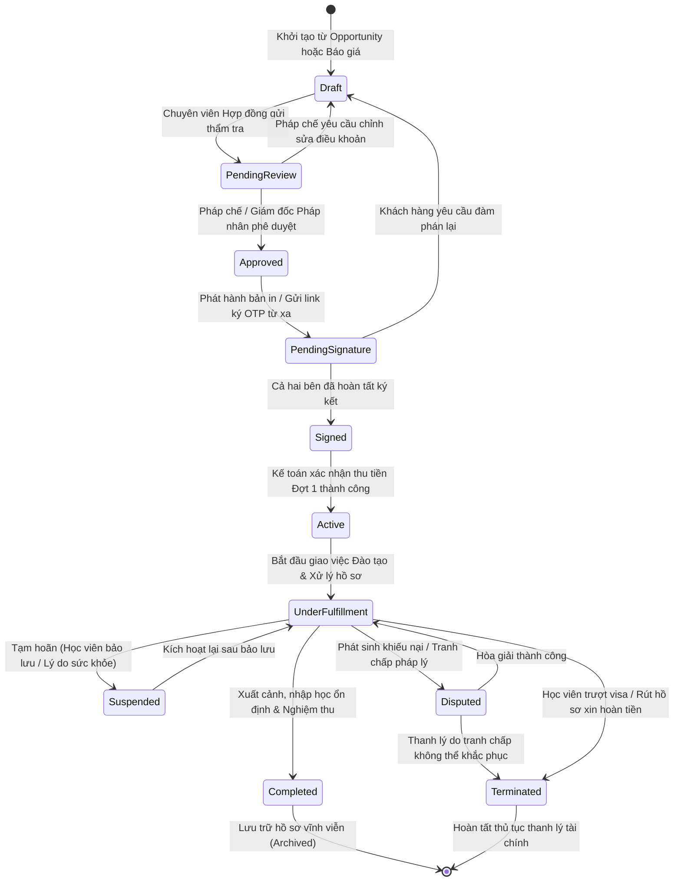

# VÒNG ĐỜI HỢP ĐỒNG & MÁY TRẠNG THÁI PHÁP LÝ (CONTRACT LIFECYCLE)
Mã tài liệu: `BUS-DOC-03-04` | Phiên bản: `1.0.0` | Ngày hiệu lực: `2026-10-28`  
Phụ trách: **Senior Product Owner / Enterprise Business Analyst / Solution Architect**  
Tương thích: **FND-03 Workflow Engine & Transactional Outbox Pattern**

---

## 1. SƠ ĐỒ MÁY TRẠNG THÁI VÒNG ĐỜI HỢP ĐỒNG (CONTRACT STATE MACHINE)

Vòng đời của một Hợp đồng Dịch vụ Du học trong SHD OneERP trải qua các giai đoạn từ lúc khởi thảo, thẩm tra pháp lý, ký kết, thực thi nghĩa vụ cho đến khi nghiệm thu hoàn tất hoặc thanh lý:

---

## 2. MA TRẬN CHUYỂN DỊCH TRẠNG THÁI HỢP ĐỒNG (TRANSITION MATRIX)

| Trạng Thái Ban Đầu | Hành Động (Action) | Trạng Thái Đích | Điều Kiện Chuyển Đổi (Guards) | Vai Trò Thực Hiện | Sự Kiện Miền Phát Sinh (Outbox Events) |
|---|---|---|---|---|---|
| `[*]` | `CREATE_CONTRACT` | `Draft` | Có Báo giá đã duyệt hoặc Opportunity Won | Chuyên viên Tư vấn / Hợp đồng | `ContractCreatedEvent` |
| `Draft` | `SUBMIT_REVIEW` | `PendingReview` | Đã điền đủ thông tin CCCD, gói sản phẩm và đợt thanh toán | Chuyên viên Hợp đồng | `ContractSubmittedEvent` |
| `PendingReview` | `APPROVE` | `Approved` | Điều khoản đúng mẫu quy chuẩn của Tập đoàn | Cán bộ Pháp chế / Trưởng phòng | `ContractApprovedEvent` |
| `PendingReview` | `REJECT` | `Draft` | Có ghi chú lý do sai sót cần chỉnh sửa | Cán bộ Pháp chế | `ContractRejectedEvent` |
| `Approved` | `SEND_FOR_SIGN` | `PendingSignature` | Đã sinh file PDF hợp đồng có mã băm SHA256 | Chuyên viên Hợp đồng | `ContractSentForSigningEvent` |
| `PendingSignature`| `CONFIRM_SIGNED`| `Signed` | Đã upload bản scan ký tươi hoặc OTP thành công | Chuyên viên Hợp đồng / Hệ thống | `ContractSignedEvent` |
| `Signed` | `ACTIVATE` | `Active` | Kế toán đã ghi nhận Phiếu thu tiền Đợt 1 | Kế toán Thu tiền (`Accountant`) | `ContractActivatedEvent` |
| `Active` | `START_DELIVERY` | `UnderFulfillment`| Đã phân rã nghĩa vụ Đào tạo và Hồ sơ | Hệ thống Tự động | `FulfillmentStartedEvent` |
| `UnderFulfillment`| `SUSPEND` | `Suspended` | Có đơn xin bảo lưu được Giám đốc BU duyệt | Cán bộ Quản trị Dịch vụ | `ContractSuspendedEvent` |
| `Suspended` | `RESUME` | `UnderFulfillment`| Hết hạn bảo lưu và học viên nhập học lại | Cán bộ Quản trị Dịch vụ | `ContractResumedEvent` |
| `UnderFulfillment`| `RAISE_DISPUTE` | `Disputed` | Khách hàng khiếu nại vi phạm cam kết | Bộ phận Chăm sóc Khách hàng | `ContractDisputedEvent` |
| `UnderFulfillment`| `TERMINATE` | `Terminated` | Có Quyết định thanh lý & Phiếu hoàn trả tiền | Giám đốc Pháp nhân | `ContractTerminatedEvent` |
| `UnderFulfillment`| `COMPLETE` | `Completed` | Học viên đã nhập học tại trường và hết hạn bảo trợ | Trưởng bộ phận Hải ngoại | `ContractCompletedEvent` |

---

## 3. CÁC TÌNH HUỐNG NGOẠI LỆ ĐẶC THÙ (EDGE CASES & BUSINESS CONTINGENCIES)

### 3.1. Tình huống: Học viên Trượt Phỏng vấn Visa Đại sứ quán
- **Bối cảnh:** Học viên đã hoàn thành khóa học tiếng, đã có thư mời trường nhưng Đại sứ quán từ chối cấp visa.
- **Xử lý trên hệ thống:**
  1. Cán bộ hồ sơ cập nhật kết quả `Visa Denied` kèm biên bản từ chối của ĐSQ.
  2. Hợp đồng tạm thời chuyển sang trạng thái chờ xử lý (`PendingContingencyAction`).
  3. *Lựa chọn 1 (Luyện lại nộp kỳ sau):* Tạo Phụ lục hợp đồng điều chỉnh kỳ bay; trạng thái hợp đồng quay lại `UnderFulfillment`.
  4. *Lựa chọn 2 (Thanh lý hợp đồng):* Kích hoạt luồng `Wf_ContractTerminationApproval`. Hệ thống tự động tính toán số tiền được hoàn trả căn cứ theo điều khoản trượt visa (Hoàn 100% học phí trường, khấu trừ chi phí dịch thuật thực chi). Hợp đồng chuyển sang `Terminated`.

### 3.2. Tình huống: Học viên Đơn phương Rút Hồ sơ trước khi Xuất cảnh
- **Bối cảnh:** Học viên đã đóng tiền Đợt 1 và Đợt 2 nhưng gia đình có việc đột xuất xin dừng không đi du học nữa.
- **Xử lý trên hệ thống:**
  1. Tạo Yêu cầu Hủy Hợp đồng (`Refund Request`).
  2. Chuyên viên Pháp chế và Kế toán rà soát các chi phí thực tế đã chi: Học phí tiếng đã học, phí dịch thuật công chứng đã nộp, phí chuyển tiền quốc tế.
  3. Giám đốc Pháp nhân ký Quyết định thanh lý hợp đồng.
  4. Hợp đồng chuyển sang trạng thái `Terminated`. Kế toán lập Phiếu chi hoàn tiền tồn đọng cho phụ huynh.

### 3.3. Tình huống: Bất khả kháng (Force Majeure - Dịch bệnh, Đóng cửa biên giới)
- **Bối cảnh:** Chính phủ nước sở tại ngừng cấp visa du học sinh hoặc hạn chế nhập cảnh.
- **Xử lý:** Kích hoạt trạng thái `Suspended` toàn bộ các hợp đồng thuộc thị trường đó; tạm dừng các lịch trình thanh toán tiếp theo mà không tính phạt chậm nộp.

