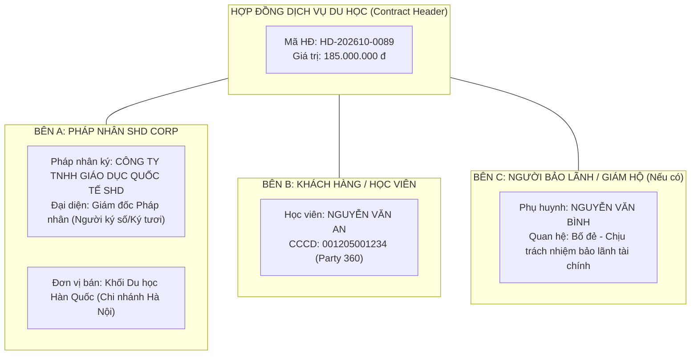

# TÀI LIỆU YÊU CẦU NGHIỆP VỤ — QUẢN TRỊ HỢP ĐỒNG DỊCH VỤ ĐA PHÁP NHÂN (BUS-02)
Mã tài liệu: `BUS-DOC-03-03` | Phiên bản: `1.0.0` | Ngày hiệu lực: `2026-10-28`  
Phụ trách: **Senior Product Owner / Enterprise Business Analyst / Solution Architect**  
Mã Phân Hệ: `COMMERCIAL` | Danh mục: **Contract Management**  
Trạng thái: `PROPOSED` (Thiết kế kiến trúc hợp đồng đa chủ thể toàn hệ sinh thái)

---

## 1. MỤC TIÊU & KIẾN TRÚC HỢP ĐỒNG ĐA THỰC THỂ (MULTI-ENTITY CONTRACT ARCHITECTURE)

Hợp đồng trong hệ thống SHD OneERP là văn bản pháp lý tối cao xác lập quyền và nghĩa vụ giữa **Pháp nhân thuộc SHD Corp** và **Khách hàng (Học viên & Người bảo lãnh)**.

### 1.1. Mục tiêu Nghiệp vụ
1. **Quản lý Đa Pháp nhân Chuẩn xác:** Hệ thống hỗ trợ nhiều pháp nhân ký kết hợp đồng khác nhau trên cùng một nền tảng ERP mà không bị lẫn lộn biểu mẫu, con dấu hay mã số thuế.
2. **Hỗ trợ Một Học viên Ký Nhiều Hợp đồng:** Một học viên có thể ký nhiều hợp đồng kế tiếp nhau (Ví dụ: Hợp đồng 1: Khóa học tiếng Hàn tại Việt Nam; Hợp đồng 2: Dịch vụ Du học Hàn Quốc D4-1; Hợp đồng 3: Chuyển đổi Visa D2 lên Đại học).
3. **Phân tách Rõ Ràng Pháp nhân Ký vs Đơn vị Bán hàng:** Ghi nhận đồng thời `ContractingLegalEntityId` (pháp nhân ký kết xuất hóa đơn) và `SellingBusinessUnitId` (khối kinh doanh hưởng chỉ tiêu doanh số).
4. **Kiểm soát Toàn vẹn & Chống Sửa đổi Bất hợp pháp:** Hợp đồng sau khi ký kết được số hóa, mã hóa băm SHA256 lưu trữ trong nền tảng `Doc_Documents` (ADR-009). Mọi sự điều chỉnh quyền lợi, dịch vụ hoặc dòng tiền đều bắt buộc phải phát hành Phụ lục Hợp đồng (Contract Addendum) có phê duyệt qua **FND-03 Workflow Engine**.

---

## 2. PHÂN LOẠI HỢP ĐỒNG & BIỂU MẪU QUY CHUẨN (CONTRACT CLASSIFICATION)

| Mã Loại | Tên Loại Hợp Đồng Dịch Vụ | Pháp Nhân Đại Diện Ký (Dự kiến) | Đối Tượng Áp Dụng | Đặc Thù Nghĩa Vụ |
|---|---|---|---|---|
| `CON-STUDY-KR` | Hợp đồng Dịch vụ Tư vấn Du học Hàn Quốc | Công ty TNHH Giáo dục Quốc tế SHD | Du học tiếng D4, Du học chuyên ngành D2 | Cam kết dịch thuật, xin CoA, xin mã code visa, đón sân bay Incheon. |
| `CON-VOC-DE` | Hợp đồng Dịch vụ Du học Nghề CHLB Đức | Công ty TNHH Giáo dục Quốc tế SHD | Du học nghề Điều dưỡng, Nhà hàng khách sạn, Cơ khí | Cam kết đào tạo B1/B2 tiếng Đức, hợp đồng học nghề với doanh nghiệp Đức, nộp visa. |
| `CON-STUDY-JP` | Hợp đồng Dịch vụ Du học & Kỹ sư Nhật Bản | Công ty Cổ phần Học viện SHD | Du học trường Nhật ngữ, Kỹ sư Tokutei | Cam kết đạt JLPT N4/N3, xin COE (Tư cách lưu trú), hồ sơ Đại sứ quán. |
| `CON-LANG-ONLY`| Hợp đồng Đào tạo Ngoại ngữ Độc lập | Công ty Cổ phần Học viện SHD | Học viên chỉ học tiếng, chưa du học | Cam kết số buổi học, chuẩn đầu ra Topik/JLPT, chính sách học lại miễn phí. |
| `CON-OVERSEAS` | Hợp đồng Dịch vụ Hỗ trợ & Giám hộ Hải ngoại | SHD Global Co., Ltd (Hàn Quốc) | Du học sinh đã sang nước ngoài | Hỗ trợ tìm nhà, làm thẻ cư trú ARC, gia hạn visa định kỳ. |

---

## 3. CÁC BÊN THAM GIA KÝ KẾT HỢP ĐỒNG (CONTRACT PARTIES)

Mỗi hợp đồng dịch vụ du học trong SHD OneERP là một giao dịch pháp lý đa bên (Multi-party Contract):

1. **Bên A (Bên Cung cấp Dịch vụ):**
   - Bắt buộc là một `Org_LegalEntities` có giấy phép tư vấn du học hợp pháp.
   - Người ký đại diện: Giám đốc Pháp nhân hoặc người được ủy quyền hợp pháp theo Giấy ủy quyền lưu vết trong hệ thống.
2. **Bên B (Bên Sử dụng Dịch vụ - Học viên):**
   - Định danh duy nhất thông qua `PartyId` trong `Party_Parties`.
   - Bắt buộc có thông tin CCCD hoặc Hộ chiếu đã được thẩm định.
3. **Bên C (Bên Bảo lãnh & Đồng ký kết - Người Giám hộ/Phụ huynh):**
   - Bắt buộc đối với học viên dưới 18 tuổi hoặc các chương trình du học yêu cầu cam kết bảo lãnh tài chính từ gia đình.
   - Lưu vết mối quan hệ (`ParentChild`) trong `Party_PartyRelationships`.

---

## 4. HÌNH THỨC KÝ KẾT & LƯU TRỮ CHỨNG MINH PHÁP LÝ (SIGNING MODES)

Hệ thống hỗ trợ song song 2 phương thức ký kết:
1. **Ký Trực Tiếp (In-Person Wet Ink Signature):**
   - Hệ thống tự động điền dữ liệu vào biểu mẫu hợp đồng quy chuẩn và xuất file PDF.
   - Hai bên ký tươi và đóng dấu tròn đỏ của Pháp nhân.
   - Cán bộ hợp đồng scan tài liệu đã ký kèm dấu giáp lai, upload lên hệ thống dưới dạng tệp đính kèm `Doc_Documents` với phân loại `Restricted`, tự động sinh mã băm SHA256 để chống tráo đổi trang.
2. **Ký Điện Tử Từ Xa (Remote e-Signature with OTP / Timestamping):**
   - Áp dụng khi khách hàng ở tỉnh xa không thể đến trực tiếp văn phòng.
   - Hệ thống gửi đường link tra cứu hợp đồng an toàn qua tin nhắn SMS Brandname hoặc Zalo ZNS.
   - Khách hàng đọc điều khoản và xác nhận ký bằng mã OTP gửi về số điện thoại chính chủ của phụ huynh/học viên.
   - Hệ thống chèn chữ ký điện tử, ghi nhận IP người ký, thời gian thực (Timestamp) và phát sinh chứng chỉ ký điện tử lưu vết.

---

## 5. QUẢN LÝ PHỤ LỤC HỢP ĐỒNG (CONTRACT AMENDMENT / ADDENDUM)

- Khi có bất kỳ thay đổi nào liên quan đến:
  - Thay đổi trường đại học mục tiêu (Ví dụ: Chuyển từ Đại học Chung-Ang sang Đại học Dong-A).
  - Thay đổi kỳ bay (Hoãn kỳ từ Tháng 9/2026 sang Tháng 12/2026).
  - Bổ sung chi phí dịch vụ phát sinh hoặc hoàn giảm chi phí.
- **Quy tắc bất biến:** Tuyệt đối không sửa đổi hợp đồng gốc đã ký. Nhân viên phải khởi tạo một bản ghi `Com_ContractAddenda` (Phụ lục hợp đồng).
- Phụ lục hợp đồng kế thừa mã hợp đồng gốc (VD: `HD-202610-0089/PL01`), phải trải qua quy trình thẩm tra của Pháp chế và được hai bên ký xác nhận trước khi có hiệu lực.

---

## 6. QUY TẮC NGHIỆP VỤ HỢP ĐỒNG (BUSINESS RULES)

- `BR-COM-020`: Một hợp đồng chỉ được chuyển sang trạng thái `Active` (Có hiệu lực thực hiện) khi thỏa mãn đồng thời:
  1. Hợp đồng đã có đủ chữ ký của hai bên (hoặc file scan hợp lệ / xác thực OTP thành công).
  2. Kế toán đã ghi nhận Phiếu thu (Payment Receipt) cho khoản tiền đặt cọc/học phí Đợt 1 theo đúng lịch trình thanh toán.
- `BR-COM-021`: Hợp đồng đã kích hoạt không bao giờ bị xóa vật lý. Nếu khách hàng dừng dịch vụ, hợp đồng phải được chuyển trạng thái sang `Terminated` (Thanh lý) kèm theo Biên bản thanh lý và Quyết định phê duyệt hoàn phí (nếu có).
- `BR-COM-022`: Người ký đại diện cho Pháp nhân trên hợp đồng bắt buộc phải có quyền `commercial.contract.sign` kèm Data Scope bao trùm Pháp nhân ký kết.

