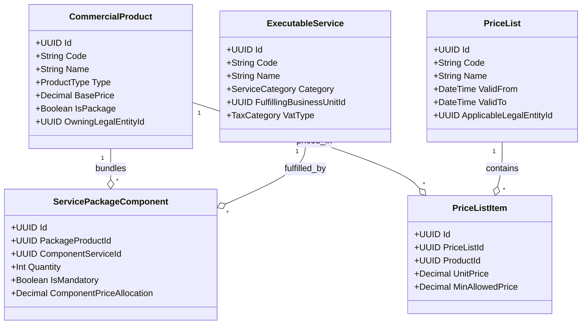

# TÀI LIỆU YÊU CẦU NGHIỆP VỤ — QUẢN TRỊ DANH MỤC SẢN PHẨM & DỊCH VỤ (BUS-02)
Mã tài liệu: `BUS-DOC-03-01` | Phiên bản: `1.0.0` | Ngày hiệu lực: `2026-10-28`  
Phụ trách: **Senior Product Owner / Enterprise Business Analyst / Solution Architect**  
Mã Phân Hệ: `COMMERCIAL` | Danh mục: **Product & Service Catalog Management**  
Trạng thái: `PROPOSED` (Chuẩn hóa toàn diện danh mục thương mại đa pháp nhân)

---

## 1. TỔNG QUAN KIẾN TRÚC DANH MỤC THƯƠNG MẠI (COMMERCIAL CATALOG ARCHITECTURE)

Trong hệ sinh thái giáo dục và di trú của SHD Corp, việc quản lý sản phẩm và dịch vụ có tính chất đặc thù phức tạp:
- Khách hàng mua **Gói Sản Phẩm Thương Mại (Commercial Package)** (Ví dụ: *"Gói Du học Hàn Quốc D4-1 Trọn Gói Kỳ Thu 2026"*).
- Gói sản phẩm thương mại này được cấu thành từ nhiều **Dịch Vụ Thực Thi Độc Lập (Executable Services)** (Đào tạo tiếng Hàn, Thẩm định hồ sơ visa, Đưa đón sân bay tại Seoul).
- Các dịch vụ này lại do các **Pháp nhân hoặc Đơn vị Vận hành khác nhau** chịu trách nhiệm thực hiện.

---

## 2. PHÂN ĐỊNH CÁC KHÁI NIỆM CỐT LÕI (CORE COMMERCIAL CONCEPTS)

1. **Sản phẩm Thương mại (Commercial Product):**
   - Đơn vị hàng hóa/dịch vụ được niêm yết bán cho khách hàng trên báo giá và hợp đồng.
   - Có thể là:
     - *Sản phẩm đơn lẻ (Single Service):* Khóa học Topik 2 cấp tốc (3 tháng); Dịch vụ dịch thuật công chứng hồ sơ du học độc lập.
     - *Gói sản phẩm tổng hợp (Composite Service Package):* Gói du học trọn gói bao gồm toàn bộ quá trình từ đào tạo, visa đến đón sân bay.
2. **Dịch vụ Thực thi (Executable Service):**
   - Nhiệm vụ công việc thực tế mà một đơn vị nghiệp vụ trong SHD Corp phải cung cấp cho học viên sau khi ký hợp đồng.
   - Mỗi dịch vụ gắn với một Khối Nghiệp vụ chịu trách nhiệm (`FulfillingBusinessUnitId`):
     - Dịch vụ Đào tạo tiếng $\rightarrow$ Khối Học viện (`BU_LANG`).
     - Dịch vụ Xin Visa & Thư mời $\rightarrow$ Khối Hồ sơ (`BU_VISA`).
     - Dịch vụ Hỗ trợ Hải ngoại $\rightarrow$ Văn phòng Quốc tế (`BU_CARE`).
3. **Cấu phần Gói Sản phẩm (Package Components):**
   - Bảng định mức chi tiết các dịch vụ cấu thành gói sản phẩm thương mại.
   - Phân biệt:
     - *Thành phần bắt buộc (Mandatory):* Bắt buộc phải có trong gói (ví dụ: Phí dịch thuật hồ sơ).
     - *Thành phần tùy chọn (Optional Add-on):* Khách hàng có thể chọn thêm hoặc bỏ bớt (ví dụ: Ở ký túc xá tại Việt Nam; Khóa luyện phỏng vấn VIP 1-1).
4. **Pháp nhân Sở hữu Sản phẩm vs Đơn vị Bán vs Đơn vị Thực hiện:**
   - **Pháp nhân Sở hữu (Owning Legal Entity):** Pháp nhân nắm bản quyền chương trình và đứng tên ký hợp đồng.
   - **Đơn vị Bán hàng (Selling BU):** Khối tuyển sinh tiếp thị và chốt doanh số với khách hàng.
   - **Đơn vị Thực thi (Fulfilling Unit):** Đơn vị trực tiếp triển khai cung cấp dịch vụ cho học viên.

---

## 3. CHÍNH SÁCH GIÁ, THUẾ & CHIẾT KHẤU (PRICING, TAX & DISCOUNT POLICY)

### 3.1. Bảng Giá Đa Tầng (Multi-tier Price Lists)
- **Bảng Giá Chuẩn (Standard Price List):** Bảng giá niêm yết công khai của tập đoàn áp dụng cho toàn bộ các cơ sở.
- **Bảng Giá Theo Mùa / Kỳ Tuyển Sinh (Seasonal Price List):** Bảng giá áp dụng riêng cho kỳ tuyển sinh mùa Thu (Tháng 9) hoặc mùa Xuân (Tháng 3).
- **Bảng Giá Theo Khu Vực (Regional Price List):** Điều chỉnh đơn giá phù hợp với mức sống từng địa bàn (Chi nhánh Hà Nội / Chi nhánh TP.HCM / Văn phòng Đại diện Tỉnh).
- **Quy tắc hiệu lực giá (`BR-COM-001`):** Tại một thời điểm, một sản phẩm chỉ có 01 mức giá có hiệu lực cao nhất theo thứ tự ưu tiên: `Bảng giá chiến dịch > Bảng giá khu vực > Bảng giá chuẩn`.

### 3.2. Chính sách Thuế Giá Trị Gia Tăng (VAT Treatment)
Tuân thủ Luật Thuế Việt Nam trong lĩnh vực giáo dục và du học:
- **Dịch vụ Đào tạo Ngoại ngữ & Khảo thí:** Thuộc đối tượng **Không chịu thuế GTGT** (Non-taxable education).
- **Dịch vụ Tư vấn Du học & Xử lý Hồ sơ Di trú:** Áp dụng thuế suất **Thuế GTGT 10%** (hoặc 8% theo các nghị quyết giảm thuế hiện hành của Chính phủ).
- **Khoản Thu Hộ Chi Hộ (Out-of-Pocket Disbursements):** Tiền học phí nộp thẳng sang trường Hàn Quốc/Đức, phí nộp visa cho Đại sứ quán $\rightarrow$ Không tính vào doanh thu chịu thuế của SHD Corp (`Non-VAT Pass-through`).

### 3.3. Chính sách Phân cấp Duyệt Giảm Giá (Discount Authorization Matrix)
Nhằm kiểm soát biên lợi nhuận dịch vụ, hạn mức giảm giá được thiết lập chặt chẽ theo cấp bậc nhân sự:

| Cấp Bậc Phê Duyệt | Hạn Mức Giảm Giá Tối Đa Trên Hợp Đồng | Hình Thức Phê Duyệt |
|---|---|---|
| **Chuyên viên Tư vấn (Counselor)** | $\le 1.000.000$ VNĐ (hoặc Voucher hợp lệ) | Tự động duyệt theo mã khuyến mại |
| **Trưởng phòng Tuyển sinh (Sales Manager)** | $\le 3.000.000$ VNĐ | Duyệt trực tiếp trên hệ thống |
| **Giám đốc Chi nhánh (Branch Director)** | $\le 5.000.000$ VNĐ | Khởi tạo Workflow duyệt 1 cấp |
| **Tổng Giám đốc / Giám đốc BU (CEO / BU Head)**| $> 5.000.000$ VNĐ (hoặc miễn giảm đặc biệt) | Workflow đa cấp (FND-03) |

---

## 4. QUY TẮC NGHIỆP VỤ CATALOG (BUSINESS RULES)

- `BR-COM-001`: Quy tắc thứ tự ưu tiên áp dụng Bảng giá. Tại một thời điểm, một sản phẩm chỉ có 01 mức giá có hiệu lực cao nhất theo thứ tự: `Bảng giá chiến dịch > Bảng giá khu vực > Bảng giá chuẩn`.
- `BR-COM-002`: Giá bán trên Báo giá không được thấp hơn giá sàn (`MinAllowedPrice`) quy định trong Bảng giá trừ khi có văn bản phê duyệt ngoại lệ của Tổng Giám đốc.
- `BR-COM-003`: Mỗi sản phẩm bắt buộc phải xác định rõ `OwningLegalEntityId` để đảm bảo hợp đồng được ký đúng tư cách pháp nhân được cấp phép.
- `BR-COM-004`: Tính bất biến và cấm xóa vật lý sản phẩm hoặc dịch vụ nào đã từng phát sinh Báo giá hoặc Hợp đồng. Chỉ được đổi trạng thái sang `Deprecated` hoặc `Inactive`.

