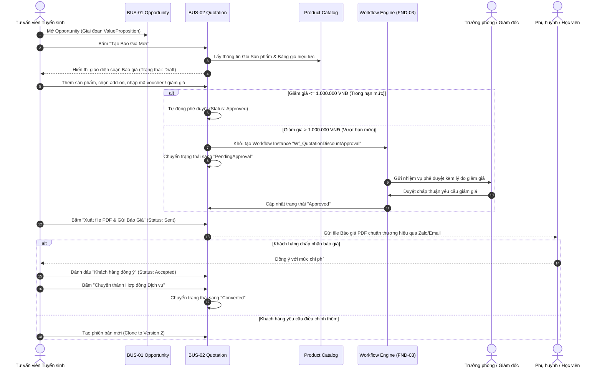
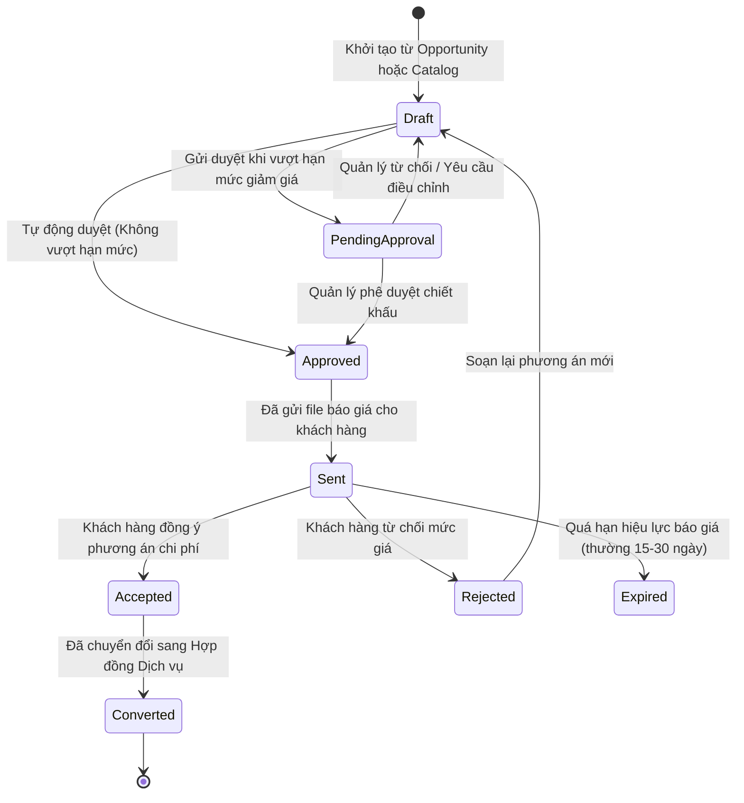

# TÀI LIỆU YÊU CẦU NGHIỆP VỤ — QUẢN LÝ BÁO GIÁ THƯƠNG MẠI (BUS-02)
Mã tài liệu: `BUS-DOC-03-02` | Phiên bản: `1.0.0` | Ngày hiệu lực: `2026-10-28`  
Phụ trách: **Senior Product Owner / Enterprise Business Analyst / Solution Architect**  
Mã Phân Hệ: `COMMERCIAL` | Danh mục: **Quotation Management**  
Trạng thái: `PROPOSED` (Tích hợp FND-03 Workflow Engine)

---

## 1. MỤC TIÊU & TỔNG QUAN NGHIỆP VỤ BÁO GIÁ

Phân hệ **Quản lý Báo giá (Quotation Management)** đóng vai trò là cầu nối thương mại trực tiếp giữa giai đoạn tư vấn tuyển sinh (BUS-01 CRM) và giai đoạn ký kết hợp đồng pháp lý (BUS-02 Commercial Contract).

### 1.1. Mục tiêu Cốt lõi
- **Chuẩn hóa Bảng tính Chi phí:** Loại bỏ việc nhân viên tự gõ bảng chi phí thủ công trên file Word/Excel gửi phụ huynh, tránh nhầm lẫn hoặc tự ý hứa hẹn mức giá sai chính sách.
- **Tự động hóa Tính toán Chiết khấu & Thuế:** Bóc tách chính xác các khoản phí dịch vụ chịu thuế VAT, học phí đào tạo không chịu thuế và các khoản thu hộ nộp sang trường nước ngoài.
- **Kiểm soát Chiết khấu & Học bổng Qua Workflow:** Tự động kích hoạt luồng phê duyệt đa cấp theo hạn mức giảm giá thông qua **FND-03 Workflow Engine**.
- **Quản lý Phiên bản Báo giá (Quotation Versioning):** Lưu trữ bất biến các bản sửa đổi khi phụ huynh đàm phán thêm ưu đãi (VD: `BG-202610-0012-V1`, `BG-202610-0012-V2`).
- **Chuyển đổi 1-Click sang Hợp đồng:** Tự động kế thừa toàn bộ cấu trúc dòng sản phẩm đã duyệt sang Hợp đồng mà không cần soạn thảo lại từ đầu.

---

## 2. QUY TRÌNH QUẢN TRỊ BÁO GIÁ (QUOTATION WORKFLOW)

---

## 3. MÁY TRẠNG THÁI BÁO GIÁ (QUOTATION STATE MACHINE)

### Chi tiết các trạng thái:
- **`Draft` (Bản nháp):** Đang soạn thảo, có thể tùy chỉnh sản phẩm và chiết khấu tùy ý. Chưa gửi cho khách hàng.
- **`PendingApproval` (Chờ phê duyệt):** Báo giá bị khóa chỉnh sửa, chuyển sang hàng đợi của cấp quản lý phê duyệt chính sách giảm giá.
- **`Approved` (Đã phê duyệt):** Đã sẵn sàng phát hành cho khách hàng.
- **`Sent` (Đã gửi):** Đã xuất bản in/PDF chính thức và gửi cho khách hàng.
- **`Accepted` (Khách hàng chấp thuận):** Khách hàng đồng ý các điều khoản chi phí.
- **`Rejected` (Khách hàng từ chối):** Khách hàng không đồng ý mức giá hoặc lộ trình.
- **`Expired` (Hết hạn):** Quá ngày hiệu lực (`ValidUntilDate`) mà khách hàng chưa phản hồi chốt hợp đồng.
- **`Converted` (Đã chuyển thành Hợp đồng):** Trạng thái đóng thành công, đã sinh bản ghi Hợp đồng pháp lý trong hệ thống.

---

## 4. QUY TẮC NGHIỆP VỤ BÁO GIÁ (BUSINESS RULES)

- `BR-COM-010`: Mỗi Báo giá bắt buộc phải có ngày hết hạn (`ValidUntilDate`), mặc định là **15 ngày** kể từ ngày tạo nếu không có chỉ định khác.
- `BR-COM-011`: Báo giá ở trạng thái `Sent` không được phép sửa đổi trực tiếp. Nếu khách hàng muốn thay đổi hạng mục hoặc mức giá, nhân viên phải tạo một phiên bản mới (Revision: `V2`, `V3`). Phiên bản cũ được lưu trữ phục vụ đối chiếu lịch sử.
- `BR-COM-012`: Tổng mức chiết khấu trên một Báo giá không được vượt quá **15% tổng giá trị hợp đồng** trong bất kỳ trường hợp nào, trừ khi có phê chuẩn bằng văn bản của Chủ tịch Hội đồng Quản trị.
- `BR-COM-013`: Khi một Báo giá được chuyển đổi thành Hợp đồng (`Converted`), tất cả các phiên bản Báo giá khác thuộc cùng Opportunity đó sẽ tự động chuyển sang trạng thái `Superseded` (Bị thay thế).

