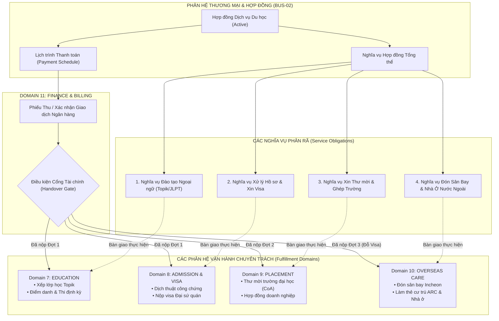

# TÀI LIỆU YÊU CẦU NGHIỆP VỤ — BÀN GIAO & NGHĨA VỤ THỰC HIỆN DỊCH VỤ (BUS-02)
Mã tài liệu: `BUS-DOC-03-05` | Phiên bản: `1.0.0` | Ngày hiệu lực: `2026-10-28`  
Phụ trách: **Senior Product Owner / Enterprise Business Analyst / Solution Architect**  
Mã Phân Hệ: `COMMERCIAL` | Danh mục: **Service Obligations & Handover Management**  
Trạng thái: `PROPOSED` (Thiết kế tích hợp liên phân hệ thương mại - vận hành - tài chính)

---

## 1. NGUYÊN TẮC PHÂN TÁCH BẢN QUYỀN HỢP ĐỒNG & THỰC THI DỊCH VỤ

Trong kiến trúc SHD OneERP, nguyên tắc thiết kế bất biến là:
> **Hợp đồng (Contract) là cam kết Pháp lý & Tài chính; Nghĩa vụ Dịch vụ (Service Obligation) là công việc Vận hành thực tế.**

Không được nhồi nhét logic điểm danh, lịch thi hay tiến độ xin visa vào thực thể Hợp đồng. Thay vào đó, Hợp đồng đóng vai trò là "gốc" phát sinh các **Nghĩa Vụ Thực Hiện Dịch Vụ (Service Obligations)** và bàn giao sang các phân hệ chuyên trách.

---

## 2. PHÂN RÃ CÁC NGHĨA VỤ THỰC THI (SERVICE OBLIGATION DECOMPOSITION)

### 2.1. Nghĩa vụ 1: Đào tạo Ngoại ngữ & Khảo thí (Education Obligation)
- **Đơn vị tiếp nhận:** Khối Học viện (`SHD Academy`) hoặc Trung tâm Ngoại ngữ chi nhánh.
- **Dữ liệu bàn giao:** Mã học viên (`PartyId`), Trình độ ngôn ngữ hiện tại, Mục tiêu chuẩn đầu ra (VD: Topik 2 trong vòng 4 tháng), Lịch học đăng ký (Sáng / Chiều / Tối).
- **Trạng thái thực hiện:** `NotStarted` $\rightarrow$ `ClassAssigned` $\rightarrow$ `InTraining` $\rightarrow$ `PassedExam` $\rightarrow$ `Completed`.

### 2.2. Nghĩa vụ 2: Xử lý Hồ sơ & Xin Visa Di trú (Admission & Visa Obligation)
- **Đơn vị tiếp nhận:** Phòng Hồ sơ & Pháp lý Di trú.
- **Dữ liệu bàn giao:** Bản scan giấy tờ gốc (Học bạ, Bằng tốt nghiệp, Sổ hộ khẩu, CCCD, Sao kê tài chính ngân hàng).
- **Trạng thái thực hiện:** `DossierReceived` $\rightarrow$ `Translated` $\rightarrow$ `Apostilled` $\rightarrow$ `SubmittedToSchool` $\rightarrow$ `SubmittedToEmbassy` $\rightarrow$ `VisaGranted` / `VisaDenied`.

### 2.3. Nghĩa vụ 3: Thư mời Nhập học & Khảo sát Trường (International Placement)
- **Đơn vị tiếp nhận:** Khối Hợp tác Quốc tế.
- **Dữ liệu bàn giao:** Nguyện vọng chọn trường (Trường công lập/dân lập, vùng Seoul hay Busan), ngành học mong muốn.
- **Trạng thái thực hiện:** `Applied` $\rightarrow$ `InterviewScheduled` $\rightarrow$ `CoAIssued` $\rightarrow$ `TuitionInvoicePaid`.

### 2.4. Nghĩa vụ 4: Hỗ trợ Đón Sân Bay & Chăm sóc Hải ngoại (Overseas Care)
- **Đơn vị tiếp nhận:** Văn phòng Đại diện Hải ngoại (Hàn Quốc, Đức, Nhật).
- **Dữ liệu bàn giao:** Lịch trình vé máy bay chính thức, số hiệu chuyến bay, địa chỉ trường đại học, đăng ký ký túc xá hay thuê trọ ngoài.
- **Trạng thái thực hiện:** `FlightScheduled` $\rightarrow$ `AirportPickedUp` $\rightarrow$ `HousingAssigned` $\rightarrow$ `ArcRegistered` $\rightarrow$ `Settled`.

---

## 3. CƠ CHẾ ĐỒNG BỘ CỔNG TÀI CHÍNH (FINANCIAL GATES & PAYMENT MILESTONES)

Các khâu bàn giao vận hành chỉ được phép kích hoạt khi thỏa mãn điều kiện thanh toán theo đúng quy chế quản trị rủi ro tài chính của SHD Corp:

| Mốc Thanh Toán (Payment Milestone) | Tỷ Lệ / Số Tiền Dự Kiến | Thời Điểm Kích Hoạt | Nghĩa Vụ Vận Hành Được Mở Khóa (Unlocking Gate) |
|---|---|---|---|
| **Đợt 1: Phí Mở Hồ Sơ & Nhập Học Tiếng** | 20.000.000 - 30.000.000 đ | Ngay khi ký hợp đồng dịch vụ | - Xếp lớp học tiếng Topik tại cơ sở đào tạo. - Bắt đầu dịch thuật công chứng hồ sơ. |
| **Đợt 2: Học Phí Trường Nước Ngoài** | Theo Invoice của trường | Khi trường gửi Hóa đơn nộp tiền (Invoice) | - Chuyển tiền học phí sang trường đại học. - Xin Giấy chứng nhận nhập học chính thức (CoA). |
| **Đợt 3: Hoàn Tất Hợp Đồng (Phí Visa & Bay)**| Số tiền còn lại của hợp đồng | Khi có mã code visa hoặc đỗ visa ĐSQ | - Mua vé máy bay quốc tế. - Bàn giao thông tin cho Văn phòng Hải ngoại đón tiếp. |

---

## 4. RANH GIỚI VÀ ĐIỂM TÍCH HỢP VỚI PHÂN HỆ TÀI CHÍNH (FINANCE INTEGRATION BOUNDARY)

Để đảm bảo tính độc lập và module hóa:
1. **Phân hệ Commercial (BUS-02) chịu trách nhiệm:**
   - Quản lý **Kế hoạch thu tiền (Payment Schedule)** và các Mốc nghĩa vụ (Milestones).
   - Quản lý số dư công nợ danh nghĩa trên hợp đồng (`ContractReceivables`).
   - Gửi yêu cầu lập hóa đơn (Billing Request) sang Finance.
2. **Phân hệ Finance (Domain 11) chịu trách nhiệm:**
   - Ghi nhận **Giao dịch thực tế (Bank Transaction / Cash Receipt)**.
   - Đối soát sao kê ngân hàng và gạch nợ công nợ.
   - Xuất Hóa đơn điện tử GTGT chính thức (qua VNPT/Viettel Invoice API).
   - Hạch toán sổ cái kế toán tổng hợp (General Ledger) và tính thuế nhà nước.
3. **Cơ chế giao tiếp:** Thông qua sự kiện bất đồng bộ Transactional Outbox:
   - `Commercial` bắn sự kiện: `PaymentMilestoneDueEvent`.
   - `Finance` bắn sự kiện: `PaymentReceiptConfirmedEvent`.
   - Khi nhận được `PaymentReceiptConfirmedEvent`, `Commercial` tự động mở khóa trạng thái của Nghĩa vụ tương ứng.

