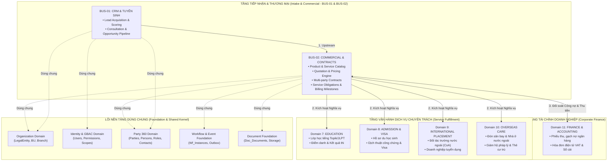

# BẢN ĐỒ MIỀN NGHIỆP VỤ & RANH GIỚI LIÊN PHÂN HỆ (BUSINESS DOMAIN MAP)
Mã tài liệu: `BUS-DOC-04-01` | Phiên bản: `1.0.0` | Ngày hiệu lực: `2026-10-28`  
Phụ trách: **Senior Product Owner / Enterprise Business Analyst / Solution Architect**  
Phương pháp luận: **Domain-Driven Design (DDD) & Context Mapping**

---

## 1. TỔNG THỂ BẢN ĐỒ CÁC MIỀN NGHIỆP VỤ (BOUNDED CONTEXT TOPOLOGY)

Trong kiến trúc Modular Monolith của SHD OneERP, toàn bộ hệ sinh thái được phân chia thành **14 Bounded Contexts**. Hai phân hệ **BUS-01 (CRM)** và **BUS-02 (Commercial)** đóng vai trò là "Cửa ngõ Doanh thu & Pháp lý" của toàn bộ doanh nghiệp.

---

## 2. MA TRẬN MỐI QUAN HỆ GIỮA CÁC MIỀN (CONTEXT MAPPING RELATIONSHIPS)

Áp dụng các mẫu quan hệ chuẩn DDD (Domain-Driven Design Context Mapping):

| Cặp Domain Giao Tiếp | Loại Mối Quan Hệ (Relationship Type) | Cơ Chế Tương Tác Kỹ Thuật | Mô Tả Ranh Giới Nghiệp Vụ |
|---|---|---|---|
| **CRM $\rightarrow$ Party 360** | **Conformist (Tuân thủ)** | Direct Domain Service (`IPartyService`) | CRM tuân thủ định dạng định danh Party của Foundation; không tự tạo bảng Person riêng. |
| **CRM $\rightarrow$ Commercial** | **Customer / Supplier (Khách - Thợ)** | Domain Events + Contract Request DTO | CRM cung cấp Khách hàng tiềm năng & Nguyện vọng; Commercial cung cấp Gói sản phẩm & Báo giá. |
| **Commercial $\rightarrow$ Workflow** | **Open Host Service (OHS)** | `IWorkflowEngine` Interface | Commercial sử dụng động cơ workflow nền tảng để phê duyệt Báo giá và Hợp đồng. |
| **Commercial $\rightarrow$ Fulfillment (Edu, Visa, Care)** | **Upstream / Downstream (Thượng nguồn / Hạ nguồn)** | Transactional Outbox Domain Events | Commercial phát sự kiện kích hoạt; các Domain Fulfillment đăng ký tiêu thụ bất đồng bộ. |
| **Commercial $\leftrightarrow$ Finance** | **Partnership (Hợp tác hai chiều)** | Eventual Consistency qua Outbox | Commercial quản lý lịch nộp tiền hợp đồng; Finance quản lý giao dịch thu tiền thực tế và gạch nợ. |
| **Tất cả $\rightarrow$ Organization & Identity** | **Shared Kernel (Lõi chia sẻ)** | GBAC Policies & Data Scopes | Mọi domain đều chia sẻ cấu trúc Legal Entity, Business Unit, Branch và User. |

---

## 3. NGUYÊN TẮC BẢO TOÀN TÍNH ĐỘC LẬP MIỀN (LOOSE COUPLING PRINCIPLES)

1. **Không Truy vấn Chéo Database Schema Trực tiếp (No Cross-boundary SQL Joins):**
   - Khi Service của `CRM` cần thông tin `Contract`, nó không được phép `JOIN` trực tiếp vào bảng `Com_Contracts` trong cùng transaction nếu không thuộc facade CQRS được định nghĩa trước.
   - Thao tác ghi dữ liệu của từng Domain phải độc lập tuyệt đối trong DbContext của module đó.
2. **Giao tiếp Bất đồng bộ qua Sự kiện Miền (Async via Domain Events):**
   - Mọi thay đổi trạng thái có ảnh hưởng sang phân hệ khác đều phải phát sinh Domain Event (Ví dụ: `ContractActivatedDomainEvent`).
   - Các Domain tiếp nhận (như `Education`, `AdmissionVisa`) tự lắng nghe sự kiện và tạo hồ sơ nội bộ độc lập. Nếu phân hệ Đào tạo bị gián đoạn, việc ký kết hợp đồng bên Commercial vẫn diễn ra thông suốt.

