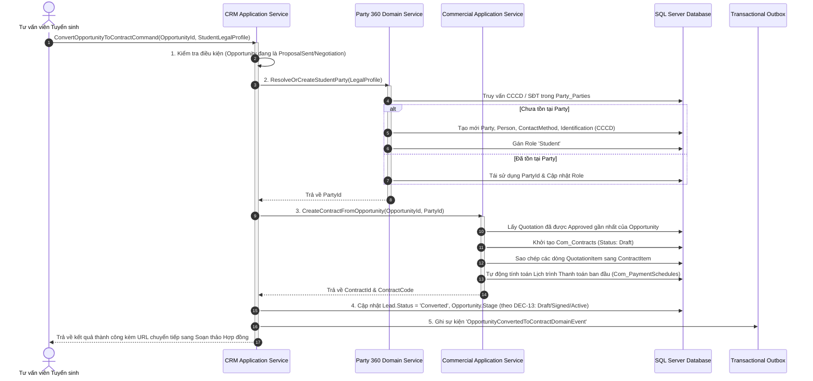

# QUY TRÌNH CHUYỂN GIAO CRM SANG HỢP ĐỒNG (CRM TO CONTRACT HANDOFF)
Mã tài liệu: `BUS-DOC-04-02` | Phiên bản: `1.0.0` | Ngày hiệu lực: `2026-10-28`  
Phụ trách: **Senior Product Owner / Enterprise Business Analyst / Solution Architect**  
Mục tiêu: **Chuẩn hóa điểm chuyển tiếp giữa Giai đoạn Tư vấn Tuyển sinh và Quản lý Hợp đồng Pháp lý**

---

## 1. BẢI TOÁN NGHIỆP VỤ & NGUY CƠ ĐỨT GÃY DỮ LIỆU

Trong vận hành truyền thống của các công ty tư vấn du học, khâu bàn giao từ Tư vấn tuyển sinh sang Pháp chế/Hợp đồng là nơi xảy ra tỷ lệ lỗi cao nhất:
- Nhân viên hợp đồng phải nhập lại bằng tay toàn bộ họ tên, CCCD, ngày sinh từ file ghi chú của tư vấn viên $\rightarrow$ Dẫn đến sai sót trên bản in hợp đồng chính thức.
- Báo giá một đằng, hợp đồng ký một nẻo do thiếu cơ chế khóa giá và kế thừa dòng chi phí đã duyệt.
- Tranh chấp về pháp nhân ký kết: Tư vấn viên tư vấn thương hiệu A nhưng lập hợp đồng thuộc pháp nhân B chưa được phân bổ ngân sách.

Hệ thống SHD OneERP giải quyết triệt để vấn đề này bằng **Quy trình Chuyển giao Tự động hóa Liền mạch (Automated Seamless Handoff)**.

---

## 2. MA TRẬN ÁNH XẠ DỮ LIỆU CHUYỂN GIAO (DATA MAPPING CONTRACT)

| Thực Thể Nguồn (CRM Domain) | Trường Nguồn | Thực Thể Đích (Party 360 / Commercial) | Trường Đích | Quy Tắc Chuyển Đổi & Ràng Buộc |
|---|---|---|---|---|
| `Crm_Leads` | `FullName` | `Party_Persons` | `LastName`, `FirstName` | Tự động bóc tách Họ và Tên theo từ điển tiếng Việt. |
| `Crm_Leads` | `PhoneNumber` | `Party_PartyContactMethods` | `Value` (`ContactType=Phone`) | Gán cờ `IsPrimary = true`. |
| `Crm_Leads` | `Email` | `Party_PartyContactMethods` | `Value` (`ContactType=Email`) | Gán cờ `IsPrimary = true` (nếu có). |
| `Crm_Opportunities`| `StudentCccd` | `Party_PartyIdentifications` | `IdNumber` (`IdType=CCCD`) | Kiểm tra trùng lặp trên toàn hệ thống. |
| `Crm_Opportunities`| `ScopeLegalEntityId` | `Com_Contracts` | `ContractingLegalEntityId` | Xác định pháp nhân ký kết. |
| `Crm_Opportunities`| `ScopeBusinessUnitId`| `Com_Contracts` | `SellingBusinessUnitId` | Ghi nhận doanh số tuyển sinh cho đơn vị bán. |
| `Crm_Opportunities`| `ScopeBranchId` | `Com_Contracts` | `SellingBranchId` | Địa điểm chi nhánh tiếp nhận hồ sơ. |
| `Com_Quotations` | `Id` | `Com_Contracts` | `QuotationId` | Khóa liên kết với Báo giá đã được chấp thuận. |
| `Com_Quotations` | `GrandTotal` | `Com_Contracts` | `TotalContractValue` | Kế thừa 100% giá trị hợp đồng sau chiết khấu. |
| `Com_QuotationItems`| Toàn bộ danh sách dòng | `Com_ContractItems` | Toàn bộ danh sách dòng | Sao chép bất biến snapshot sản phẩm/dịch vụ. |

---

## 3. SƠ ĐỒ TRÌNH TỰ CHUYỂN GIAO CHI TIẾT (SEQUENCE SPECIFICATION)

---

## 4. XỬ LÝ LỖI & NGOẠI LỆ (ERROR & ROLLBACK STRATEGY)

1. **Lỗi Xung đột CCCD (Identity Conflict):**
   - Nếu số CCCD nhập vào đã tồn tại trong `Party_PartyIdentifications` nhưng họ tên hoặc ngày sinh không khớp với dữ liệu cũ:
   - Hệ thống lập tức trả về lỗi HTTP 409 Conflict với mã lỗi `PARTY_IDENTITY_MISMATCH`.
   - Toàn bộ transaction bị Rollback; Opportunity không bị đóng thành `ClosedWon`.
2. **Lỗi Chưa có Báo giá Phê duyệt (No Approved Quotation):**
   - Nếu Opportunity chưa từng có Báo giá nào ở trạng thái `Approved`:
   - Hệ thống chặn chuyển đổi với mã lỗi `OPPORTUNITY_REQUIRES_APPROVED_QUOTATION`.
   - Yêu cầu tư vấn viên hoàn tất quy trình báo giá và duyệt chiết khấu trước.
3. **Quy tắc Ghi nhận ClosedWon theo Quyết định PO (`DEC-13` - `PO_DECISION_REQUIRED`):**
   - *Phương án 1 (Handoff to Draft):* Cập nhật `Opportunity.Stage = 'ClosedWon'` ngay khi tạo Hợp đồng nháp thành công; có cơ chế Reopen về `Negotiation` nếu Hợp đồng nháp bị xóa/hủy.
   - *Phương án 2 (Contract Signed - Khuyến nghị kỹ thuật):* Bước 4 chuyển Opportunity sang `ContractDrafted`, chỉ chuyển `ClosedWon` khi nhận sự kiện `ContractSignedEvent`.
   - *Phương án 3 (Contract Activated):* Opportunity chỉ chuyển `ClosedWon` khi nhận sự kiện `ContractActivatedEvent` sau khi đóng cọc Đợt 1.

