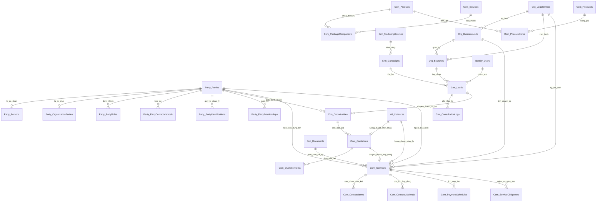

# MÔ HÌNH DỮ LIỆU TỔNG THỂ DOANH NGHIỆP (ENTERPRISE BUSINESS DATA MODEL)
Mã tài liệu: `BUS-DOC-04-05` | Phiên bản: `1.0.0` | Ngày hiệu lực: `2026-10-28`  
Phụ trách: **Senior Product Owner / Enterprise Business Analyst / Solution Architect**  
Phạm vi: **Hợp nhất CRM, Commercial, Party 360, Organization, Documents & Workflow**

---

## 1. SƠ ĐỒ THỰC THỂ DOANH NGHIỆP TOÀN DIỆN (ENTERPRISE MASTER ERD)

---

## 2. MA TRẬN QUAN HỆ & BẢN SỐ (CARDINALITY MATRIX)

| Thực Thể Gốc (Source Entity) | Quan Hệ | Thực Thể Đích (Target Entity) | Bản Số (Cardinality) | Ý Nghĩa Nghiệp Vụ |
|---|:---:|---|:---:|---|
| `Party_Parties` | $1 \rightarrow N$ | `Crm_Leads` | $1 : 0..N$ | Một người có thể để lại nhiều Lead qua nhiều năm/kỳ tuyển sinh khác nhau. |
| `Crm_Leads` | $1 \rightarrow 1$ | `Crm_Opportunities` | $1 : 0..1$ | Một Lead chỉ chuyển đổi thành tối đa 01 Opportunity trong cùng một chu kỳ tuyển sinh. |
| `Crm_Opportunities` | $1 \rightarrow N$ | `Com_Quotations` | $1 : 1..N$ | Một cơ hội có thể có nhiều phiên bản Báo giá (V1, V2, V3) trong quá trình đàm phán. |
| `Com_Quotations` | $1 \rightarrow 1$ | `Com_Contracts` | $1 : 0..1$ | Chỉ có 01 Báo giá được chấp thuận mới được chuyển đổi thành Hợp đồng chính thức. |
| `Party_Parties` | $1 \rightarrow N$ | `Com_Contracts` | $1 : 0..N$ | Một học viên có thể ký nhiều hợp đồng (Học tiếng, Du học nghề, Chuyển tiếp). |
| `Com_Contracts` | $1 \rightarrow N$ | `Com_ContractItems` | $1 : 1..N$ | Mỗi hợp đồng bao gồm một hoặc nhiều gói sản phẩm / dịch vụ cụ thể. |
| `Com_Contracts` | $1 \rightarrow N$ | `Com_PaymentSchedules`| $1 : 1..N$ | Mỗi hợp đồng có lịch trình thanh toán chia làm nhiều đợt (thường 2 - 4 đợt). |
| `Com_Contracts` | $1 \rightarrow N$ | `Com_ServiceObligations`| $1 : 1..N$ | Mỗi hợp đồng phát sinh nhiều nghĩa vụ (Đào tạo, Hồ sơ visa, Đón sân bay). |
| `Com_Contracts` | $1 \rightarrow N$ | `Com_ContractAddenda` | $1 : 0..N$ | Một hợp đồng có thể có nhiều phụ lục sửa đổi điều khoản qua thời gian. |
| `Doc_Documents` | $1 \rightarrow N$ | `Com_Contracts` | $1 : 1..N$ | Bản scan hợp đồng và các giấy tờ tùy thân được quản lý trong Document Foundation. |

---

## 3. NGUYÊN TẮC BẢO TOÀN DỮ LIỆU & ĐỒNG BỘ DOANH NGHIỆP

1. **Khóa Lạc Quan Toàn Hệ Thống (Optimistic Concurrency Control):**
   - 100% các bảng giao dịch chính (`Crm_Leads`, `Crm_Opportunities`, `Com_Quotations`, `Com_Contracts`) bắt buộc có trường `RowVersion ROWVERSION NOT NULL`.
   - Mọi thao tác cập nhật từ Frontend bắt buộc gửi kèm `RowVersionBase64`. Nếu phát hiện dữ liệu đã bị người khác thay đổi trước đó, hệ thống trả về mã lỗi HTTP 409 Conflict.
2. **Chính Sách Xóa Mềm Bất Biến (Soft Delete & Immutability):**
   - Áp dụng cờ `IsDeleted = 1`, `DeletedAtUtc = SYSUTCDATETIME()`.
   - Hợp đồng ở trạng thái `Active`, `UnderFulfillment`, `Completed` tuyệt đối không được phép xóa mềm lẫn xóa cứng; chỉ có thể chuyển trạng thái sang `Terminated`.
3. **Phân Vùng Dữ Liệu Phân Quyền (Scoped Data Isolation):**
   - Mọi bản ghi giao dịch đều mang đủ bộ 3 khóa ngoại phạm vi: `ScopeLegalEntityId`, `ScopeBusinessUnitId`, `ScopeBranchId`.
   - Stored Procedures đọc dữ liệu luôn lọc theo phạm vi được cấp của người dùng đăng nhập (`IScopeResolver`).

