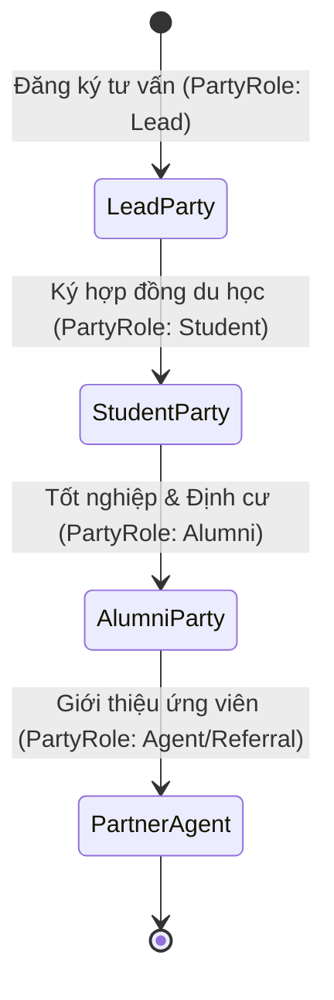

# TÍCH HỢP ĐỊNH DANH TOÀN DIỆN — PARTY 360 INTEGRATION SPECIFICATION
Mã tài liệu: `BUS-DOC-04-03` | Phiên bản: `1.0.0` | Ngày hiệu lực: `2026-10-28`  
Phụ trách: **Senior Product Owner / Enterprise Business Analyst / Solution Architect**  
Tương thích: **Party 360 Foundation (Migration 20261025_0004 & 20261026_0008)**

---

## 1. MỤC TIÊU CHIẾN LƯỢC CỦA PARTY 360 TRONG TOÀN BỘ HỆ SINH THÁI

Trong mô hình tập đoàn đa công ty của SHD Corp, một cá nhân hoặc một tổ chức có thể đóng nhiều vai trò khác nhau tùy theo từng thời điểm và từng pháp nhân:
- **Nguyễn Văn An:** Ban đầu là **Khách hàng tiềm năng (Lead)** $\rightarrow$ Khi ký hợp đồng trở thành **Học viên (Student)** của SHD Edu $\rightarrow$ Sau khi tốt nghiệp trở thành **Cựu du học sinh (Alumni)** $\rightarrow$ Đồng thời đăng ký làm **Cộng tác viên (Agent/Referral)** giới thiệu học viên mới cho SHD Academy.
- **Trường Đại học Chung-Ang (Hàn Quốc):** Đóng vai trò là **Đối tác Tuyển sinh (Partner School)** tiếp nhận du học sinh của SHD Corp.
- **Công ty Dịch thuật ABC:** Đóng vai trò là **Nhà cung cấp Dịch vụ (Vendor)** công chứng hồ sơ.

Thay vì mỗi phân hệ CRM, Commercial, Education, Finance tự tạo một bảng khách hàng riêng lẻ dẫn đến tình trạng một khách hàng có 5 hồ sơ khác nhau, **Party 360 Foundation** cung cấp một mã định danh duy nhất (`PartyId`) toàn hệ thống.

---

## 2. MA TRẬN VAI TRÒ CHỦ THỂ (PARTY ROLES TOPOLOGY)

Bảng ánh xạ các vai trò của Party được phân hệ CRM và Commercial sử dụng:

| Vai Trò (`RoleType`) | Loại Party (`PartyType`) | Phân Hệ Khởi Tạo | Ý Nghĩa Nghiệp Vụ Trong SHD OneERP |
|---|---|---|---|
| `Lead` | `Person` | BUS-01 (CRM) | Ứng viên tiềm năng đang được tư vấn tuyển sinh. |
| `Student` | `Person` | BUS-02 (Commercial) | Học viên chính thức đã ký hợp đồng dịch vụ du học/đào tạo. |
| `Parent` | `Person` | BUS-02 (Commercial) | Người bảo lãnh tài chính, phụ huynh của học viên. |
| `Teacher` | `Person` | Education Domain | Giảng viên, giáo viên dạy tiếng tại các cơ sở đào tạo. |
| `Alumni` | `Person` | Overseas Care Domain | Cựu học viên đã hoàn thành chương trình du học. |
| `Agent` | `Person` / `Org` | BUS-01 (CRM) | Cộng tác viên tuyển sinh hoặc đơn vị đại lý giới thiệu nguồn. |
| `PartnerSchool` | `Organization` | Placement Domain | Trường Nhật ngữ, Cao đẳng, Đại học nước ngoài liên kết. |
| `Vendor` | `Organization` | Commercial / Finance | Nhà cung cấp vé máy bay, bảo hiểm, dịch thuật công chứng. |

---

## 3. MỐI QUAN HỆ GIỮA CÁC CHỦ THỂ (PARTY RELATIONSHIPS)

Hệ thống sử dụng bảng `Party_PartyRelationships` để mô hình hóa mạng lưới quan hệ xã hội và pháp lý:
- **Quan hệ Phụ huynh - Con cái (`ParentChild`):**
  - `FromPartyId`: Phụ huynh (Role: `Parent`).
  - `ToPartyId`: Học viên (Role: `Student`).
  - `RelationshipType`: `Father`, `Mother`, `LegalGuardian`.
  - Giúp gửi thông báo điểm danh, tình hình học tập và thông báo nộp học phí trực tiếp cho phụ huynh.
- **Quan hệ Giới thiệu Tuyển sinh (`Referral`):**
  - `FromPartyId`: Cộng tác viên (Role: `Agent` hoặc `Alumni`).
  - `ToPartyId`: Khách hàng tiềm năng (Role: `Lead`).
  - Phục vụ truy vết tự động để chi trả hoa hồng tuyển sinh.

---

## 4. BẢO MẬT DỮ LIỆU CÁ NHÂN THEO NGHỊ ĐỊNH 13/2023/NĐ-CP

1. **Phân loại Cấp độ Nhạy cảm:**
   - Dữ liệu định danh cá nhân (Số CCCD, Số Hộ chiếu, Ngày sinh, Dấu vân tay/Ảnh chân dung, Hồ sơ tài chính) trong bảng `Party_PartyIdentifications` được gắn nhãn `DataClassification = 'Restricted'`.
2. **Cơ chế Masking Tự động trên Read-side:**
   - Stored Procedure `sp_Party_GetById` hoặc `sp_Party_Search` tự động kiểm tra quyền của `RequestingUserId`. Nếu không có quyền quản trị tối cao hoặc không phải chuyên viên hồ sơ đang thụ lý hợp đồng, số CCCD sẽ được tự động che giấu (VD: `001205***234`).
3. **Kiểm soát Truy vết Toàn diện (Access Auditing):**
   - Mọi truy vấn đọc hoặc xuất dữ liệu hồ sơ cá nhân ra file Excel đều được ghi nhận vào `Audit_SystemLogs` kèm theo địa chỉ IP và lý do truy cập.

