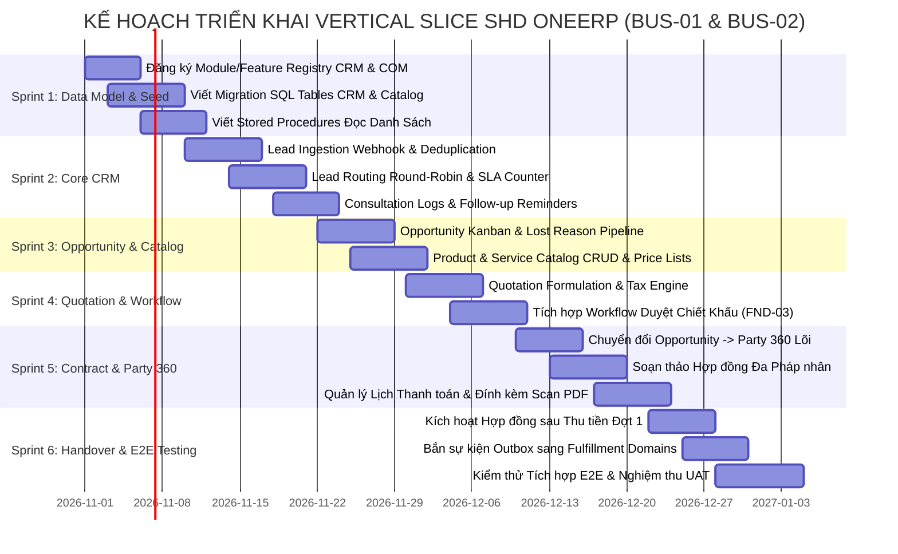

# MA TRẬN PHỤ THUỘC & LỘ TRÌNH THỰC THI (DEPENDENCY MATRIX)
Mã tài liệu: `BUS-DOC-05-03` | Phiên bản: `1.0.0` | Ngày hiệu lực: `2026-10-28`  
Phụ trách: **Senior Product Owner / Enterprise Business Analyst / Solution Architect**  
Phương pháp luận: **Critical Path Method (CPM) & Vertical Slice Sequencing**

---

## 1. MA TRẬN PHỤ THUỘC NỀN TẢNG (FOUNDATION DEPENDENCIES)

Các tính năng của BUS-01 (CRM) và BUS-02 (Commercial) phụ thuộc trực tiếp vào các phân hệ Foundation đã được kiểm chứng trong mã nguồn:

| Phân Hệ / Chức Năng Mới | Phụ Thuộc Vào Foundation Nào | Entity / Service Cụ Thể Cần Tái Sử Dụng | Mức Độ Phụ Thuộc |
|---|---|---|:---:|
| **CRM Lead & Routing** | `FND-01` (Identity & Authorization) | `Identity_Users`, `Identity_UserGroups`, GBAC Scopes | **Bắt buộc (Hard)** |
| **CRM Lead Ingestion** | `Organization Foundation` | `Org_LegalEntities`, `Org_BusinessUnits`, `Org_Branches` | **Bắt buộc (Hard)** |
| **CRM Lead Conversion**| `Party 360 Foundation` | `Party_Parties`, `Party_Persons`, `Party_PartyRoles` | **Bắt buộc (Hard)** |
| **Commercial Catalog** | `Organization Foundation` | `Org_LegalEntities` (Xác định pháp nhân sở hữu sản phẩm) | **Bắt buộc (Hard)** |
| **Quotation Discount** | `FND-03` (Workflow Engine) | `Wf_Definitions`, `Wf_Instances`, `IWorkflowEngine` | **Bắt buộc (Hard)** |
| **Contract Documents** | `Document Foundation` | `Doc_Documents`, `IDocumentStorageService` (SHA256) | **Bắt buộc (Hard)** |
| **Contract Lifecycle** | `FND-03` (Workflow Engine) | `Wf_Definitions`, `Wf_History` (Lưu vết bất biến) | **Bắt buộc (Hard)** |
| **Handoff Events** | `FND-03` (Transactional Outbox) | `System_OutboxMessages`, `AuditSaveChangesInterceptor` | **Bắt buộc (Hard)** |
| **Feature Registry** | `FND-04` (Module Registry) | `System_Modules`, `System_Features`, `ActionPermissions`| **Bắt buộc (Hard)** |
| **All CUD Operations** | `FND-02` (Audit Log Engine) | `Audit_SystemLogs` (Chụp Before/After Diff tự động) | **Bắt buộc (Hard)** |

---

## 2. LỘ TRÌNH THỰC THI THEO SPRINT (VERTICAL SLICE SPRINT PLAN)

---

## 3. ĐƯỜNG GĂNG QUYẾT ĐỊNH (CRITICAL PATH) & QUẢN TRỊ RỦI RO

1. **Rủi ro 1: Chậm phê duyệt Danh mục Pháp nhân thực tế (`TBD-01`):**
   - *Tác động:* Không thể phát hành Hợp đồng chính thức cho UAT.
   - *Biện pháp giảm thiểu:* Dùng danh mục pháp nhân giả định (`SHD_EDU`, `SHD_ACADEMY`) trong code; thiết kế hệ thống đọc động từ DB bảng `Org_LegalEntities`, khi có MST thật chỉ cần update bản ghi mà không phải sửa code.
2. **Rủi ro 2: Thiếu chính sách duyệt chiết khấu chính thức (`Q-COM-02`):**
   - *Tác động:* Logic kiểm tra hạn mức Workflow bị thay đổi.
   - *Biện pháp giảm thiểu:* Lưu hạn mức trong bảng tham số cấu hình hoặc JSON Workflow Definition thay vì hardcode trong C# code.
3. **Rủi ro 3: Bất nhất định danh khi học viên khai sai số CCCD:**
   - *Tác động:* Xung đột dữ liệu trong Party 360.
   - *Biện pháp giảm thiểu:* Bắt buộc upload ảnh chụp 2 mặt CCCD và có bước xác nhận đối chiếu hồ sơ gốc của Cán bộ Pháp chế.

