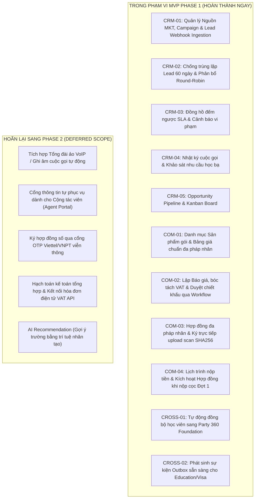

# ĐỀ XUẤT PHẠM VI TRIỂN KHAI MVP PHASE 1 (MVP SCOPE PROPOSAL)
Mã tài liệu: `BUS-DOC-05-02` | Phiên bản: `1.0.0` | Ngày hiệu lực: `2026-10-28`  
Phụ trách: **Senior Product Owner / Enterprise Business Analyst / Solution Architect**  
Chiến lược: **Vertical Slice Architecture — End-to-End từ Tiếp thị tới Kích hoạt Hợp đồng**

---

## 1. NGUYÊN TẮC XÂY DỰNG PHẠM VI MVP

Trong dự án chuyển đổi số SHD OneERP, phương pháp luận phát triển là xây dựng **Lát cắt dọc hoàn chỉnh (Complete Vertical Slice)** thay vì xây dựng bề rộng mà không khép kín được quy trình nghiệp vụ:
- Không phát triển CRM đơn lẻ mà không có Hợp đồng (sẽ dẫn đến tình trạng nhân viên chốt khách nhưng vẫn phải lập hợp đồng trên Word).
- Không phát triển Hợp đồng mà không có Party 360 (sẽ dẫn đến dữ liệu học viên bị phân mảnh).
- **Mục tiêu tối thượng của MVP Phase 1:** Thực thi trơn tru một luồng nghiệp vụ xuyên suốt:  
  *Khách hàng điền form Ads $\rightarrow$ Lead tự động phân bổ $\rightarrow$ Tư vấn viên gọi điện ghi log $\rightarrow$ Tạo Opportunity $\rightarrow$ Lập Báo giá duyệt chiết khấu $\rightarrow$ Sinh Hợp đồng & Nhận tiền cọc Đợt 1 $\rightarrow$ Đồng bộ Party 360 & Bàn giao nghĩa vụ dịch vụ.*

---

## 2. MA TRẬN PHÂN ĐỊNH PHẠM VI (IN-SCOPE vs OUT-OF-SCOPE)

| STT | Hạng Mục Nghiệp Vụ | Phân Loại | Lý Do Phân Bổ & Phương Án Tạm Thời Cho MVP |
|---|---|:---:|---|
| 1 | Tiếp nhận Lead Webhook & Form | **IN MVP** | Nền tảng bắt buộc để dừng việc nhập Google Sheets |
| 2 | Chống trùng lặp Lead (60 ngày) | **IN MVP** | Chấm dứt xung đột hoa hồng giữa các cơ sở |
| 3 | Phân bổ Round-robin theo ca trực | **IN MVP** | Đảm bảo tốc độ gọi điện tiếp cận khách hàng |
| 4 | Nhật ký cuộc gọi & Timeline | **IN MVP** | Giúp theo dõi quá trình chăm sóc học viên |
| 5 | Opportunity Kanban Board | **IN MVP** | Cung cấp góc nhìn phễu bán hàng cho Ban Lãnh đạo |
| 6 | Danh mục Sản phẩm & Gói du học | **IN MVP** | Chuẩn hóa bảng giá và cấu phần gói toàn tập đoàn |
| 7 | Báo giá & Workflow duyệt giảm giá | **IN MVP** | Tái sử dụng FND-03 Workflow Engine |
| 8 | Hợp đồng dịch vụ du học & Ký tươi scan | **IN MVP** | Đảm bảo tính pháp lý, lưu file vào `Doc_Documents` |
| 9 | Lịch thanh toán & Kích hoạt sau cọc | **IN MVP** | Bản lề kết nối thương mại với thực thi |
| 10 | Tự động sinh hồ sơ Party 360 | **IN MVP** | Tái sử dụng Party 360 Foundation đã hoàn thành |
| 11 | Tích hợp Tổng đài VoIP (Click-to-Call)| *Phase 2* | Chờ lựa chọn nhà mạng viễn thông & đấu nối SIP Trunk |
| 12 | Cổng Portal riêng cho CTV | *Phase 2* | MVP sử dụng nhân viên nội bộ nhập mã CTV |
| 13 | Ký số từ xa qua SMS OTP | *Phase 2* | Chờ hợp đồng khung dịch vụ viễn thông |
| 14 | Hạch toán Sổ cái Kế toán | *Phase 2* | Thuộc phạm vi Domain 11 (Finance) ở giai đoạn sau |

---

## 3. CHỈ SỐ ĐO LƯỜNG THÀNH CÔNG CỦA MVP (SUCCESS METRICS / NORTH STAR)

1. **Tỷ lệ Trùng Lặp Lead Ngoại Ý:** Giảm về **0%** trường hợp cùng một số điện thoại bị 2 tư vấn viên gọi điện cùng lúc trong cửa sổ 60 ngày.
2. **Thời Gian Phản Hồi Khách Hàng (Response SLA):** $100\%$ Lead Hot được thực hiện cuộc gọi đầu tiên trong vòng **15 phút** trong giờ hành chính.
3. **Tính Toàn Vẹn Hợp Đồng & Định Danh:** $100\%$ hợp đồng được tạo ra đều gắn đúng Pháp nhân pháp lý chịu trách nhiệm và có mã `PartyId` chuẩn xác trong Party 360.
4. **Không Thất Thoát Dữ liệu Bàn Giao:** $100\%$ học viên nộp tiền Đợt 1 thành công đều tự động kích hoạt trạng thái sẵn sàng xếp lớp tiếng và bàn giao hồ sơ visa.

