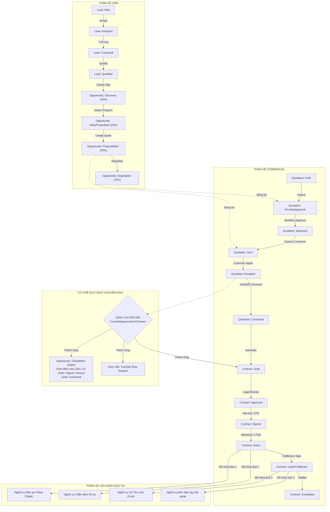

# ĐỐI CHIẾU DỮ LIỆU & QUY TRÌNH LIÊN PHÂN HỆ (CROSS-DOMAIN DATA & WORKFLOW RECONCILIATION)
Mã tài liệu: `BUS-RECON-2026-04` | Phiên bản: `2.0.0` | Ngày hiệu lực: `2026-10-28`  
Phụ trách: **Senior Product Owner / Enterprise Business Analyst / Solution Architect**  
Phạm vi: **Hợp nhất CRM, Commercial, Party 360, Workflow Engine và Fulfillment Domains**

---

## 1. ĐỒNG BỘ HÓA MÁY TRẠNG THÁI TOÀN HỆ THỐNG (END-TO-END STATE SYNCHRONIZATION)

Trong kiến trúc liên kết phân hệ của SHD OneERP, sự chuyển dịch trạng thái của một thực thể ở phân hệ này sẽ kích hoạt có điều kiện sự chuyển dịch trạng thái của thực thể ở phân hệ kế tiếp:



---

## 2. MA TRẬN ĐIỀU KIỆN CHUYỂN GIAO & KỊCH BẢN ROLLBACK (HANDOFF GATES & ROLLBACK)

| Khâu Chuyển Giao | Tác Vụ Thực Thi | Điều Kiện Tiên Quyết (Guards) | Hành Động Khi Thất Bại (Rollback Strategy) |
|---|---|---|---|
| **CRM $\rightarrow$ Party 360** | Tạo mới hoặc ánh xạ `PartyId` cho học viên và người bảo lãnh | Bắt buộc có CCCD, Họ tên, Ngày sinh hợp lệ (`BR-CRM-013`) | Transaction Rollback; Opportunity không được chuyển `ClosedWon`; hiển thị lỗi `PARTY_IDENTITY_MISMATCH`. |
| **CRM $\rightarrow$ Commercial** | Tạo Hợp đồng nháp `Com_Contracts` từ Cơ hội chốt thành công | Bắt buộc có Báo giá ở trạng thái `Approved` được khách đồng ý | Transaction Rollback; không sinh hợp đồng rác; trả về lỗi `APPROVED_QUOTATION_REQUIRED`. |
| **Commercial $\rightarrow$ Finance** | Sinh Lịch trình Thanh toán `Com_PaymentSchedules` | Hợp đồng chuyển sang `Signed` | Nếu tạo lịch trình lỗi, hợp đồng giữ nguyên `Approved` chờ thử lại. |
| **Finance $\rightarrow$ Commercial** | Kích hoạt Hợp đồng `Active` sau khi Kế toán xác nhận Phiếu thu Đợt 1 | Số tiền nộp thực tế $\ge$ Số tiền yêu cầu Đợt 1 (`BR-COM-020`) | Nếu số tiền thiếu, ghi nhận trạng thái `PartiallyPaid`, hợp đồng giữ nguyên `Signed`. |
| **Commercial $\rightarrow$ Fulfillment**| Mở khóa nghĩa vụ dịch vụ `Com_ServiceObligations` | Hợp đồng đã ở trạng thái `Active` (`BR-COM-025`) | Phân hệ Đào tạo không tiếp nhận học viên nếu chưa có cờ `Active`. |

---

## 3. TIẾN TRÌNH TIẾP NỐI VAI TRÒ CHỦ THỂ PARTY 360 (ROLE LIFECYCLE EVOLUTION)

Kiến trúc Party 360 giải quyết bài toán khách hàng quay lại hoặc đóng nhiều vai trò trong tập đoàn SHD Corp:

```mermaid
stateDiagram-v2
    [*] --> LeadRole: 1. Khách hàng để lại thông tin tư vấn
    note right of LeadRole: PartyType: Person<br/>Role: Lead<br/>Scope: Branch/BU tư vấn
    
    LeadRole --> StudentRole: 2. Ký hợp đồng du học & Đóng cọc
    note right of StudentRole: Bổ sung Role: Student<br/>Gán CCCD chính chủ<br/>Liên kết Role: Parent (Bảo lãnh)
    
    StudentRole --> AlumniRole: 3. Nhập học thành công tại nước ngoài
    note right of AlumniRole: Bổ sung Role: Alumni<br/>Lưu thông tin trường nước ngoài<br/>Khai thác mạng lưới cựu học sinh
    
    AlumniRole --> AgentRole: 4. Giới thiệu học viên khóa sau
    note right of AgentRole: Bổ sung Role: Agent (CTV)<br/>Cấp ReferralCode cá nhân<br/>Hưởng hoa hồng tuyển sinh
    
    AgentRole --> [*]
```

### Quy tắc Toàn vẹn Định danh:
1. **Khóa Định danh Bất biến:** `Party.Id` (GUID) được tạo một lần duy nhất khi học viên được xác nhận pháp lý.
2. **Đa Hợp đồng, Chung Định danh:** Học viên Nguyễn Văn An ký hợp đồng tiếng tại SHD Academy năm 2026, sau đó ký hợp đồng du học nghề Đức tại SHD International năm 2027 $\rightarrow$ Cả hai hợp đồng đều trỏ tới cùng một `StudentPartyId`.
3. **Phân quyền Đa Pháp nhân trên cùng một Party:** Quyền xem chi tiết hồ sơ học viên được kiểm soát theo `PartyRole.ScopeLegalEntityId`. Kế toán Pháp nhân Đức chỉ nhìn thấy các Hợp đồng và Vai trò học viên thuộc Pháp nhân Đức.

---

## 4. TÁCH BIỆT BẢN QUYỀN SẢN PHẨM, ĐƠN VỊ BÁN HÀNG VÀ ĐƠN VỊ THỰC HIỆN

Trong môi trường tập đoàn SHD Corp, cấu trúc hợp đồng phản ánh chính xác thực tế vận hành:

```
[ THỰC THỂ HỢP ĐỒNG (Com_Contracts) ]
├── ContractingLegalEntityId : CÔNG TY TNHH GIÁO DỤC QUỐC TẾ SHD (Pháp nhân có giấy phép ký Bên A)
├── SellingBusinessUnitId    : Khối Du học Hàn Quốc (Đơn vị chốt sale, tính KPI doanh số)
├── SellingBranchId          : Chi nhánh TP.HCM (Địa điểm tiếp đón học viên)
└── DANH SÁCH NGHĨA VỤ DỊCH VỤ PHÂN RÃ (Com_ServiceObligations):
    ├── Nghĩa vụ 1: Đào tạo Tiếng Topik  --> FulfillingBusinessUnitId: KHỐI HỌC VIỆN SHD ACADEMY
    ├── Nghĩa vụ 2: Xử lý Hồ sơ Visa    --> FulfillingBusinessUnitId: PHÒNG HỒ SƠ PHÁP LÝ SHD EDU
    └── Nghĩa vụ 3: Đón Sân Bay Incheon --> FulfillingBusinessUnitId: SHD GLOBAL CO., LTD (Hàn Quốc)
```

Kiến trúc này đảm bảo:
- **Tính Pháp lý Minh bạch:** Đúng pháp nhân có chức năng xuất hóa đơn GTGT.
- **Tính Công bằng Vận hành:** Khối bán hàng nhận doanh số; các đơn vị vận hành nhận ngân sách thực hiện nội bộ theo đơn giá định mức của Gói cấu phần (`Com_PackageComponents.AllocatedPrice`).

