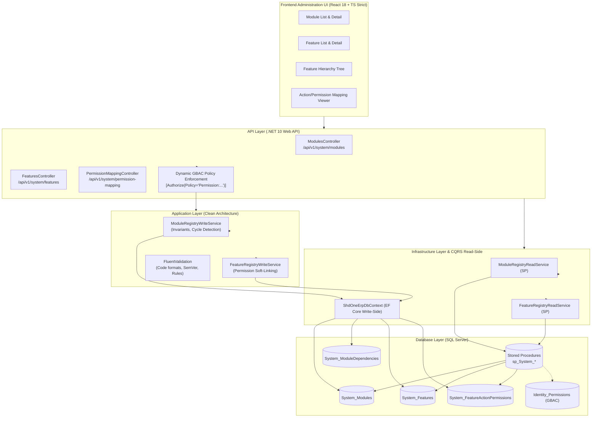

# BÁO CÁO KỸ THUẬT & CÁC QUYẾT ĐỊNH CHỜ PRODUCT OWNER (FND-04)

**Phân hệ:** FND-04: Module & Feature Registry  
**Dự án:** SHD OneERP Enterprise Platform  
**Vai trò đảm nhiệm:** Principal Solution Architect, Senior Full-stack Engineer, Enterprise Application Architect  
**Trạng thái:** Hoàn thành triển khai kỹ thuật (Ready for Integration & PO Review)  
**Ngày lập:** 27/10/2026  

---

## 1. Tóm tắt Điều hành (Executive Summary)

Trong bối cảnh SHD OneERP là nền tảng quản trị hợp nhất đa phân hệ nghiệp vụ thuộc nhiều công ty thành viên (Tập đoàn Giáo dục, Cơ sở đào tạo Campus, Trung tâm, Công ty dịch vụ phụ trợ), việc hardcode danh mục màn hình, tính năng, hành động và mã quyền phân tán rải rác trong code từng module sẽ gây ra các rủi ro nghiêm trọng:
1. **Phân mảnh danh mục quyền:** Khó kiểm soát bức tranh tổng thể các quyền hạn nghiệp vụ hiện có trong toàn hệ thống.
2. **Khó khăn trong mở rộng đa phân hệ (Modular Monolith):** Khi bổ sung một module mới (ví dụ: Tuyển sinh, Học vụ, Tài chính học phí, Quản lý ký túc xá), việc tích hợp vào hệ thống yêu cầu sửa đổi thủ công nhiều tầng code.
3. **Thiếu khả năng tự động hóa kiểm toán & phân quyền (GBAC):** Không có căn cứ metadata để giao diện quản trị nhóm quyền (User Groups) hiển thị ma trận chức năng theo phân cấp cây logic `Module → Feature → Action`.

Phân hệ **FND-04: Module & Feature Registry** đã được thiết kế và triển khai để giải quyết triệt để vấn đề này, đóng vai trò **Danh mục Metadata nghiệp vụ tập trung** của toàn bộ nền tảng SHD OneERP.

---

## 2. Kiến trúc Giải pháp Kỹ thuật

### 2.1. Phân định rõ giữa Metadata và Runtime Authorization
Nguyên tắc cốt lõi được tuân thủ nghiêm ngặt:
- **Module & Feature Registry KHÔNG PHẢI là Permission Engine mới.**
- Registry chỉ nắm giữ **metadata mô tả**: Phân hệ này tên gì, tính năng này có route nào, hỗ trợ những hành động gì (`view`, `create`, `edit`, `delete`, `approve`), và mỗi hành động tương ứng với `PermissionCode` nào trong chuẩn GBAC.
- **Runtime Authorization Enforcement** tiếp tục do hệ thống bảo mật hiện tại (`PermissionAuthorizationHandler`, `IPermissionResolver`, `Identity_UserGroupPermissions`) thực thi 100%. Registry không tự cấp quyền hay thay đổi cơ chế kiểm tra quyền của người dùng.

### 2.2. Mô hình Dữ liệu (Schema Architecture)
1. **`System_Modules`**:
   - `Code`: Mã phân hệ viết hoa duy nhất (`SYSTEM`, `IDENTITY`, `ORGANIZATION`, `PARTY360`, `AUDIT`, `WORKFLOW`...).
   - `ParentModuleId`: Hỗ trợ cấu trúc phân hệ mẹ - phân hệ con (ví dụ: `ACADEMIC` có thể chứa con là `ADMISSIONS`, `STUDENT_AFFAIRS`).
   - `Version`: Quản lý phiên bản phân hệ theo chuẩn Semantic Versioning (SemVer: `1.0.0`).
   - `Status`: Vòng đời phân hệ (`Active`, `Beta`, `Deprecated`, `Inactive`).
   - `EffectiveFromUtc`, `EffectiveToUtc`: Quản lý thời gian hiệu lực phục vụ lộ trình phát hành phần mềm.

2. **`System_ModuleDependencies`**:
   - Quản lý tường minh ma trận phụ thuộc giữa các phân hệ nghiệp vụ.
   - `DependencyType`: `Required` (Bắt buộc phải có để hoạt động), `Optional` (Tùy biến), `Extension` (Gói cắm bổ sung).
   - Kiểm tra chống phụ thuộc vòng (Circular Dependency Detection) ở tầng Application Service.

3. **`System_Features`**:
   - `Code`: Mã định danh ổn định duy nhất (`system.modules`, `system.features`, `org.legal_entities`).
   - `FeatureType`: Phân loại cấu phần (`Screen`, `Api`, `BusinessProcess`, `Report`, `Component`, `Service`).
   - `ParentFeatureId`: Hỗ trợ cấu trúc phân cấp cây tính năng (Feature Hierarchy) không giới hạn độ sâu.
   - `RoutePath`: Đường dẫn giao diện frontend React (ví dụ: `/admin/modules`).
   - `ApiEndpoint`: Đường dẫn Web API backend (ví dụ: `/api/v1/system/modules`).
   - `SupportedActions`: Danh sách hành động được hỗ trợ dưới dạng chuỗi chuẩn hóa (CSV / JSON).
   - `DataClassification`: Phân loại mức độ bảo mật dữ liệu (`Public`, `Internal`, `Confidential`, `Restricted`).
   - `OwnerTeam`: Đội ngũ kỹ thuật chịu trách nhiệm (Code Ownership).

4. **`System_FeatureActionPermissions`**:
   - Cặp liên kết chính xác: **`Module → Feature → Action → PermissionCode`**.
   - `ActionCode`: Mã thao tác nghiệp vụ (`view`, `create`, `edit`, `delete`, `export`, `approve`, `assign`).
   - `PermissionCode`: Mã quyền GBAC (ví dụ: `system.module.view`, `system.module.manage`).
   - `PermissionId`: Khóa ngoại mềm trỏ tới `Identity_Permissions` khi mã quyền này đã được khai báo và cấp phát trong catalog định danh.
   - `IsDefault`: Cờ đánh dấu quyền mặc định cần có để truy cập tính năng (thường là quyền `view`).

---

## 3. Các Quyết định Kiến trúc & Đang Chờ Product Owner (PO Decisions)

Dưới đây là 4 quyết định chiến lược cần Product Owner phê duyệt trước khi phát hành diện rộng ra toàn bộ các phân hệ nghiệp vụ tiếp theo:

### Quyết định 1: Cơ chế Sinh Menu Giao diện — Động (Dynamic Menu) hay Tĩnh (Code-Declared Menu)?
- **Bối cảnh:** Hiện tại giao diện `Sidebar.tsx` đang khai báo cấu trúc menu bằng mảng tĩnh trong code TypeScript, có kiểm tra `hasPermission(permissionCode)`. Khi Feature Registry hoàn thành, chúng ta có thể sinh động 100% cây menu điều hướng từ API `sp_System_Feature_GetHierarchy`.
- **Phương án A (Khuyến nghị - Phased Rollout):** 
  - *Giai đoạn 1 (Hiện tại):* Giữ menu code tĩnh để đảm bảo tốc độ tải trang tức thì, hiệu năng tối đa và không phụ thuộc vào network khi render shell ban đầu. Các route được cross-check chặt chẽ với Feature Registry.
  - *Giai đoạn 2:* Xây dựng Dynamic Navigation Provider có LocalStorage/React Query Caching. Khi người dùng đăng nhập, hệ thống tải cây menu được lọc theo quyền của user từ `System_Features`.
- **Phương án B (Sinh động 100% ngay lập tức):** Chuyển toàn bộ `Sidebar.tsx` sang đọc từ API `/api/v1/system/features/hierarchy`.
- **Tác động:** Phương án A đảm bảo an toàn tuyệt đối cho các phân hệ đang chạy (Party 360, Organization, GBAC User Groups) mà không gây gián đoạn trải nghiệm người dùng.

### Quyết định 2: Xử lý Khi Phân hệ hoặc Tính năng bị Tắt Toàn cục (`Status = Disabled / Deprecated`)
- **Bối cảnh:** Thuộc tính `IsEnabledGlobal` và `Status` trên `System_Features` cho phép quản trị viên hệ thống tạm thời tắt một tính năng (ví dụ: tính năng bảo trì hoặc chưa hoàn thiện).
- **Phương án A (Khuyến nghị - System-level Kill-switch):**
  - Cấu hình một middleware hoặc Action Filter kiểm tra `FeatureStatus`. Nếu Feature có `Status == Disabled` hoặc `IsEnabledGlobal == false`, hệ thống lập tức chặn request với mã HTTP `503 Service Unavailable` hoặc `403 Feature Disabled`, bất kể tài khoản người dùng có quyền GBAC hay không.
- **Phương án B (Chỉ mang tính chất hiển thị UI):** Ẩn nút trên UI nhưng API vẫn cho phép gọi nếu người dùng có quyền trong token.
- **Tác động:** Phương án A cung cấp cơ chế bảo vệ cấp doanh nghiệp (Feature Toggle / Circuit Breaker) an toàn tuyệt đối khi xảy ra sự cố bảo mật hoặc bảo trì khẩn cấp.

### Quyết định 3: Quy trình Đăng ký Quyền Mới — Tự động Đồng bộ (Auto-sync) hay Phê duyệt Kiểm soát (Gated Approval)?
- **Bối cảnh:** Khi một lập trình viên thêm một Action mới vào một Feature (ví dụ: Action `export_excel` ứng với quyền `student.profile.export`), quyền này có cần tự động chèn vào bảng `Identity_Permissions` hay không?
- **Phương án A (Khuyến nghị - Soft-linking & Gated Catalog):**
  - Feature Registry cho phép tạo Action Mapping ngay lập tức, nhưng trường `PermissionId` sẽ là `NULL` và cờ `isPermissionRegistered` hiển thị cảnh báo màu vàng *"Chưa có trong Catalog"* trên UI.
  - Mã quyền chỉ có hiệu lực cấp phát cho User Group khi Security Admin hoặc migration chính thức phê duyệt và seed vào `Identity_Permissions`.
- **Phương án B (Tự động chèn trực tiếp):** Khi tạo Action Mapping, hệ thống tự động INSERT vào `Identity_Permissions`.
- **Tác động:** Phương án A ngăn chặn việc lập trình viên tự ý phát sinh hàng trăm mã quyền rác không kiểm soát vào động cơ phân quyền cốt lõi của ngân hàng/tập đoàn.

### Quyết định 4: Phạm vi Dữ liệu (Data Scope Constraints) cho từng Action
- **Bối cảnh:** Trong kiến trúc GBAC của SHD OneERP, quyền hạn được áp dụng theo phạm vi dữ liệu (`System`, `LegalEntity`, `Branch`, `Self`). Một số hành động chỉ có ý nghĩa ở phạm vi cụ thể (ví dụ: `system.module.manage` chỉ áp dụng ở cấp `System`, trong khi `student.attendance.edit` chỉ có ý nghĩa ở cấp `Branch`).
- **Khuyến nghị kiến trúc cho phiên bản tiếp theo (FND-04.1):** Bổ sung trường `AllowedScopes` (dạng bitmask hoặc flags: `System | LegalEntity | Branch`) vào bảng `System_FeatureActionPermissions`. Khi Admin phân quyền trong User Group, giao diện sẽ tự động vô hiệu hóa các Scope không hợp lệ cho hành động đó, tránh lỗi cấu hình bảo mật do con người.

---

## 4. Tổng kết & Tình trạng Sẵn sàng

Toàn bộ các yêu cầu của **FND-04: Module & Feature Registry** đã được thực thi và xác minh nghiêm ngặt:
- [x] **Backend Clean Architecture:** .NET 10, CQRS Stored Procedures, EF Core, FluentValidation, Concurrency, Dynamic GBAC Authorization.
- [x] **Database:** T-SQL hand-written migration `20261027_0012`, 7 Stored Procedures hiệu năng cao, Seed dữ liệu 8 module nền tảng được phê duyệt.
- [x] **Frontend:** React 18, TypeScript strict, TanStack Query, shadcn/ui components, Real API integration (0 mock).
- [x] **Automated Tests:** 135/135 tests passing (Domain, Service, Validation, CQRS).
- [x] **Build Status:** Backend build 0 errors, Frontend build 0 errors (1621 modules transformed).
- [x] **Collaboration Rules:** Tuân thủ 100% nguyên tắc không gây xung đột với Agent 01 và các phân hệ khác.
